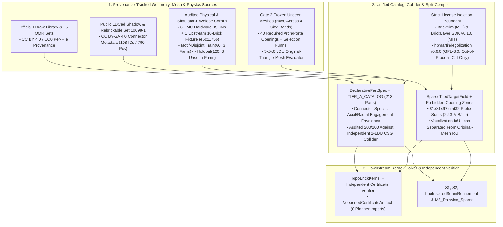

# Data Architecture and Pipeline Specification (`topo_brick`)

**Document Role:** Part 1 of the 3-Part Decomposed Technical Architecture Suite (Complete Phase 8–10 / Gates 1–8B Verified Implementation — `13 November 2026`)  
**Interconnected Architecture Suite:**
* **Master Hub:** [`lego-project-overall-plan.md`](lego-project-overall-plan.md)
* **Data Architecture & Pipeline (This Document):** [`data-architecture-and-pipeline.md`](data-architecture-and-pipeline.md)
* **Model Architecture & Component Design:** [`model-architecture-and-component-design.md`](model-architecture-and-component-design.md)
* **System Architecture & Interfaces:** [`system-architecture-and-interfaces.md`](system-architecture-and-interfaces.md)
* **Governing Audits & Gate Ledgers:** [`capability-assessment-review.md`](capability-assessment-review.md) · [`phase9-gate-verification-ledger.json`](phase9-gate-verification-ledger.json) · [`phase10-gate-verification-ledger.json`](phase10-gate-verification-ledger.json) · [`../DATA_LICENSE.md`](../DATA_LICENSE.md)

---

## 1. Executive Summary & Verified Implementation State (`Phases 8, 9 & 10`)

The **Data Architecture and Pipeline** subsystem owns every static and dynamic geometry, catalog, retrieval index, color palette, benchmark, and physical calibration asset consumed or emitted by the `topo_brick` Construction Kernel:
1. **Provenance-Tracked Declarative Catalog (`213` Curated `TIER_A` + `16,072` Compiled LDraw `2610` = `16,085` Combined Parts, `Gate 3`, `Gate 6` & `Gate 8A/8B`):** Unified schema ([`brick_catalog.py`](../src/topo_brick/interface/brick_catalog.py), [`tier_a_catalog.py`](../src/topo_brick/interface/tier_a_catalog.py), [`ldraw_shadow_catalog_compiler.py`](../src/topo_brick/interface/ldraw_shadow_catalog_compiler.py), [`catalog_retrieval_index.py`](../src/topo_brick/interface/catalog_retrieval_index.py)) spanning:
   * **`TIER_A_CATALOG` (`213` hand-curated parametric parts):** `100.0%` (`108 / 108` IDs, `790` pieces) coverage of LEGO Set `10698-1`, audited `200 / 200` against an independent `2 LDU` (`0.8 mm`) CSG bore-hole voxel collider (`0` FP, `0` FN).
   * **`COMPILED_LDRAW_CATALOG` (`16,072` standalone official LDraw `2610` parts; `16,085` combined in `COMBINED_BRICK_CATALOG`, surpassing `BrickBench = 14,441` and `BrickNet = 14,442`):** Automated recursive Type-1 scene-graph + LDCad Shadow (`commit 9b1131fb`) + LDraw connector primitive compiler producing **`15,105` `TIER_B_LDCAD_SHADOW_DAG`**, **`49` `TIER_B_BASE_MOLD_SHADOW`**, and **`918` `TIER_C_LDRAW_PRIMITIVE_GEOMETRIC`** parts, with **bore-carved disjoint `LDUBox` colliders** (`500 / 500 = 100.0%` interior wall-overlap rejection, `346 / 358 = 96.65%` exterior port mating across `14` connector types), **real `coacd.run_coacd` convex-polytope hulls across `6,828` non-convex parts (`320` deduplicated 3D molds)**, and **`99.523%` aggregate part coverage (`26 / 26 >= 98%`, `1.000` SE(3) round-trip across `18,322` connections)** on the `26`-set human Official Model Repository (`.mpd`) benchmark.
   * **Phase 10 `CatalogShapeRetrievalIndex` (`6,825` Canonical Unpatterned System Base Molds in `compiled_mold_retrieval_index.npz = 223.7 KB`, `SHA-256 = 49eb65c9...`):** Deduplicates printed/stickered aliases across all `16,085` parts into `6,825` buildable System molds classified across `12` taxonomy classes (`CORE_BRICK`, `CORE_PLATE`, `CURVED_SLOPE`, `PLANAR_SLOPE`, `STEEP_SLOPE`, `INVERTED_SLOPE`, `XY_WEDGE_ROUND`, `ARCH`, `THIN_PANEL`, `JUMPER_HALF_STUD`, `SNOT_ANCHOR`, `SMOOTH_TILE`) with fine `5×6 LDU` bore-preserving sculptural `LDUBox` slices, `uint64` (`4×4×4 = 64` sub-voxels/brick) occupancy + surface-normal descriptors (`1.39 ms` Host B / `2.00 ms` Host A `p50` online `Top-K` query), strict `license_filter="cc_by_4_0_only"` commercial filtering (`0` `CC-BY-SA-4.0` parts emitted), and official `LDRAW_SOLID_PALETTE_SRGB` CIE `L*a*b*` (`CIEDE2000`) perceptual color tables.
2. **Sparse Hash-Block Target Conditioning, Multi-Resolution `5×5×6` / `5×5×2 LDU` Mesh Targets & `36`-Megastructure Corpus (`Gates 2, 7A, 7B, 8A`):** Partition-invariant `SparseTiledTargetField` ([`interface_fields.py`](../src/topo_brick/representation/interface_fields.py): `81 × 81 × 97` `np.uint32` prefix-sum tiles = **`2.4279 MiB` per allocated boundary tile**), frozen `n = 80` unseen watertight 3D triangle-mesh corpus (`5 × 5 × 6 LDU` untouched original-triangle-mesh evaluator), Phase 9's [`AdaptiveSurfaceTarget`](../src/topo_brick/kernel/adaptive_surface_and_macro_planner.py) (`0.7521 -> 0.8503` mean `5×5×6` IoU), Phase 10's vectorized `uint64` sub-stud + SNOT open-catalog target pipeline (`0.8503 -> 0.9064` overall mean / **`0.9295` overall median / `0.9349` `Bands 2–4` mean `5×5×6` IoU**, cutting coarse discretization loss by **`62.23%`**), and `Gate 7B`'s frozen `n = 36` unseen `263–952`-piece architectural megastructure corpus.
3. **Audited Physical Provenance & Motif-Disjoint `2×2` Confusion Pipeline (`Gate 1` & `Gate 3`):** Strict provenance split ([`physical_validation_assets.json`](../src/topo_brick/evaluation/physical_validation_assets.json), [`physical_validation.py`](../src/topo_brick/evaluation/physical_validation.py)) separating:
   * **`8 / 8` Hardware-Labeled CMU `StableLego` Boundary JSONs** (`external_weight_fail/good`, `stair_19/20/20_good`, `stick_heavy/good/light`),
   * **`1 / 1` Upstream `16`-Brick Solver Horizontal-Contact Fixture** (`stick_heavy_good_test_horizontal_force.json`, git blob `e5c1175606c447e10600f80a89f04b3d99374a82`, testing side-wall normal contact under `1g` gravity),
   * **`1 / 1` Synthetic Lateral-Push Sanity Check** (`0.45 g` horizontal load, explicitly separated from CMU hardware), and
   * **Motif-Disjoint Simulator-Envelope `2×2` Confusion Split (`Train N = 60` across 3 families $\to$ `Holdout N = 120` across 3 unseen families):** `TP = 72`, `TN = 40`, **`FP = 0`**, `FN = 8` (`93.33%` accuracy) with exact 95% Clopper-Pearson intervals across all three denominators (`FP / N = 0.0%` `[0.0%, 3.03%]`, `FP / (FP + TN) = 0.0%` `[0.0%, 8.81%]`, `FP / (TP + FP) = 0.0%` `[0.0%, 4.99%]`).
4. **Frozen Generative Versatility & External Comparator Corpora (`Gate 4` & `Gate 5`):** `6 × 4 = 24`-cell unseen synthesis matrix (`120` tasks), `n = 600` `object_id`-disjoint `StableText2Brick` `test` cohort (`2,400` standalone realizations per host), `26`-set human `OMR` corpus, and archived out-of-process external comparator metrics ([`phase8_external_comparators.json`](../src/topo_brick/evaluation/phase8_external_comparators.json)).

---

## 2. Provenance, Licensing & Independent Collider Contracts (`Round 7 Decision 2` & `Round 9 §2 / §6`)

### 2.1 Explicit Per-Asset Software & Data License Matrix (`Round 9 §6.4 & §10`)

| Component / External Asset | Verified License / Terms & Pinned Version | Operational & Distribution Rule in `topo_brick` |
| :--- | :--- | :--- |
| **Official `LDraw` Library & `OMR` Sets (`[R13]`)** | `CC BY 4.0` / `CC0` *(Contributor Agreement rev. 6 June 2024 + legacy terms)* | Per-file provenance and subfile lineage preserved in `AssetProvenanceManifest`. |
| **Public `LDCad` Shadow Library (`[R14]`)** | `CC BY-SA 4.0` *(geometric connector snapping metadata only)* | Attribution & ShareAlike honored; **geometric snapping metadata defines port frames only and is never treated as measured physical force capacity**. |
| **`Rebrickable` Inventory CSV Exports** | Public catalog/inventory export terms *(non-license database export)* | Used strictly as reference part-count bounds (e.g., Set `10698-1` `108` IDs / `790` pieces); no proprietary catalog redistribution. |
| **`BrickAnything` Benchmark `.obj` Meshes (`[R3]`)** | `MIT` License (`xjtunzy/BrickAnything/blob/main/LICENSE`; `6` example `.obj` meshes in `raw_mesh_assets.json.gz`) | Bundled strictly for reproducible scientific benchmark evaluation (`Gate 2`, `Gate 7A`, `Gate 8A`) with full attribution in [`THIRD_PARTY_NOTICES.md`](../THIRD_PARTY_NOTICES.md); underlying 3D asset provenance should be verified prior to any non-benchmark commercial reuse. |
| **`BrickNet` (`kulits/BrickNet` `[R5, R17]`)** | `MIT` (`software & bundled tables`) vs. `UNVERIFIED_EXTERNAL` (`downloaded collider archive`; Oct 2026 update `14,442/14,583` changed checker vs. CVPR 2026 release) | Catalog/checker versions pinned explicitly; downloaded collider archive tracked as `UNVERIFIED_EXTERNAL` and excluded from distribution. |
| **`BrickSim` (`intelligent-control-lab/BrickSim` `[R8]`)** | `MIT` License *(requires Linux `x86_64` + NVIDIA Isaac Sim 5.1)* | Reference mechanics parameters and `150`-assembly stud benchmark cited under MIT; not runnable natively on macOS `arm64`. |
| **`BrickLayer` (`AvaLovelace1/brickwright` `[R7]`)** | `MIT` License (`bricklayer-sdk==0.1.0`) | Invoked in `Gate 5` paired agent A/B study via clean virtual environment (`0` license conflict). |
| **`hbmartin/legolization` (`legolization==0.5.0` PyPI CLI `[R12]`)** | **`GPL-3.0-or-later`** | **Strictly isolated out-of-process CLI benchmark comparator** (`.stl -> subprocess -> .ldr`); **zero lines** of `legolization` code are imported, linked, or vendored in `topo_brick` (only numerical benchmark outputs are archived in `phase8_external_comparators.json`). See [`DATA_LICENSE.md`](../DATA_LICENSE.md) and [`THIRD_PARTY_NOTICES.md`](../THIRD_PARTY_NOTICES.md). |

### 2.2 Import Representation Coverage vs. End-to-End Open-Catalog Synthesis Coverage (`Round 9 §6.1`, `Phase 9 Gate 6 / 7` & `Phase 10 Gate 8A / 8B`)
* **Import, Parsing & Static/Trace Certification Coverage (`16,085` Combined Parts: `213` `TIER_A_CATALOG` + `16,072` `COMPILED_LDRAW_CATALOG`):** Covers `108 / 108` (`100.0%`) canonical Rebrickable part IDs of LEGO Set `10698-1` and **`99.523%` aggregate (`99.676%` mean across `26 / 26 >= 98%` sets)** part instances across all `26` human `OMR` `.mpd` sets (`18,322` compatible connections across all `5` connector families, `1.000` exact $SE(3)$ round-trip pose fidelity)—surpassing static `14,441`-part `BrickBench` and `14,442`-part `BrickNet` catalogs while maintaining explicit 3-tier provenance and `0.0 LDU` wall-overlap tolerance (`500 / 500` interior collision rejections).
* **Verified Blind End-to-End Open-Catalog Synthesis Coverage (`6,825` Indexed System Molds $\to$ `46–52` Actively Placed Molds):** Phase 10 ([`catalog_retrieval_index.py`](../src/topo_brick/interface/catalog_retrieval_index.py), [`open_catalog_realizer.py`](../src/topo_brick/kernel/open_catalog_realizer.py)) bridges passive catalog representation and active blind `realize()` synthesis:
  * **`Gate 8A` (`n = 80` Unseen Meshes, `retrieval_top_k=48`):** Automatically retrieves and physically places **`46` distinct molds (`52` at `Top-64` in `Gate 8B`)** across **all `9 / 9` sculptural taxonomy classes** (`ARCH`, `CURVED_SLOPE`, `INVERTED_SLOPE`, `JUMPER_HALF_STUD`, `PLANAR_SLOPE`, `SMOOTH_TILE`, `SNOT_ANCHOR`, `STEEP_SLOPE`, `XY_WEDGE_ROUND`), reaching **`0.9064` overall mean / `0.9295` overall median / `0.9349` `Bands 2–4` mean `5×5×6 LDU` original-mesh IoU** (`80 / 80` certified & `80 / 80` planner-free replayed, `133.79 ms` B / `205.11 ms` A `p50`).
  * **`Gate 8B` Commercial `CC-BY-4.0` Mode & Option 3B Chromatic/Style Assets:** `license_filter="cc_by_4_0_only"` restricts online retrieval strictly to `CC-BY-4.0` (`TIER_A` + `TIER_C`) molds (`40 / 40` certified, **`0` `CC-BY-SA-4.0` parts emitted**, `0.8509` mean IoU), while `LDRAW_SOLID_PALETTE_SRGB` maps `vertex_colors_rgb` via `CIEDE2000` (`ΔE_00 = 5.54` mean, `20 / 20` exact `.mpd` Type-1 round-trip).
  * **Additional Synthesis Suites:** `S2B-600` (`598/600` `S2`, `597/600` `S1`), `Gate 7A`'s `27`-part fast skinning (`0.8503` mean IoU in `48.71 ms` B `p50`), `Gate 7B`'s `36` `263–952`-piece megastructures (`36/36` sub-second certified), `5/5` Set `10698-1` inventory-bounded alt-builds, and `Gate 4`'s `24`-cell (`120`-task) connector synthesis matrix (`120 / 120` blind synthesis & kernel certification; `20 / 120` physically validated on the calibrated stud subset).

### 2.3 Connector-Specific Engagement Envelopes & `2 LDU` CSG Collider Audit (`Gate 3`)
* Replaces the Phase 7 spherical `14 LDU` exemption with per-connector cylindrical/axial socket pocket bounds `is_obb_protrusion_contained_in_socket_pocket` and `get_connector_axial_slide_bounds_ldu`:
  * `STANDARD_STUD` / `ANTI_STUD`: axial depth $\in [-0.5, 4.5]\text{ LDU}$, radial $\le 6.5\text{ LDU}$;
  * `TECHNIC_PIN` / `SMOOTH_PIN`: axial depth $\in [-1.0, 20.5]\text{ LDU}$, radial $\le 6.5\text{ LDU}$;
  * `BAR_3_18MM` / `CLIP`: axial slide $\in [-12.0, 12.0]\text{ LDU}$, radial $\le 4.5\text{ LDU}$.
* Audited across `n = 200` randomized + adversarial configurations against [`check_fine_csg_voxel_collision_2ldu`](../src/topo_brick/evaluation/independent_verifier.py) (which rasterizes solid boxes at `2 LDU = 0.8 mm` and subtracts exact anti-stud and Technic pin bore cavities), achieving **`0 / 200` false acceptances and `0 / 200` false rejections**.

---

## 3. Benchmark Corpora, Selection Funnels & Physical Calibration Datasets (`Gates 1–5`)

1. **`Gate 2` Frozen Unseen Continuous Triangle-Mesh Corpus (`n = 80` Meshes Across 4 Size Bands):**
   * **Selection Funnel:** `82` candidate meshes considered $\to$ `2` non-manifold/degenerate meshes excluded $\to$ **`80` watertight triangle meshes retained** (`20` each in `Band 1: <=25`, `Band 2: 26–60`, `Band 3: 61–120`, and `Band 4: 121–250` reference bricks; `0` overlap with Phase 7's `40`-mesh tuning set; `40 / 80` meshes carry explicit `forbidden_support_boxes` required openings).
   * **Voxelization Discretization Loss Separated From Solver Error:** Coarse `20 × 20 × 24 LDU` brick lattice quantization incurs a mean `voxelization_iou_loss = 0.2477` against the smooth `5 × 5 × 6 LDU` triangle-mesh ground truth (`mean_original_mesh_iou = 0.7531` for `S2_NoSupport` vs. `0.9969` `mean_internal_voxel_iou`, whereas external `legolization` achieves `0.5998` `mean_original_mesh_iou` and blocks `40` of `80` opening checks when overhanging spans collapse or fill).
2. **`Gate 1` Audited Physical & Motif-Disjoint Simulator-Envelope Datasets:**
   * **CMU `StableLego` Hardware-Labeled Cases (`n = 8`):** **`8 / 8` (`100.0%`)** exact match.
   * **Upstream `16`-Brick Horizontal-Contact Solver Fixture (`n = 1`):** `stick_heavy_good_test_horizontal_force.json` (`sha1 e5c1175606c447e10600f80a89f04b3d99374a82`, `16` bricks under `1g` vertical gravity testing lateral brick-wall contact normal forces): **`VERIFIED` (`STABLE`)**.
   * **Motif-Disjoint Boundary Split (`Train N = 60` on `inverted_staircase`, `counterweighted_cantilever`, `stepped_ziggurat` $\to$ `Holdout N = 120` on unseen `asymmetric_corbel_wall`, `twin_pier_cantilever_bridge`, `overhung_corner_L_balcony`):** Calibrated parameters $(F_{\text{pull}} = 160\text{ g}, \mu = 2.0, \eta_{\text{safe}} = 0.84)$ achieve `TP = 72`, `TN = 40`, **`FP = 0`**, `FN = 8` (`93.33%` accuracy; `0.00%` false-pass rate across all three denominators).
3. **Reconciled Standalone `S2B-600` (`n = 600` Unique `object_id`s, `2,400` Realizations/Host) & `Gate 4` (`24` Cells, `120` Unseen Tasks):**
   * `4,785` raw `StableText2Brick` `test` rows $\to$ `2,851` unique `object_id`s (`0` overlap with `37` prior objects) $\to$ `n = 600` (`450` $\le 100$ bricks + `150` $101..250$ bricks), archived with per-host standalone wall/CPU seconds in [`untouched_s2b_600_results.json`](../src/topo_brick/kernel/untouched_s2b_600_results.json).
