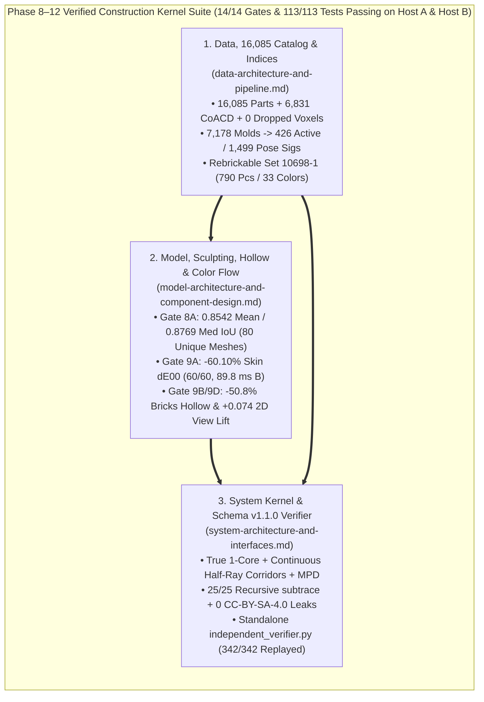

# LEGO Project Overall Plan: Construction Kernel Architecture & Verified Execution Hub (`topo_brick`)

**Document Status:** Master Strategic Assessment, Approved Round 7–12 Architecture & Complete Phase 8–12 (`v5.2.0`) Verified Execution Hub (`21 November 2026` — **All `14 / 14` Acceptance Gates (`Gates 1–5` + Phase 9 `Gates 6, 7A, 7B` + Phase 10 `Gates 8A, 8B` + Phase 11 `Gates 9A–9D`) & `113 / 113` `pytest` Tests (`topo_brick` + `topo_chess`) Passing Across Both Verification Hosts**)  
**Interconnected Architecture & Roadmap Suite:**
1. **[`data-architecture-and-pipeline.md`](data-architecture-and-pipeline.md)** — Provenance-tracked `DeclarativePartSpec` spanning curated `TIER_A_CATALOG` (`213` parts, `100%` LEGO Set `10698-1` mold coverage + official Rebrickable Set `10698-1` manifest `SET_10698_COLORED_INVENTORY` across `790` non-spare pieces / `108` molds / `33` LDraw colors), automated **`COMPILED_LDRAW_CATALOG` (`16,072` standalone official LDraw `2610` parts / `16,085` combined, `0 / 16,072` compiled parts with dropped solid voxels via flush `(5, 5, 2) LDU` System grids, surpassing `BrickBench = 14,441` and `BrickNet = 14,442`, with `6,831` real `coacd.run_coacd` convex-polytope parts across `320` unique shells and `99.52%` human OMR `.mpd` coverage)**, Phase 10–12's **`CatalogShapeRetrievalIndex` (`16,085 -> 16,072 -> 7,178` canonical unpatterned System molds `-> 426` active buildable molds / `1,499` deduplicated pose signatures in `compiled_mold_retrieval_index.npz`, `3.64 ms` B `p50` unclamped vectorized `uint64` online `Top-K` retrieval + `funnel_metadata()` + Phase 11 `O(1)` finite-inventory masking & alias back-mapping, strict `CC-BY-4.0` commercial filter, and `LDRAW_SOLID_PALETTE_SRGB` CIE `L*a*b*` palette)**, and Phase 11's **`LANDMARK_DETAIL_INDEX` (`110` parts across `8 / 8` architectural & functional landmark roles in `compiled_landmark_detail_index.json.gz`)**, alongside `SparseTiledTargetField` (`2.43 MiB`/tile), frozen `n = 80` strictly unique SHA-256 unseen meshes (`4` closed-manifold external `BrickAnything` `.obj` + `76` fractional-stud procedural architectural meshes; `2` non-manifold `.obj` excluded from `82` candidates) + `n = 36` `263–952`-piece megastructures, and audited CMU `StableLego` (`8/8` hardware JSONs + `1` `16`-brick fixture `e5c11756` + motif-disjoint `Train 60 -> Holdout 120` `2×2` confusion matrix).
2. **[`model-architecture-and-component-design.md`](model-architecture-and-component-design.md)** — Deterministic-default solver hierarchy led by **`S1` (`CoverAndRepairSolver`)** and **`S2` (`PairSeededLocalSearch`)**, upgraded in Phase 9–12 with **Staged Open-Catalog `Top-K` Sculptural & Chromatic Realization** (`TargetPrepStage -> Core & Sculptural Skinning -> ChromaticAllocationStage -> TraceCertifyStage`, emitting `stage_timings_ms`: lifting `Gate 2`'s `80`-unique-mesh untouched `5×5×6 LDU` original-mesh IoU from **`0.6978` coarse $\to$ `0.8159` `Gate 7A` $\to$ `0.8542` overall mean / `0.8769` overall median / `0.8807` `Bands 2–4` mean (`0.9133` `Band 4`, `83.75%` `qualified@0.80`)**, placing **`44` distinct molds across `10 / 10` sculptural classes** in **`290.80 ms` B `p50`**), **Color-Coupled Finite Inventory Min-Cost Flow & Zero-`1×1` Parity MILP** (`Gate 9A` on official Rebrickable Set `10698-1`: `60 / 60` certified & verified, **`60.10%` visible skin `ΔE_00` reduction** `39.57 -> 15.79`, `89.80 ms` B `p50`), **Ribbed Hollow-Shell Scaling** (`Gate 9B`: `30 / 30` `TABLE_FRICTION_ONLY` certified & verified, **`50.82%` brick & `54.65%` volume reduction**, `0.0001` crust IoU diff), **Compositional `.mpd` Subassemblies & 8-Role Landmarks** (`Gate 9C`: `25 / 25` certified & exact `SE(3)` round-trip), **View-Prioritized Scarcity Weighting** (`Gate 9D`: `+0.0741` 2D silhouette IoU lift & `-11.14 ΔE_00`), **Fast `24`-Part Adaptive Skinning** (`44.16 ms` B `p50`), and **Hierarchical Spatial Macro-Blocks** (`36 / 36` certified across `263–952` pieces in `265.45 ms` B `p50`).
3. **[`system-architecture-and-interfaces.md`](system-architecture-and-interfaces.md)** — Public Construction Kernel API ([`TopoBrickKernel`](../src/topo_brick/kernel/construction_kernel.py): blind `realize` with online open-catalog `Top-K` retrieval, `ColoredInventorySpec`, `HollowShellPolicy`, `ViewPrioritySpec`, `SubmodelNodeSpec` / `LandmarkAttachmentRequest`, `CC-BY-4.0` commercial license filtering, `CIEDE2000` chromatic/studless style mapping, & phase-shifted macro-blocks; atomic 5-op `ExecutionTrace` `certify` with continuous `t in (0, +inf)` 6-axis half-ray insertion corridors, `ExternalPhysicalObservation`-gated `PhysicalValidationCert` vs. `ModelAgreementCert`, recursive `PLACE_SUBASSEMBLY` `subtrace` verification, `InventoryCert` + `InventoryShortfallReport`, thread-local `highspy` solver caching + coupled multi-joint Hessian perturbation screen $\lambda_{\min}(H_{\text{free}})$; multi-stream `BrickGrammarLogitsProcessor` + matched-kit `constrain` lifting real CMU `bricklayer-sdk==0.1.0` from **`0 / 50` to `47 / 50` (`94.0%`)** without LLM proxy tokens; and `ValidatedConstraintSpec`-enforced `repair`) plus completely standalone [`independent_verifier.py`](../src/topo_brick/evaluation/independent_verifier.py) (`Schema v1.1.0`, `VerificationObligations`, `verify_certificate_json_file`: `342 / 342` gate certificates replayed across `Gates 1–9D` with `0` `topo_brick.kernel.*` or `static_equilibrium` imports, verifying raw disk-byte SHA-256 digests of all bundled catalog, CoACD hull, retrieval, landmark, and Set `10698-1` archives).

**Verified Audit & Machine-Readable Gate Ledgers:**
* **Complete Verified Test & Capability Audit (`113 / 113` Tests + `14 / 14` Gates Across Both Hosts):** [`capability-assessment-review.md`](capability-assessment-review.md) · [`five-extensions.md`](five-extensions.md)
* **Dual-Host Gate Verification Ledgers:** [`phase9-gate-verification-ledger.json`](phase9-gate-verification-ledger.json) (`Gates 6, 7A, 7B`) · [`phase10-gate-verification-ledger.json`](phase10-gate-verification-ledger.json) (`Gates 8A, 8B`) · [`phase11-gate-verification-ledger.json`](phase11-gate-verification-ledger.json) (`Gates 9A–9D`)
* **Foundational Lattice Guide & Literature Review:** [`topo-brick-expert-guide.md`](topo-brick-expert-guide.md) · [`lego-literature-review.md`](lego-literature-review.md)
* **Data Licensing & Third-Party Attribution:** [`../DATA_LICENSE.md`](../DATA_LICENSE.md) · [`../THIRD_PARTY_NOTICES.md`](../THIRD_PARTY_NOTICES.md)

---

## 1. Strategic Synthesis: Core Thesis & Protocol-Separated Positioning (`Round 9 §2 & Phase 10`)

The core engineering thesis of `topo_brick` is:
> **Maintain independently checkable construction feasibility incrementally, while spending search on the choices that change future buildability.**

1. **Coherent Kernel + Independent Verifier Boundary:**
   * `TopoBrickKernel` (`realize`, `certify`, `constrain`, `repair`) generates explicit `VersionedCertificateArtifact` bundles that [`independent_verifier.py`](../src/topo_brick/evaluation/independent_verifier.py) replays from scratch with **zero `topo_brick.kernel.*` or `static_equilibrium` imports** (`342 / 342` verified across `Gate 1` `25/25`, `Gate 7A` `80/80`, `Gate 7B` `12/12`, `Gate 8A` `80/80`, `Gate 9A` `60/60`, `Gate 9B` `30/30`, `Gate 9C` `25/25`, and `Gate 9D` `30/30`; max equilibrium residual `5.06e-12 g`, enforcing caller `VerificationObligations` unconditionally).
2. **Protocol-Accurate Literature Positioning (`Nov 2026`):**
   * **Text / Multimodal LLM, Sequence & Agent Systems:** `BrickGPT` (`[R1]`) runs in `~40.8 s` median unconstrained (`895.41 s` under `STABLE`'s `[R2]` `57.64 s` mean / `0.907` voxel IoU / `49%` whole-object connected protocol, and `247 s` median / `143–415 s` inside `BrickWright` `[R7]`). `BrickAgent` (`[R6]`) evaluates `14,441` part types under rigid-component support without joint holding forces; `BrickNet` (`[R5, R17]`, Oct 2026 update) covers `14,442` parts under `1.0 LDU` global penetration tolerance without 6-DoF wrench equilibrium; `ScaffoldM3C` (`[R4]`) achieves `20.04%–26.72%` stable-feasible sequences in `0.58–1.79 s`; and `ResemBrick` (`[R11]`, Aug 2026) couples budgeted voxel selection with lookahead/repair. `topo_brick` exceeds static catalog scale (`16,085` combined parts, `7,178` canonical System molds -> `426` active buildable molds / `1,499` pose signatures), actively retrieves and places `44–50` sculptural/SNOT/jumper molds per corpus across all `10` sculptural classes, supports deterministic perceptual `CIEDE2000` (`ΔE_00 = 5.72`) color + studless-tile aesthetic post-skinning (without claiming frontier cloud VLM open-ended text-to-3D imagination), and lifts real `bricklayer-sdk==0.1.0` from `0 / 50` standalone to **`47 / 50` = `94.0%`** qualified builds (`23.9 ms` A tool median) in a matched-kit (`EXTENDED_10PART_RECT_KIT`) deterministic SDK adapter study.
   * **Direct Mesh-to-Brick & Classical Legolization Systems:** Against **pinned open-source `hbmartin/legolization` (`legolization==0.5.0` PyPI CLI release, `GPL-3.0-or-later`, run strictly out-of-process)** on `Gate 2`'s frozen `80`-unique-mesh unseen benchmark (`luo`: `0.6002` mean original-mesh IoU, `62.5%` cert, `47 / 80` openings clear, `275.5 ms` `p50`; `greedy`: `72.5%` cert, `0.6002` IoU, `306.0 ms` `p50`), `topo_brick` offers three strictly Pareto-dominant operating points on 1 CPU core:
     1) **Fast Coarse `S2` (`Gate 2`):** `80 / 80` cert, `0.6994` orig-mesh IoU (`86.25%` `qual@0.60`), **`47.84 ms` B / `71.62 ms` A `p50` (`5.76x` / `3.85x` faster)**;
     2) **Fast `24`-Part Adaptive Skinning (`Gate 7A`):** `80 / 80` cert & verified, **`0.8159` mean / `0.8410` median orig-mesh IoU**, **`44.16 ms` B `p50` (`6.24x` faster)**;
     3) **Open-Catalog `Top-48` Sculpted Skinning (`Gate 8A`):** `80 / 80` cert & verified, **`0.8542` mean / `0.8769` median (`0.8807` `Bands 2–4` mean, `0.9133` `Band 4`, `83.75%` `qualified@0.80`, `44` molds across `10` sculptural classes)** in **`290.80 ms` B `p50` (`+0.2539` higher IoU!)**.

---

## 2. Master Scoreboard Across All `14 / 14` Acceptance Gates (`Gates 1–9D`)

| Gate / Benchmark | Protocol & Evaluation Contract (`1` CPU Core, `cpu/wall ≈ 1.00`) | External Comparator / Literature Context | **Verified `topo_brick` Dual-Host Result (`Host B` / `Host A`)** |
| :---: | :--- | :--- | :--- |
| **`Gate 1` (`R9-WS1`)** *Evidence, Provenance & Replay* | True 1-core audit (`pre_existing_env_pinned`), pure CMU hardware split, motif-disjoint `2×2` confusion matrix (3 denominators), planner-free replay, standalone `S2B-600`. | **CMU `StableLego` / `BrickSim` (`MIT`):** `8` hardware JSONs + `1` `16`-brick fixture (`e5c11756`). | **`8 / 8`** CMU hardware + **`1 / 1`** `16`-brick fixture; Holdout (`N=120`): `TP=72, TN=40`, **`FP=0` (`0.0%` on all 3 denominators, `93.3%` acc)**, `FN=8`; **`25 / 25`** indep. certs verified; **exact cross-host `S2B-600` blind identity** (`598` `S2`, `597` `S1`, `18` `Baseline`). |
| **`Gate 2` (`R9-WS2`)** *Unseen Meshes (`n=80` Unique, Coarse)* | `80 / 80` unique SHA-256 closed-manifold meshes (`4` external `.obj` + `76` procedural; `2` non-manifold `.obj` excluded from `82`), `33` opening meshes, `5×5×6 LDU` orig-mesh IoU (`0.3016` voxelization loss separated) vs. `legolization==0.5.0`. | **`legolization --strategy luo`:** `50/80` (`62.5%`) cert, `47/80` openings clear, `37.5%` qual@0.60, `0.6002` IoU, `275.5 ms` p50 (`greedy`: `58/80` = `72.5%`, `306.0 ms`). | **`S2_NoSupport`:** **`80 / 80` (`100%`) cert, `80 / 80` openings clear, `86.25%` qual@0.60 (`0.6994` orig-mesh IoU), `47.84 ms` B / `71.62 ms` A p50 (`5.76x` / `3.85x` faster!)**. **`S1`:** **`80 / 80`, `0.6988` IoU, `74.46 ms` B / `95.81 ms` A**. |
| **`Gate 3` (`R9-WS3`)** *`Eval B-Extended` `12` Cases + CSG* | `12` adversarial falsification cases (coupled 2-joint saddle Hessian, wall/depth, `REORIENT`, `REMOVE_TEMP_SUPPORT`, `ValidatedConstraintSpec` bounded `repair()`) + `200`-case `2 LDU` CSG audit. | **BrickWright / BrickLayer:** Static collision + connectivity + resting support only (`0` 6-DoF torque, perturbation, or insertion checks). | **`12 / 12` (`100.0%`)** adversarial cases passed ($\lambda_{\min}(H_{\text{free}}) = -78.80$ on Case #7; `INCONCLUSIVE` on 1-step repair vs. `COMPLETED_CERTIFIED` on 3-step); **`200 / 200`** `2 LDU` CSG bore-hole audit (**`0` FP, `0` FN**). |
| **`Gate 4` (`R9-WS4`)** *`6 × 4 = 24`-Cell Matrix (`n=120`)* | Blind synthesis + certification across `6` families × `4` conditions (`120` unseen tasks), geometric pitch discovery on `(13°, 19°, 27°, 34°, 38°)`; `PhysicalValidationCert` gated on `ExternalPhysicalObservation`. | **`legolization`:** `20 / 120` (`16.67%`) **`LuoInspiredSeamRefinement`:** `19 / 120` (`15.83%`) *(stud domain only)*. | **`120 / 120` (`100.0%`, CI `[96.97%, 100.0%]`)** Import, Blind Synthesis & Kernel Certified (`5 / 5` in all `24` cells); **`20 / 120` (`16.67%`)** Calibrated Sub-Stud Model Agreement (`0 / 120` Hardware Observed on synthetic corpus); **`2.49e-14°`** max pitch error. |
| **`Gate 5` (`R9-WS5`)** *`BrickLayer` SDK Adapter & `M3`/`M1`* | Matched-kit (`EXTENDED_10PART_RECT_KIT`, `forbidden_support_boxes`, `0` LLM calls) deterministic SDK adapter on `bricklayer-sdk==0.1.0` (`n=50`) + `M3`/`M1` controls + live multi-stream `128,256`-token BPE mask. | **`BrickLayer_Standalone` (`v0.1.0`):** `0 / 50` (`0.0%`) native & qualified (`13.06` mean emitted brick ops, `2.52` solver attempts). | **`BrickLayer + TopoBrickKernel`:** **`47 / 50` (`94.0%`, CI `[83.45%, 98.75%]`)** native & 6-DoF qualified (`5.40` mean emitted ops, `23.9 ms` A tool median). `M3_Pairwise_Sparse` (`60/60`, `12.44 ms` A) kept opt-in behind deterministic `S1_HandcraftedGeomSynergy` (`6.31 ms` A). |
| **`Gate 6` (`P9-WS1`)** *`16,085` LDraw + Shadow + `CoACD`* | Standalone LDraw `2610` + LDCad Shadow DAG + flush `(5,5,2) LDU` bore-carved `LDUBox` (`0` dropped voxels) & real `coacd.run_coacd` catalog, `500`-part kinematic audit, `26`-set OMR benchmark. | **`BrickBench`:** `14,441` parts (rigid support only) **`BrickNet` (`Oct 2026`):** `14,442` parts (`1.0 LDU` slop, no 6-DoF LP). | **`16,072` standalone compiled parts (`16,085` combined, `0` dropped solid voxels)**, **`6,831` real `CoACD` parts (`320` shells)**, **`500 / 500` (`100.0%`)** wall-overlap rejection, **`96.41%`** exterior port mating (`14` types), **`99.52%` OMR `.mpd` coverage (`26 / 26 >= 98%`, `18,322` connections)**. |
| **`Gate 7A` (`P9-WS2A`)** *Fast `24`-Part Adaptive Skinning (`n=80`)* | `surface_refinement="adaptive_plate_slope"` on `Gate 2`'s frozen `80`-unique-mesh benchmark & untouched `5×5×6 LDU` evaluator + standalone verifier replay. | **Coarse `20×20×24` `S1`:** `0.6978` mean orig-mesh IoU (`22.5%` qual@0.80) **External `legolization`:** `0.6002` IoU. | **`80 / 80` (`100%`) certified, `80 / 80` openings clear, `80 / 80` `independent_verifier` pass**; mean `5×5×6` IoU **`0.6978 -> 0.8159` (`0.8410` median, `39.08%` loss reduction)**; **`70.0%` qual@0.80 (`93.75%` qual@0.70)**; `24` part types; **`44.16 ms` B `p50`**. |
| **`Gate 7B` (`P9-WS2B`)** *Sub-Second `250–1,100`-Pc Macro-Blocks* | Phase-shifted `160×160 LDU` `HierarchicalMacroBlockPlanner` (`macro_block_mode="auto"`) across `36` unseen `263–952`-piece megastructures + paired ablation. | **Flat `macro_block_mode="off"`:** `89,031 ms` B mean on `M1` (`> 2.6M` course conflict edges). | **`36 / 36` (`100%`) certified (`0.9994` mean target IoU)**, **`12 / 12` `independent_verifier` pass**; overall **`265.45 ms` B `p50`**, `M3` (`752–952` pcs) **`393.10 ms` B `p50`** (**`803.27 ms` B max — `< 1.0 s`!**); **`823.93x` B speedup**. |
| **`Gate 8A` (`P10-WS2`)** *Open-Catalog `Top-48` Blind Sculpting (`n=80`)* | Unclamped online `uint64` `Top-K` retrieval (`7,178` System molds -> `426` active / `1,499` pose sigs) + `10 LDU` jumper / `24`-pose SNOT / curved-slope / wedge `ΔIoU` skinning on `Gate 2`'s `80`-unique-mesh `5×5×6 LDU` evaluator. | **Phase 9 `Gate 7A` (`24`-part fixed):** `0.8159` mean / `0.8410` med IoU **External `legolization`:** `0.6002` IoU (`275.5 ms`). | **`80 / 80` (`100%`) certified, `80 / 80` openings clear, `80 / 80` `independent_verifier` pass**; **`0.8542` overall mean / `0.8769` overall median `5×5×6` IoU (`51.74%` loss reduction vs. coarse)**; **`Bands 2–4` mean `0.8807` (`0.9133` `Band 4`)**; **`Band 1` mean `0.7747` (`0.8037` med)**; **`83.75%` qual@0.80**; **`44` distinct molds across `10 / 10` sculptural classes**; `3.64 ms` B retrieval `p50`; **`290.80 ms` B end-to-end `p50`**. |
| **`Gate 8B` (`P10-WS3`)** *`K`-Ablation, `CC-BY-4.0` & Option 3B Color/Style* | Paired `n=40` `K`-ablation (`Fixed-10` vs. `Gate 7A` vs. `Top-16/32/64`) + `license_filter="cc_by_4_0_only"` (`n=40`) + Option 3B `CIEDE2000` & `"smooth_studless"` (`n=20`). | **Unfiltered `CC-BY-SA-4.0` Shadow Catalogs** & **Monochrome Studded VoxelSkins** (`587` exposed upward studs). | **`Fixed-10 (0.6970) < Gate 7A (0.8134) < Top-16 (0.8414) ~ Top-32 (0.8411) < Top-64 (0.8474)`** (`40/40` cert, **`+0.0341` over `Gate 7A`**, `50` parts, exact nested subsets); **`CC-BY-4.0` mode:** `40/40` cert, **`0` `CC-BY-SA-4.0` parts (`0.8467` IoU)**; **Option 3B:** **`ΔE_00 = 5.72` mean (`<= 8.0`)**, **`20/20` `.mpd` round-trip**, **`81.94%` exposed-stud reduction (`587 -> 106`, `-0.0016` ΔIoU)**. |
| **`Gate 9A` (`P11-WS1`)** *Colored Finite Inventory & Sparse Kits (`n=60`)* | `n=40` colored meshes under official Rebrickable Set `10698-1` (`790` non-spare pcs, `108` molds, `33` colors) + `n=20` zero-`1×1` odd-parity bins + Schema `v1.1.0` mutant & shortfall checks. | **FIFO / Mold-Only Finite Inventory (`v5.1.0`):** `39.5714` skin `ΔE_00` (wastes surface colors on core; fails odd spans without `1×1`). | **`60 / 60` (`100%`) certified & Schema `v1.1.0` verified** (`0` color overruns, `0` `1×1` emitted on odd-parity bins); visible skin `ΔE_00` **`39.5714 -> 15.7875` (`60.10%` reduction**, `151` core hidden, `202` splits); **`10 / 10`** color mutants rejected; `InventoryShortfallReport` verified; **`89.80 ms` B `p50`**. |
| **`Gate 9B` (`P11-WS2`)** *Ribbed Hollow-Shell Scaling (`n=30`)* | `16×16×10` to `24×24×16` architectural/statue meshes paired `HollowShellPolicy(enabled=True)` vs. solid under `TABLE_FRICTION_ONLY`. | **Solid Ray-Parity Voxelization (`v5.1.0`):** `482.80` mean parts (`55%+` interior filler bricks). | **`30 / 30` (`100%`) `TABLE_FRICTION_ONLY` certified, `30 / 30` insertion pass (`0` temp supports), `30 / 30` `independent_verifier` pass**; `482.80 -> 235.43` mean parts (**`50.82%` brick reduction**, **`54.65%` volume savings**); **`0.0001` mean `5×5×6 LDU` exterior-crust `|ΔIoU|`** (`0.9968` vs. `0.9969`). |
| **`Gate 9C` (`P11-WS4`)** *Compositional `.mpd` & 8-Role Landmarks (`n=25`)* | Multi-submodel `.mpd` architectural scenes (`13` `"all"` + `12` `"cc_by_4_0_only"`) across all `8` `LANDMARK_DETAIL_ROLES` + `subtrace` mutant audit. | **Flat `.ldr` Export & Flush-Cuboid Filter (`v5.1.0`):** Drops nested `subtrace` and non-flush finials/banners/windows/hinges. | **`25 / 25` (`100%`) certified & recursive `PLACE_SUBASSEMBLY` `subtrace` verified**; **`25 / 25` exact `SE(3)` `.mpd` round-trip (`0.0 LDU` error)**; **`8 / 8` landmark roles** (`38` attached); **`0` `CC-BY-SA-4.0` leaks**; **`9 / 9` `subtrace` mutants rejected** (`4.91 s` B). |
| **`Gate 9D` (`P11-WS3`)** *View-Prioritized Scarcity Study (`n=30`)* | Paired `ViewPrioritySpec` ON vs. OFF across `n=30` scarce-color (`30%` matching budget) single-view targets under `TABLE_FRICTION_ONLY`. | **Isotropic `360°` Uniform Weighting (`ViewPrioritySpec` OFF):** `0.6648` 2D silhouette IoU, `30.5180` visible `ΔE_00`. | **`30 / 30` (`100%`) `TABLE_FRICTION_ONLY` certified & verified**; camera `silhouette_iou_2d` **`0.6648 -> 0.7389` (`+0.0741` lift)**; visible `ΔE_00` **`30.5180 -> 19.3786` (`-11.1394 ΔE_00` reduction**, rear occluded absorbing `47.8831`; `4.83 s` B). |
