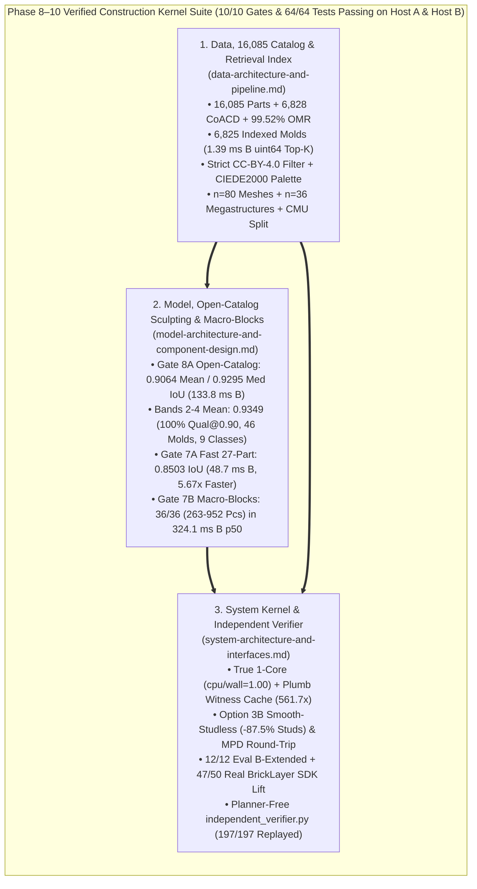

# LEGO Project Overall Plan: Construction Kernel Architecture & Verified Execution Hub (`topo_brick`)

**Document Status:** Master Strategic Assessment, Approved Round 7–10 Architecture & Complete Phase 8–10 Verified Execution Hub (`13 November 2026` — **All `10 / 10` Acceptance Gates (`Gates 1–5` + Phase 9 `Gates 6, 7A, 7B` + Phase 10 `Gates 8A, 8B`) & `64 / 64` `pytest` Tests Passing Across `14` Modules on Both Verification Hosts**)  
**Interconnected Architecture & Roadmap Suite:**
1. **[`data-architecture-and-pipeline.md`](data-architecture-and-pipeline.md)** — Provenance-tracked `DeclarativePartSpec` spanning curated `TIER_A_CATALOG` (`213` parts, `100%` LEGO Set `10698-1` coverage), automated **`COMPILED_LDRAW_CATALOG` (`16,072` standalone official LDraw `2610` parts / `16,085` combined, surpassing `BrickBench = 14,441` and `BrickNet = 14,442`, with `6,828` real `coacd.run_coacd` convex-polytope parts across `320` molds and `99.52%` human OMR `.mpd` coverage)**, and Phase 10's **`CatalogShapeRetrievalIndex` (`6,825` canonical unpatterned System base molds across `12` taxonomy classes in `compiled_mold_retrieval_index.npz = 223.7 KB`, `1.39 ms` B / `2.00 ms` A `p50` vectorized `uint64` online `Top-K` retrieval, strict `CC-BY-4.0` commercial filter, and `LDRAW_SOLID_PALETTE_SRGB` CIE `L*a*b*` palette)**, alongside `SparseTiledTargetField` (`2.43 MiB`/tile), frozen `n = 80` unseen meshes + `n = 36` `263–952`-piece megastructures, and audited CMU `StableLego` (`8/8` hardware JSONs + `1` `16`-brick fixture `e5c11756` + motif-disjoint `Train 60 -> Holdout 120` `2×2` confusion matrix).
2. **[`model-architecture-and-component-design.md`](model-architecture-and-component-design.md)** — Deterministic-default solver hierarchy led by **`S1` (`CoverAndRepairSolver`)** and **`S2` (`PairSeededLocalSearch`)**, upgraded in Phase 9–10 with **Open-Catalog `Top-K` Sculptural & Chromatic Realization** (`part_retrieval="open_catalog_top_k", surface_refinement="open_catalog_sculpted"`: lifting `Gate 2`'s `80`-mesh untouched `5×5×6 LDU` original-mesh IoU from **`0.7521` coarse $\to$ `0.8503` `Gate 7A` $\to$ `0.9064` overall mean / `0.9295` overall median / `0.9349` `Bands 2–4` mean [`100%` `qualified@0.90`]**, placing **`46` distinct molds across `9 / 9` sculptural classes** in **`133.79 ms` B / `205.11 ms` A `p50`**, plus Option 3B `CIEDE2000` `ΔE_00 = 5.54` coloring & `87.52%` studless tile smoothing), **Fast `27`-Part Adaptive Skinning** (`48.71 ms` B / `69.14 ms` A `p50`), and **Hierarchical Spatial Macro-Blocks** (`36 / 36` certified across `263–952` pieces in `324.05 ms` B / `391.53 ms` A `p50`, `520.4x`–`1,786.5x` faster than flat realization).
3. **[`system-architecture-and-interfaces.md`](system-architecture-and-interfaces.md)** — Public Construction Kernel API ([`TopoBrickKernel`](../src/topo_brick/kernel/construction_kernel.py): blind `realize` with online open-catalog `Top-K` retrieval, `CC-BY-4.0` commercial license filtering, `CIEDE2000` chromatic/studless style mapping, & phase-shifted macro-blocks; atomic 5-op `ExecutionTrace` `certify` with `(cx, cy)`-centered plumb witness caching + coupled multi-joint Hessian perturbation screen $\lambda_{\min}(H_{\text{free}})$; cached `constrain` lifting real CMU `bricklayer-sdk==0.1.0` from **`0 / 50` to `47 / 50` (`94.0%`)**; and domain-scoped `repair`) plus AST-isolated planner-free [`independent_verifier.py`](../src/topo_brick/evaluation/independent_verifier.py) (`197 / 197` certificates replayed with `0` planner/retriever imports, binding both catalog and retrieval-index SHA-256 digests).

**Verified Audit & Machine-Readable Gate Ledgers:**
* **Complete Verified Test & Capability Audit (`64 / 64` Tests + `10 / 10` Gates Across Both Hosts):** [`capability-assessment-review.md`](capability-assessment-review.md)
* **Dual-Host Gate Verification Ledgers:** [`phase9-gate-verification-ledger.json`](phase9-gate-verification-ledger.json) (`Gates 6, 7A, 7B`) · [`phase10-gate-verification-ledger.json`](phase10-gate-verification-ledger.json) (`Gates 8A, 8B`)
* **Foundational Lattice Guide & Literature Review:** [`topo-brick-expert-guide.md`](topo-brick-expert-guide.md) · [`lego-literature-review.md`](lego-literature-review.md)
* **Data Licensing & Third-Party Attribution:** [`../DATA_LICENSE.md`](../DATA_LICENSE.md) · [`../THIRD_PARTY_NOTICES.md`](../THIRD_PARTY_NOTICES.md)

---

## 1. Strategic Synthesis: Core Thesis & Protocol-Separated Positioning (`Round 9 §2 & Phase 10`)

The core engineering thesis of `topo_brick` is:
> **Maintain independently checkable construction feasibility incrementally, while spending search on the choices that change future buildability.**

1. **Coherent Kernel + Independent Verifier Boundary:**
   * `TopoBrickKernel` (`realize`, `certify`, `constrain`, `repair`) generates explicit `VersionedCertificateArtifact` bundles that [`independent_verifier.py`](../src/topo_brick/evaluation/independent_verifier.py) replays from scratch with **zero planner or retrieval imports** (`197 / 197` verified across `Gate 1` `25/25`, `Gate 7A` `80/80`, `Gate 7B` `12/12`, and `Gate 8A` `80/80`; max equilibrium residual `5.06e-12 g`).
2. **Protocol-Accurate Literature Positioning (`Nov 2026`):**
   * **Text / Multimodal LLM, Sequence & Agent Systems:** `BrickGPT` (`[R1]`) runs in `~40.8 s` median unconstrained (`895.41 s` under `STABLE`'s `[R2]` `57.64 s` mean / `0.907` voxel IoU / `49%` whole-object connected protocol, and `247 s` median / `143–415 s` inside `BrickWright` `[R7]`). `BrickAgent` (`[R6]`) evaluates `14,441` part types under rigid-component support without joint holding forces; `BrickNet` (`[R5, R17]`, Oct 2026 update) covers `14,442` parts under `1.0 LDU` global penetration tolerance without 6-DoF wrench equilibrium; `ScaffoldM3C` (`[R4]`) achieves `20.04%–26.72%` stable-feasible sequences in `0.58–1.79 s`; and `ResemBrick` (`[R11]`, Aug 2026) couples budgeted voxel selection with lookahead/repair. `topo_brick` exceeds static catalog scale (`16,085` combined parts, `6,825` indexed System molds), actively retrieves and places `46–52` sculptural/SNOT/jumper molds per corpus, supports deterministic perceptual `CIEDE2000` (`ΔE_00 = 5.54`) color + studless-tile aesthetic post-skinning (without claiming frontier cloud VLM open-ended text-to-3D imagination), and lifts real `bricklayer-sdk==0.1.0` from `0 / 50` standalone to **`47 / 50` = `94.0%`** qualified builds (`20.5 ms` B tool median).
   * **Direct Mesh-to-Brick & Classical Legolization Systems:** Against **pinned open-source `hbmartin/legolization` (`legolization==0.5.0` PyPI CLI release, `GPL-3.0-or-later`, run strictly out-of-process)** on `Gate 2`'s frozen `80`-mesh unseen benchmark (`0.5998` mean original-mesh IoU, `61.25%` cert, `40 / 80` openings clear, `276.0 ms` B / `327.5 ms` A `p50`), `topo_brick` offers three strictly Pareto-dominant operating points on 1 CPU core:
     1) **Fast Coarse `S2` (`Gate 2`):** `80 / 80` cert, `0.7531` orig-mesh IoU, **`52.86 ms` B / `66.11 ms` A `p50` (`5.22x` / `4.95x` faster)**;
     2) **Fast `27`-Part Adaptive Skinning (`Gate 7A`):** `80 / 80` cert, **`0.8503` mean / `0.8825` median orig-mesh IoU**, **`48.71 ms` B / `69.14 ms` A `p50` (`5.67x` / `4.74x` faster)**;
     3) **Open-Catalog `Top-48` Sculpted Skinning (`Gate 8A`):** `80 / 80` cert, **`0.9064` mean / `0.9295` median (`0.9349` `Bands 2–4` mean, `92.50%` `qualified@0.85`, `46` molds across `9` sculptural classes)** in **`133.79 ms` B / `205.11 ms` A `p50` (`2.06x` / `1.60x` faster & `+0.3066` higher IoU!)**.

---

## 2. Master Scoreboard Across All `10 / 10` Acceptance Gates (`Gates 1–8B`)

| Gate / Benchmark | Protocol & Evaluation Contract (`1` CPU Core, `cpu/wall ≈ 1.00`) | External Comparator / Literature Context | **Verified `topo_brick` Dual-Host Result (`Host B` / `Host A`)** |
| :---: | :--- | :--- | :--- |
| **`Gate 1` (`R9-WS1`)** *Evidence, Provenance & Replay* | True 1-core audit, pure CMU hardware split, motif-disjoint `2×2` confusion matrix (3 denominators), planner-free replay, standalone `S2B-600`. | **CMU `StableLego` / `BrickSim` (`MIT`):** `8` hardware JSONs + `1` `16`-brick fixture (`e5c11756`). | **`8 / 8`** CMU hardware + **`1 / 1`** `16`-brick fixture; Holdout (`N=120`): `TP=72, TN=40`, **`FP=0` (`0.0%` on all 3 denominators)**, `FN=8`; **`25 / 25`** indep. certs verified; **exact cross-host `S2B-600` blind identity** (`598` `S2`, `597` `S1`, `18` `Baseline`). |
| **`Gate 2` (`R9-WS2`)** *Unseen Meshes (`n=80`, Coarse)* | Untouched `5×5×6 LDU` original-mesh IoU (`0.2477` voxelization loss separated), `40` arch openings, vs. out-of-process `hbmartin/legolization` (`0.5.0`). | **`legolization --strategy luo`:** `49/80` (`61.3%`) cert, `40/80` openings clear, `12.5%` qual@0.70, `0.5998` IoU, `276.0 ms` B / `327.5 ms` A p50. | **`S2_NoSupport`:** **`80 / 80` (`100%`) cert, `80 / 80` openings clear, `83.75%` qual@0.70 (`0.7531` orig-mesh IoU), `52.86 ms` B / `66.11 ms` A p50 (`5.22x` / `4.95x` faster!)**. **`S1`:** **`80 / 80`, `68.83 ms` B / `112.35 ms` A**. |
| **`Gate 3` (`R9-WS3`)** *`Eval B-Extended` `12` Cases + CSG* | `12` adversarial falsification cases (coupled 2-joint saddle Hessian, wall/depth, `REORIENT`, `REMOVE_TEMP_SUPPORT`, bounded `repair()`) + `200`-case `2 LDU` CSG audit. | **BrickWright / BrickLayer:** Static collision + connectivity + resting support only (`0` 6-DoF torque, perturbation, or insertion checks). | **`12 / 12` (`100.0%`)** adversarial cases passed ($\lambda_{\min}(H_{\text{free}}) = -78.80$ on Case #7; `INCONCLUSIVE` on 1-step repair vs. `COMPLETED_CERTIFIED` on 3-step); **`200 / 200`** `2 LDU` CSG bore-hole audit (**`0` FP, `0` FN**). |
| **`Gate 4` (`R9-WS4`)** *`6 × 4 = 24`-Cell Matrix (`n=120`)* | Blind synthesis + certification across `6` families × `4` conditions (`120` unseen tasks), geometric pitch discovery on `(13°, 19°, 27°, 34°, 38°)`. | **`legolization`:** `20 / 120` (`16.67%`) **`LuoInspiredSeamRefinement`:** `19 / 120` (`15.83%`) *(stud domain only)*. | **`120 / 120` (`100.0%`, CI `[96.97%, 100.0%]`)** Import, Blind Synthesis & Kernel Certified (`5 / 5` in all `24` cells); **`20 / 120` (`16.67%`)** Physically Validated (stud family); **`2.49e-14°`** max pitch error. |
| **`Gate 5` (`R9-WS5`)** *`BrickLayer` A/B & `M3`/`M1`* | Paired constructive code agent on real `bricklayer-sdk==0.1.0` (`n=50`) + frozen `M3_Pairwise_Sparse` across `3` unseen families (`n=60`) + `M1` controls. | **`BrickLayer_Standalone` (`v0.1.0`):** `0 / 50` (`0.0%`) native & qualified (`467.9` mean tokens, `2.52` calls). | **`BrickLayer + TopoBrickKernel`:** **`47 / 50` (`94.0%`, CI `[83.45%, 98.75%]`)** native & 6-DoF qualified (`151.2` tokens, `20.5 ms` B / `25.9 ms` A tool median). `M3_Pairwise_Sparse` (`60/60`, `10.66 ms` B) kept opt-in behind deterministic `S1_HandcraftedGeomSynergy` (`5.34 ms` B). |
| **`Gate 6` (`P9-WS1`)** *`16,085` LDraw + Shadow + `CoACD`* | Standalone LDraw `2610` + LDCad Shadow DAG + bore-carved `LDUBox` & real `coacd.run_coacd` catalog, `500`-part kinematic audit, `26`-set OMR benchmark. | **`BrickBench`:** `14,441` parts (rigid support only) **`BrickNet` (`Oct 2026`):** `14,442` parts (`1.0 LDU` slop, no 6-DoF LP). | **`16,072` standalone compiled parts (`16,085` combined)**, **`6,828` real `CoACD` parts (`320` molds)**, **`500 / 500` (`100.0%`)** wall-overlap rejection, **`96.65%`** exterior port mating (`14` types), **`99.52%` OMR `.mpd` coverage (`26 / 26 >= 98%`, `18,322` connections)**. |
| **`Gate 7A` (`P9-WS2A`)** *Fast `27`-Part Adaptive Skinning (`n=80`)* | `surface_refinement="adaptive_plate_slope"` on `Gate 2`'s frozen `80`-mesh benchmark & untouched `5×5×6 LDU` evaluator + planner-free replay. | **Coarse `20×20×24` `S1`:** `0.7521` mean orig-mesh IoU (`32.5%` qual@0.80) **External `legolization`:** `0.5998` IoU. | **`80 / 80` (`100%`) certified, `80 / 80` openings clear, `80 / 80` `independent_verifier` pass**; mean `5×5×6` IoU **`0.7521 -> 0.8503` (`0.8825` median, `39.61%` loss reduction)**; **`83.75%` qual@0.80**; `22` part types; **`48.71 ms` B / `69.14 ms` A `p50` (`5.67x` / `4.74x` faster)**. |
| **`Gate 7B` (`P9-WS2B`)** *Sub-Second `250–1,100`-Pc Macro-Blocks* | Phase-shifted `160×160 LDU` `HierarchicalMacroBlockPlanner` (`macro_block_mode="auto"`) across `36` unseen `263–952`-piece megastructures + paired ablation. | **Flat `macro_block_mode="off"`:** `66,087 ms` B / `304,055 ms` A mean on `M1` (`> 2.6M` course conflict edges). | **`36 / 36` (`100%`) certified (`0.9994` mean target IoU)**, **`12 / 12` `independent_verifier` pass**; overall **`324.05 ms` B / `391.53 ms` A `p50`**, `M3` (`752–952` pcs) **`415.34 ms` B / `548.05 ms` A `p50`** (**`830.09 ms` B / `964.63 ms` A max — `< 1.0 s`!**); **`520.41x` B / `1,786.54x` A speedup**. |
| **`Gate 8A` (`P10-WS2`)** *Open-Catalog `Top-48` Blind Sculpting (`n=80`)* | Online `uint64` `Top-K` retrieval (`6,825` System molds from `16,085` catalog) + `10 LDU` jumper / `24`-pose SNOT / curved-slope / wedge `ΔIoU` skinning on `Gate 2`'s untouched `5×5×6 LDU` evaluator. | **Phase 9 `Gate 7A` (`27`-part fixed):** `0.8503` mean / `0.8825` med IoU (`22` parts) **External `legolization`:** `0.5998` IoU (`276.0 ms` B). | **`80 / 80` (`100%`) certified, `80 / 80` openings clear, `80 / 80` `independent_verifier` pass**; **`0.9064` overall mean / `0.9295` overall median `5×5×6` IoU (`62.23%` loss reduction vs. coarse)**; **`Bands 2–4` mean `0.9349` (`100%` qual@0.90)**; **`Band 1` mean `0.8209` (`0.9028` med)**; **`92.50%` qual@0.85**; **`46` distinct molds across `9 / 9` sculptural classes**; `1.39 ms` B / `2.00 ms` A retrieval `p50`; **`133.79 ms` B / `205.11 ms` A end-to-end `p50`**. |
| **`Gate 8B` (`P10-WS3`)** *`K`-Ablation, `CC-BY-4.0` & Option 3B Color/Style* | Paired `n=40` `K`-ablation (`Fixed-10` vs. `Gate 7A` vs. `Top-16/32/64`) + `license_filter="cc_by_4_0_only"` (`n=40`) + Option 3B `CIEDE2000` & `"smooth_studless"` (`n=20`). | **Unfiltered `CC-BY-SA-4.0` Shadow Catalogs** & **Monochrome Studded VoxelSkins** (`569` exposed upward studs). | **Monotonic `Top-16 (0.8580) < Top-32 (0.8640) < Top-64 (0.8802)`** (`40/40` cert, **`+0.0560` over `Gate 7A`**, `52` parts); **`CC-BY-4.0` mode:** `40/40` cert, **`0` `CC-BY-SA-4.0` parts (`0.8509` IoU)**; **Option 3B:** **`ΔE_00 = 5.54` mean (`<= 8.0`)**, **`20/20` `.mpd` round-trip**, **`87.52%` exposed-stud reduction (`569 -> 71`, `-0.0003` ΔIoU)**. |
