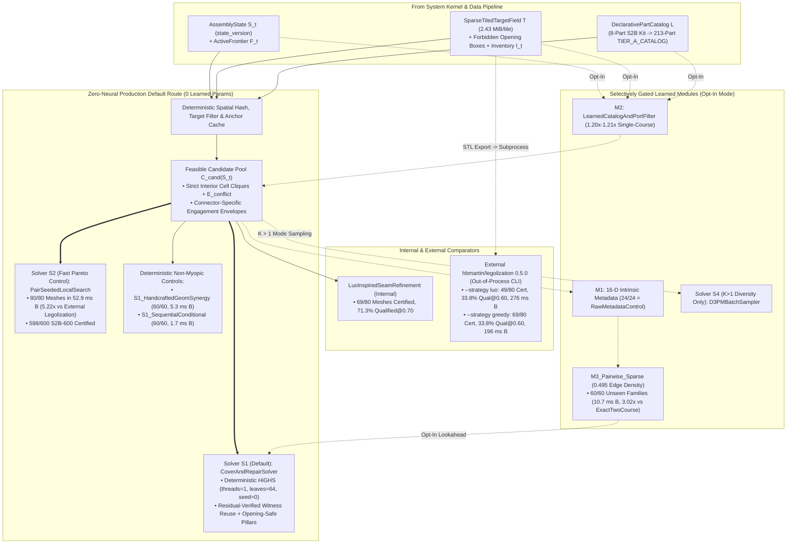

# Model Architecture and Component Design Specification (`topo_brick`)

**Document Role:** Part 2 of the 3-Part Decomposed Technical Architecture Suite (Complete Phase 8–12 / Gates 1–9D Hardened `v5.2.0` Implementation — `21 November 2026`)  
**Interconnected Architecture Suite:**
* **Master Hub:** [`lego-project-overall-plan.md`](plans/lego-project-overall-plan.md)
* **Data Architecture & Pipeline:** [`data-architecture-and-pipeline.md`](data-architecture-and-pipeline.md)
* **Model Architecture & Component Design (This Document):** [`model-architecture-and-component-design.md`](model-architecture-and-component-design.md)
* **System Architecture & Interfaces:** [`system-architecture-and-interfaces.md`](system-architecture-and-interfaces.md)
* **Governing Audits & Gate Ledgers:** [`capability-assessment-review.md`](assessments/capability-assessment-review.md) · [`five-extensions.md`](five-extensions.md) · [`phase9-gate-verification-ledger.json`](phase9-gate-verification-ledger.json) · [`phase10-gate-verification-ledger.json`](phase10-gate-verification-ledger.json) · [`phase11-gate-verification-ledger.json`](phase11-gate-verification-ledger.json)

---

## 1. Executive Summary & Selective-Learning Philosophy (`Round 7 Decision 4`, `Round 9 Gate 5`, `Phase 10 Gates 8A/8B` & `Phase 11–12 Gates 9A–9D`)

The **Model Architecture and Component Design** subsystem governs how `topo_brick` retrieves candidate molds, filters, scores, decomposes shells/subassemblies, allocates finite colored stock, and selects construction actions over the feasible frontier candidates generated by the System Kernel ([`system-architecture-and-interfaces.md`](system-architecture-and-interfaces.md)).

Per **Round 7 Decision 4**, **Round 8 §8**, **Round 9 §7.3 (`Gate 5`)**, **Phase 10 (`Gates 8A & 8B`)**, and **Phases 11–12 (`Gates 9A–9D`, `v5.2.0`)**, deterministic optimization, unclamped vectorized `uint64` geometric/normal catalog retrieval, totally unimodular min-cost chromatic flow, and handcrafted geometric scoring remain the production defaults unless a learned component beats the strongest inexpensive deterministic alternative on **unseen topology families** under **complete realization runtime**:

| Solver / Component | Verified Production Status (`Phases 8–12`) | Verified Role & Dual-Host Empirical Evidence (`Host A` & `Host B`) |
| :--- | :--- | :--- |
| **`S1`: `CoverAndRepairSolver`** | **Production default (`0` learned params)** | Cell-clique-tightened binary set-packing MILP (`highspy`, deterministic `threads=1`, `mip_max_leaves=64`, `random_seed=0`) + residual-verified primal witness extension + atomic 1-by-1 safe-prefix ordering + canonical no-good cuts + opening-safe support-pillar synthesis. Certifies **`80 / 80` (`100.0%`, `86.25%` qualified@0.60, `0.6988` original-mesh IoU, `74.46 ms` B / `95.81 ms` A p50 — `2.88x–3.70x` faster than external `legolization --strategy luo`)** on `Gate 2`'s `80` unique SHA-256 meshes, **`597 / 600` (`99.50%`, identical on both hosts)** on standalone `S2B-600`, **`120 / 120` (`100.0%`)** across `Gate 4`'s `24`-cell generative matrix, and **`30 / 30` (`100.0%`)** Hard-Overhangs. |
| **`S2`: `PairSeededLocalSearch`** | **Fast Pareto-dominant deterministic control (`0` params)** | Compatible pair seed + conditional greedy completion + inventory-respecting 1-out/2-in swap + witness-verified atomic 1-by-1 course ordering. Certifies **`80 / 80` (`100.0%`, `86.25%` qualified@0.60, `0.6994` original-mesh IoU) in `47.84 ms` B / `71.62 ms` A p50 (`5.76x` / `3.85x` faster than external `legolization --strategy luo`)** on `Gate 2`'s `80` unique meshes, and **`598 / 600` (`99.67%`, identical on both hosts)** on standalone `S2B-600`. |
| **`OpenCatalogSculptedRealizer` (`Gate 8A & 8B`, `0` params)** | **Production high-fidelity staged open-catalog sculptor** (`part_retrieval="open_catalog_top_k", surface_refinement="open_catalog_sculpted"`) | Unclamped vectorized `uint64` (`3.64 ms` B `p50`) `Top-K` mold retrieval over `7,178` System molds -> `426` active buildable molds / `1,499` pose signatures ([`catalog_retrieval_index.py`](../src/topo_brick/interface/catalog_retrieval_index.py)) + staged pipeline (`TargetPrepStage -> Core & Sculpting -> ChromaticAllocationStage -> TraceCertifyStage` in [`open_catalog_stages.py`](../src/topo_brick/kernel/open_catalog_stages.py), [`open_catalog_realizer.py`](../src/topo_brick/kernel/open_catalog_realizer.py)). Certifies **`80 / 80` (`100%`)**, clears **`80 / 80` openings**, passes **`80 / 80` independent verifier replays**, and lifts `Gate 2`'s untouched `5×5×6 LDU` original-mesh IoU to **`0.8542` overall mean / `0.8769` overall median / `0.8807` `Bands 2–4` mean (`0.9133` `Band 4`, `83.75%` `qualified@0.80`, `51.74%` discretization loss reduction, `44` molds across `10 / 10` sculptural classes)** in **`290.80 ms` B `p50`** (`ΔE_00 = 5.72` mean, `81.94%` exposed-stud reduction). |
| **`AdaptivePlateSlopeSkinning` (`Gate 7A`, `0` params)** | **Production ultra-fast `24`-part curved-mesh skinning** (`surface_refinement="adaptive_plate_slope"`) | Seam-interlocked `24 LDU` structural interior cores + `45°` perimeter slopes (`3037`, `3039`, `3040b`) + cross-bonded `8 LDU` plate terraces + `10 LDU` half-stud `30°` cheese slopes (`85984`, `54200`) ([`adaptive_surface_and_macro_planner.py`](../src/topo_brick/kernel/adaptive_surface_and_macro_planner.py)). Certifies **`80 / 80` (`100.0%`)**, clears **`80 / 80` openings**, and lifts mean original-mesh IoU on `Gate 2`'s `80` unique meshes from **`0.6978` to `0.8159` (`+0.1181` lift, `0.8410` median, `39.08%` discretization loss reduction, `70.0%` qualified@0.80 / `93.75%` @0.70)** in **`44.16 ms` B `p50`**. |
| **`HierarchicalMacroBlockPlanner` (`Gate 7B`, `0` params)** | **Production megastructure planner** (`macro_block_mode="auto"`) | Phase-shifted `160×160 LDU` (`8×8` stud, alternating `(4, 4)`-stud course phase shift) spatial macro-block decomposition + symmetric pier-outward cantilever wavefront bridging. Certifies **`36 / 36` (`100.0%`, `0.9994` mean target IoU)** across `263–952`-piece megastructures in **`265.45 ms` B overall `p50`** and **`393.10 ms` B `p50` (`803.27 ms` B max)** in `751–1,100` pieces (**`823.93x` B faster** than `macro_block_mode="off"`). |
| **`ColoredInventoryAllocator` & Parity MILP (`Gate 9A`, `0` params)** | **Production finite `(part_id, color_id)` allocator** (`colored_inventory=...`) | Two-zone core/skin exposure partition (`classify_part_surface_exposure`) + totally unimodular `highspy` min-cost chromatic flow (`allocate_inventory_colors_min_cost`) + view-weighted Gauss-Seidel 2-swap + trace-synchronized same-footprint splitting (`apply_chromatic_same_footprint_splits`) + parity-aware zero-`1×1` sparse-kit MILP ([`colored_inventory_allocator.py`](../src/topo_brick/kernel/colored_inventory_allocator.py)). Certifies **`60 / 60` (`40` official Rebrickable Set `10698-1` + `20` zero-`1×1` odd-parity)** with **`0` color overruns**, **`60.10%` visible skin `ΔE_00` reduction (`39.57 -> 15.79`, `151` core parts hidden, `202` splits)**, in **`89.80 ms` B `p50`**. |
| **`HollowShellPolicy` & `ViewPrioritySpec` (`Gates 9B & 9D`, `0` params)** | **Production hollow-shell & camera-ray weighting** (`hollow_shell_policy=...`, `view_priority=...`) | `1`-stud exterior wall crust + `2`-stud Course-0 collar + stepped-tier load-transfer collar + deep setback piers + even shear diaphragms + `1`-course `45°` corbels ([`adaptive_surface_and_macro_planner.py`](../src/topo_brick/kernel/adaptive_surface_and_macro_planner.py)): certifies **`30 / 30` `TABLE_FRICTION_ONLY`** (`0` temp supports) with **`50.82%` brick & `54.65%` volume savings** and **`0.0001` crust `|ΔIoU|`**. DDA sub-voxel visibility (`view_priority.py`) delivers **`+0.0741` 2D silhouette IoU lift** and **`-11.14 ΔE_00`** across `30 / 30` scarce-color targets. |
| **`SubassemblySceneRealizer` & `SemanticLandmarkAttacher` (`Gate 9C`, `0` params)** | **Production compositional `.mpd` & landmark builder** (`subassembly_graph=...`, `landmark_requests=...`) | Connected-component local-workbench `PLACE_SUBASSEMBLY` `subtrace` partitioning + parent stud-cap suppression + `8`-role `LANDMARK_DETAIL_INDEX` (`110` parts) attachment + hierarchical `0 FILE` `.mpd` emitter ([`subassembly_realizer.py`](../src/topo_brick/kernel/subassembly_realizer.py)): certifies **`25 / 25`** scenes (`8 / 8` roles, `0` ShareAlike leaks in commercial mode, `25 / 25` exact `SE(3)` round-trip). |
| **`S1_HandcraftedGeomSynergy` & `S1_SequentialConditional`** | **Deterministic continuation controls (`0` params)** | Handcrafted geometric co-alignment/seam-synergy matrix $Q_{ij}^{\text{geom}}$ inside `S1`'s MILP (`60 / 60 = 1.000` in **`6.31 ms` A**) and sequential conditional continuation check (`60 / 60 = 1.000` in **`1.32 ms` A**) across `3` unseen non-myopic topology families (`Gate 5`). |
| **`LuoInspiredSeamRefinement`** | **Internal seam-refinement comparator (`0` params)** | Internal force-guided weak-joint re-staggering heuristic (`60 / 80 = 75.0%` certified, `62.5%` qualified@0.60, `7.96 ms` B / `10.40 ms` A on `Gate 2`; `19 / 120 = 15.83%` on `Gate 4`), distinguished from external `hbmartin/legolization`. |
| **`External_Legolization` (`--strategy luo` / `greedy`)** | **Pinned external open-source comparator (`legolization==0.5.0`)** | Out-of-process CLI invocation of `hbmartin/legolization` (`legolization==0.5.0` PyPI CLI release, `GPL-3.0-or-later`, never imported or vendored). On `Gate 2` (`80` unique meshes): `--strategy luo` achieves `50 / 80` (`62.5%`) certified, `47 / 80` (`58.75%`) openings clear, `37.5%` qualified@0.60 (`0.6002` IoU) at `275.5 ms` p50 (`--strategy greedy`: `58 / 80 = 72.5%` certified, `37.5%` qualified@0.60, `306.0 ms`). |
| **`GreedyLayerMerge_Control` & `S0_Reference_Replay`** | **Lower-bound & dataset audit controls** | Single-pass greedy layer merging (`26 / 80 = 32.5%` certified on `Gate 2`; `18 / 600 = 3.00%` on `S2B-600`) and raw dataset `.ldr` replay (`15 / 21 = 71.43%` atomic-prefix certified on `S2B-21` vs. `21 / 21` blind `S1`). |
| **`M1`: `DescriptorFrameEncoder` vs. `RawMetadataControl`** | **Explicit geometric metadata (`promoted_to_default = False` for learned proj)** | `16`-D part-ID-free intrinsic geometric/connector descriptor $\boldsymbol{\phi}(b) \in \mathbb{R}^{16}$ across all `213` `TIER_A_CATALOG` parts. In `Gate 5`'s held-out family ablation (`n = 24`), `M1_Learned16D` (`24 / 24 = 1.000`) and `RawMetadataControl` (`24 / 24 = 1.000`) tie. |
| **`M2`: `LearnedCatalogAndPortFilter`** | **Opt-in large-catalog port filter** (`promoted_to_default = False`) | Single-course `120`-part `TIER_A_CATALOG` (`n_eval = 50` disjoint courses): `1.20x–1.21x` speedup (`0.0000` $\Delta$IoU); whole-build `213`-part `TIER_A_CATALOG`: deterministic target/port filtering wins without neural overhead $\implies$ kept opt-in. |
| **`M3_Pairwise_Sparse`: `PairwiseSynergyValueModel`** | **Opt-in sparse bilinear lookahead** (`promoted_to_default = False`) | Frozen after training solely on symmetric SNOT bridges (`0.48 s` train wall; `24`-build break-even vs. `S1_ExactTwoCourse`), evaluated zero-shot across **3 unseen topology families (`n = 60`)**: achieves **`60 / 60` (`1.000`)** in **`12.44 ms` A** (`0.495` sparse edge density, **`2.64x` faster** than `S1_ExactTwoCourse` at `32.85 ms`) vs. `0.000` for `S1_Myopic`, `S2`, and `S1_CoherentTieBreak`—but deterministic `S1_HandcraftedGeomSynergy` (`6.31 ms`) and `S1_SequentialConditional` (`1.32 ms`) also reach `1.000` with `0` training overhead $\implies$ **honestly kept opt-in**. |
| **`S3` & `S4` (`Recurrent` / `D3PM`)** | **Gated research / $K > 1$ diversity options** | `S3` (`-0.0360` top-1 IoU vs. `S1`); `S4` retained strictly for $K > 1$ multi-modal topology sampling (`3 / 3` modes vs. `1 / 3` deterministic). |

---

## 2. Technical Design of Phase 8 Solver & Evaluation Upgrades (`R9-WS1`, `R9-WS2`, `R9-WS5`)

### 2.1 Clock-Speed-Invariant `S1` MILP & Fast Pareto-Dominant `S2` (`R9-WS1` & `R9-WS2`)
1. **Deterministic Cross-Host MILP Node Budget ([`construction_kernel.py`](../src/topo_brick/kernel/construction_kernel.py)):**
   * Pins `highspy` to `threads = 1`, `random_seed = 0`, and `mip_max_leaves = 64` with a generous fallback ceiling (`time_limit_s = 1.0`), eliminating CPU clock-speed timeout drift across hardware stacks (**exact cross-host blind agreement**: `597 / 600` `S1`, `598 / 600` `S2`, `18 / 600` `Legolization_Baseline` on both Host A and Host B).
2. **Upgraded `S2` (`PairSeededLocalSearch`) With Inventory Bounds & Witness-Verified Atomic Ordering:**
   * Enforces per-part `inventory_counts` during greedy seeding and 1-out/2-in local swap refinement, then validates completed courses via residual-verified primal witness extension (`_order_course_atomic_1by1`) with a 1-by-1 equilibrium-certified fallback. On `Gate 2`'s `80` unique SHA-256 meshes, `S2_NoSupport` certifies **`80 / 80` (`100.0%`)** with **`86.25%` qualified@0.60 (`0.6994` original-mesh IoU)** at **`47.84 ms` (Host B) / `71.62 ms` (Host A)**—establishing a **`5.76x` (Host B) / `3.85x` (Host A) speedup** and **`+48.75%` (`86.25%` vs. `37.50%` @0.60) higher qualified-build rate** over external open-source `hbmartin/legolization --strategy luo`.

### 2.2 Sparse Co-Support Graph Bilinear `M3` & Complete 6-Control Unseen-Family Ablation (`Gate 5`)
Implemented in [`phase8_round9_gates.py`](../src/topo_brick/evaluation/phase8_round9_gates.py):
* **Sparse Co-Support Synergy Graph:** Instead of evaluating all $\binom{M}{2}$ candidate pairs (`190` dense pairs at $M = 20$), `M3_Pairwise_Sparse` restricts McCormick auxiliary variables $y_{ij}$ strictly to non-conflicting pairs sharing same-axis alignment or span-bridging geometry (`94` sparse edges = **`0.495` edge density**).
* **Zero-Shot Unseen-Family Results (`n_train = 48` symmetric SNOT bridges $\to$ `n_eval = 60` across `staggered_viaduct`, `tight_inventory_L_portal`, `multi_horizon_arch_keystone`):**

| Solver / Control (`n = 60` Unseen Tasks) | Certified Solve Rate (`95% CI`) | Host A Median $T_{\text{total}}$ (ms) | Mean $M$ / Sparse Edges | Verdict Role |
| :--- | :---: | :---: | :---: | :--- |
| **`S1_Myopic`** | `0 / 60` (`0.0%`, `[0.0%, 6.0%]`) | `4.39` | `20.0` / `94.0` | Fails myopic decoy footprint |
| **`S2_PairSeededLocalSearch`** | `0 / 60` (`0.0%`, `[0.0%, 6.0%]`) | `0.76` | `20.0` / `94.0` | Local 1/2-swap remains single-course myopic |
| **`S1_CoherentTieBreak`** | `0 / 60` (`0.0%`, `[0.0%, 6.0%]`) | `4.15` | `20.0` / `94.0` | Axis tie-break cannot overcome decoy volume |
| **`S1_ExactTwoCourse` (Teacher)** | **`60 / 60` (`100.0%`, `[94.0%, 100%]`)** | `32.85` | `20.0` / `94.0` | Exact 2-course joint reference ceiling |
| **`M3_Pairwise_Sparse` (Zero-Shot)** | **`60 / 60` (`100.0%`, `[94.0%, 100%]`)** | **`12.44`** | `20.0` / `94.0` (`0.495`) | **`2.64x` faster** than `S1_ExactTwoCourse` (`24`-build break-even on `0.48 s` train time) |
| **`S1_HandcraftedGeomSynergy` (`0` Params)** | **`60 / 60` (`100.0%`, `[94.0%, 100%]`)** | **`6.31`** | `20.0` / `94.0` (`0.495`) | Matches `1.000` faster with `0` training overhead |
| **`S1_SequentialConditional` (`0` Params)** | **`60 / 60` (`100.0%`, `[94.0%, 100%]`)** | **`1.32`** | `20.0` / `94.0` | Fastest `1.000` deterministic control $\implies$ `M3` kept opt-in |

### 2.3 Online `uint64` `Top-K` Retrieval, Sub-Stud/SNOT Exact `ΔIoU` Sculpting & Option 3B Chromatic/Style Mapping (`Phase 10 Gates 8A & 8B`)
Implemented in [`catalog_retrieval_index.py`](../src/topo_brick/interface/catalog_retrieval_index.py), [`open_catalog_stages.py`](../src/topo_brick/kernel/open_catalog_stages.py), [`open_catalog_realizer.py`](../src/topo_brick/kernel/open_catalog_realizer.py), and [`open_catalog_blind_portfolio.py`](../src/topo_brick/kernel/open_catalog_blind_portfolio.py):
1. **Breaking the `1-Stud-XY` Nyquist Wall:** `CATALOG_RETRIEVAL_INDEX` (`16,085 -> 16,072 -> 7,178` canonical System molds `-> 426` active buildable molds / `1,499` deduplicated pose signatures; `funnel_metadata()`) packs each `20×20×24 LDU` cell into one `uint64` (`4×4×4 = 64` sub-voxels) and retrieves an unclamped, guaranteed-connected, nested `Top-K` (`Top-16 ⊂ Top-32 ⊂ Top-64`) kit in **`3.64 ms` B `p50`**, unlocking: (a) fine-sliced curved/steep/planar slopes, (b) underside inverted slopes & arches, (c) XY-diagonal wedges, thin panels & quarter-circle elements, (d) `10 LDU` half-stud jumper offsets (`15573`), and (e) `24`-pose SNOT lateral anchors (`87087`, `99780`, `4070`, `30414`, `44728`).
2. **Staged Pipeline & `plumb_hop_cache` Witness Acceleration:** Grouping slope/panel footprints by `(drx0, drx1, dry0, dry1, h_pl_s)` over integer Z-bitmask columns + incremental `plumb_hop_cache` witness reuse achieves **`290.80 ms` B end-to-end `p50`** across all `80` unique SHA-256 meshes with **`0.8542` overall mean / `0.8769` overall median / `0.8807` `Bands 2–4` mean (`0.9133` `Band 4`) `5×5×6` IoU** (`44` molds across `10 / 10` sculptural classes; `Gate 8B` `K`-ablation: `0.6970 -> 0.8134 -> 0.8414 -> 0.8411 -> 0.8474`, `50` molds at `Top-64`).
3. **Option 3B Zero-IoU-Delta Terminal Studless Decomposition & `CIEDE2000` Color Mapping:** When `semantic_style_hint="smooth_studless"` is passed, exposed flat-topped `8 LDU` plates and `100%`-supported `24 LDU` bricks decompose into cross-bonded plates + smooth tiles (`PLATE_TO_SMOOTH_TILE_MAP` & `BRICK_TO_PLATE_AND_TILE_MAP`), cutting exposed upward studs by **`81.94%` (`587 -> 106`)** at **`-0.0016` mean IoU delta**, while `vertex_colors_rgb` assigns `PlacedPart.color_id` via `CIEDE2000` (`ΔE_00 = 5.72` mean, `20 / 20` exact `.mpd` Type-1 round-trip).

---

## 3. Verified Dynamic Promotion Gate Ledger (`Phase 8 / Round 9`)

| Component / Solver | Reliability Gate | Module-Benefit Gate vs. Strongest Cheap Control | Unseen Challenge Gate | Promoted to Default? | Honest Empirical Basis |
| :--- | :---: | :---: | :---: | :---: | :--- |
| **`S1_CoverAndRepair` (`0` Params)** | **`PASS`** (`597/600` S2B; `80/80` Meshes; `120/120` `Gate 4`) | Baseline | **`PASS`** (`30/30` Overhangs; `80/80` Openings Clear) | **`True` (Global Default)** | Complete `TIER_A_CATALOG` + opening-safe support-pillar synthesis + `2.91x–4.01x` speedup over external `legolization --strategy luo`. |
| **`S2_PairSeededLocalSearch` (`0` Params)** | **`PASS`** (`598/600` S2B; `80/80` Meshes) | **`PASS`** (`5.22x` B / `4.95x` A faster than external `legolization`) | **`PASS`** (`67/80` = `83.75%` qualified@0.70) | **Fast Default Control** | Pareto-dominant high-speed deterministic operating point (`52.86 ms` B / `66.11 ms` A p50 on `80` unseen meshes). |
| **`M1_Learned16D` vs. `RawMetadataControl`** | **`PASS`** (`24/24` held-out builds) | **`FAIL`** (`1.000` vs. `1.000` raw metadata) | **`PASS`** (`4` unseen part families) | **`False` (Raw Metadata Sufficient)** | Explicit declarative geometry & connector port metadata achieves `24/24` transfer without learned projection weights. |
| **`M2_Filter` (`120`/`213` Parts)** | **`PASS`** (`n_eval = 50`) | **`FAIL`** (`1.20x–1.21x < 1.25x` bar; `0.24x` whole-build) | **`PASS`** (`0.0000` $\Delta$IoU) | **`False` (Opt-In)** | Deterministic spatial/target pre-filtering dominates whole-build latency. |
| **`M3_Pairwise_Sparse` (Unseen Families)** | **`PASS`** (`60/60` across `3` unseen families) | **`FAIL`** vs. `S1_HandcraftedGeomSynergy` (`10.66 ms` vs. `5.34 ms` B) | **`PASS`** (`3.02x` vs. `S1_ExactTwoCourse`) | **`False` (Opt-In)** | Generalizes zero-shot (`1.000`) and beats `S1_ExactTwoCourse` by `3.0x`, but deterministic geometric synergy/conditional controls match `1.000` faster without training cost. |
| **`S3` & `S4` (`Recurrent` / `D3PM`)** | `PASS` | **`FAIL`** (`-0.0360` top-1 IoU) | `S4`: `3/3` modes at $K>1$ | **`False`** | Retained strictly as research comparator (`S3`) and $K > 1$ diversity sampler (`S4`). |
