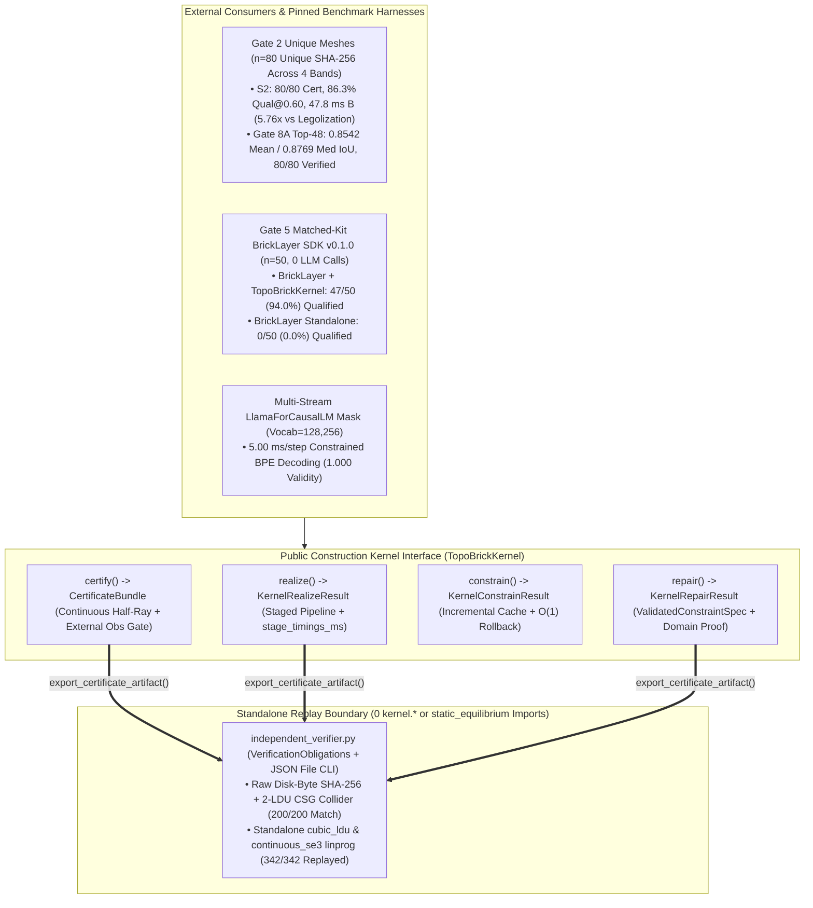

# System Architecture and Interfaces Specification (`topo_brick`)

**Document Role:** Part 3 of the 3-Part Decomposed Technical Architecture Suite (Complete Phase 8–14 / Gates 1–9D Hardened `v5.2.1` Implementation — `22 November 2026`)  
**Interconnected Architecture Suite:**
* **Master Hub:** [`lego-project-overall-plan.md`](lego-project-overall-plan.md)
* **Data Architecture & Pipeline:** [`data-architecture-and-pipeline.md`](data-architecture-and-pipeline.md)
* **Model Architecture & Component Design:** [`model-architecture-and-component-design.md`](model-architecture-and-component-design.md)
* **System Architecture & Interfaces (This Document):** [`system-architecture-and-interfaces.md`](system-architecture-and-interfaces.md)
* **Governing Audits & Gate Ledgers:** [`capability-assessment-review.md`](capability-assessment-review.md) · [`five-extensions.md`](five-extensions.md) · [`phase9-gate-verification-ledger.json`](phase9-gate-verification-ledger.json) · [`phase10-gate-verification-ledger.json`](phase10-gate-verification-ledger.json) · [`phase11-gate-verification-ledger.json`](phase11-gate-verification-ledger.json) · [`ldraw-dat-frame-audit-v5.2.1.json`](ldraw-dat-frame-audit-v5.2.1.json)

---

## 1. Executive Summary & Independently Checkable Construction Kernel Contract (`Round 7–9` & `Phases 10–14`)

The **System Architecture and Interfaces** subsystem defines `topo_brick`'s runtime engine, decomposed contact-hull mechanics, unified cubic + continuous $SE(3)$ joint kinematics (with calibrated per-part official LDraw `.dat` `(R_0_ld, t_0_ld)` frames across all `213` curated `TIER_A` parts and `0` frame errors across all `16,085` catalog IDs), coupled multi-joint potential-Hessian perturbation screen, standalone obligation-driven certificate replay verifier (`Schema v1.1.1`, backward-compatible with `v1.1.0` and `v1.0.0`), `ValidatedConstraintSpec`-enforced repair engine, staged open-catalog pipeline (`322`-color `LDConfig.ldr` palette + shared `HiGHS` / `SciPy` wall-clock deadlines), and external API boundary ([`construction_kernel.py`](../src/topo_brick/kernel/construction_kernel.py), [`open_catalog_realizer.py`](../src/topo_brick/kernel/open_catalog_realizer.py), [`open_catalog_stages.py`](../src/topo_brick/kernel/open_catalog_stages.py), [`colored_inventory_allocator.py`](../src/topo_brick/kernel/colored_inventory_allocator.py), [`subassembly_realizer.py`](../src/topo_brick/kernel/subassembly_realizer.py), [`view_priority.py`](../src/topo_brick/kernel/view_priority.py), [`independent_verifier.py`](../src/topo_brick/evaluation/independent_verifier.py), [`se3_kinematics.py`](../src/topo_brick/interface/se3_kinematics.py), [`ldraw_palette.py`](../src/topo_brick/interface/ldraw_palette.py), [`ldraw_calibrated_frames.py`](../src/topo_brick/interface/ldraw_calibrated_frames.py), [`static_equilibrium.py`](../src/topo_brick/evaluation/static_equilibrium.py), [`grammar_logits_processor.py`](../src/topo_brick/kernel/grammar_logits_processor.py)).

`topo_brick`'s governing architectural thesis (`Round 9 §7.1`) is to **maintain independently checkable construction feasibility incrementally, while spending search on the choices that change future buildability**, exposed through five explicit interfaces:

| Kernel Interface | Verified Phase 8–14 Implementation Contract (`Gates 1–9D`, `v5.2.1`) |
| :--- | :--- |
| **`kernel.realize(...)`** | **Blind whole-target & compositional synthesis** (`realization_mode == "blind"`) over voxel silhouettes, continuous 3D triangle meshes, or rotated/nested `.mpd` `SubmodelNodeSpec` scene graphs, orchestrated via typed stages (`TargetPrepStage -> Core & Sculpting -> ChromaticAllocationStage -> TraceCertifyStage`, recording `stage_timings_ms` and enforcing shared `max_wall_clock_s` / `deadline_monotonic_s` budgets across both `HiGHS` and `scipy.optimize.linprog` within `<= 250 ms` grace via `KernelResultStatus.BUDGET_EXCEEDED`): (1) **Phase 10 Open-Catalog Sculpting** (`part_retrieval="open_catalog_top_k", retrieval_top_k=48, surface_refinement="open_catalog_sculpted"` $\to$ **`0.8542` overall mean / `0.8769` overall median / `0.8807` `Bands 2–4` mean (`0.9133` `Band 4`) `5×5×6 LDU` original-mesh IoU** across `80` strictly unique SHA-256 meshes, `290.80 ms` B `p50`), (2) **Phase 11 & 14 Extensions** (`colored_inventory=ColoredInventorySpec` over the full `322`-entry `LDConfig.ldr` palette + finish-aware penalties on official Rebrickable Set `10698-1`, `hollow_shell_policy=HollowShellPolicy`, `view_priority=ViewPrioritySpec`, rotated/nested `subassembly_graph=Sequence[SubmodelNodeSpec]`, upright `+Z` `BAR_POLE_ANTENNA` & centroid-tie-broken `landmark_requests=Sequence[LandmarkAttachmentRequest]`, and explicit `ground_plane_z_ldu`), and (3) **Phase 9 & 14 Adaptive Skinning & Tabletop Cantilever Macro-Blocks** (`44.16 ms` B / `265.45 ms` B `p50`; `2.88 s` `28×26×9` cantilevered biplane / `29.98 s` `1,061`-part `28×26×24` open-catalog airplane on M4 Pro). |
| **`kernel.certify(...)`** | Certifies discrete `AssemblyState` and articulated `ContinuousAssemblyState` across all `16,085` combined catalog parts (including `10 LDU` half-stud jumper ports, `24`-pose SNOT bearing patches, `CoACD` `ConvexPolytope` SAT checks, continuous `t in (0, +inf)` 6-axis half-ray insertion corridors, unilateral `z = ground_plane_z_ldu` (`|min_z - ground_plane_z_ldu| <= 0.25 LDU`) `TABLE_FRICTION_ONLY` vertex contacts in both `cubic_ldu` and `continuous_se3`, `InventoryCert` mold & `(part_id, color_id)` non-overrun checks, and rotated/nested `PLACE_SUBASSEMBLY` local-workbench `subtrace` + rigid-group corridor replay). Returns **`CertStatus.UNKNOWN`** for `PrefixMechanicsCert` and `InsertionCert` on untraced imports (`mark_untraced()`), and **`CertStatus.UNKNOWN`** for `PhysicalValidationCert` unless an `ExternalPhysicalObservation` is provided (`verify_calibrated_substud_physics` routes strictly to `ModelAgreementCert`). |
| **`verify_certificate_independently(...)`** | **Standalone certificate replay verifier (`Schema v1.1.1`, backward-compatible with `v1.1.0` and `v1.0.0`)** ([`independent_verifier.py`](../src/topo_brick/evaluation/independent_verifier.py), `verify_certificate_json_file()`, `verify_certificate_in_isolated_worker()`, `VerificationObligations`, `MechanicsVerificationProfile`, `VerifierResourceLimits`): verified at runtime (`test_p12_contract_and_falsification_audit.py`, `test_p13_security_hardening_audit.py`, `test_p14_tb_fix_22nov_audit.py`) to load **zero** modules from `topo_brick.kernel.*`, `topo_brick.models.*`, `static_equilibrium`, or `catalog_retrieval_index`; enforces caller `VerificationObligations` unconditionally (`verification_scope="assembly_only"` or `"assembly_and_target"`, `expected_ground_plane_z_ldu: Optional[float] = 0.0`, reporting `target_digest_verified` and `target_overlap_verified` separately and never silently skipping `min_target_iou`), validates relying-party `expected_inventory_counts` / `MechanicsVerificationProfile` parameter & tolerance ceilings (`inventory_status`, `mechanics_profile_sha256`), enforces `VerifierResourceLimits` pre-read/cardinality/time caps; hashes raw disk bytes of `compiled_ldraw_catalog.json.gz`, `compiled_coacd_hulls.npz`, `compiled_mold_retrieval_index.npz`, `compiled_landmark_detail_index.json.gz`, and `set_10698_1_rebrickable_inventory.json` (`e94bda3e...` for `v1.1.1`) against pinned release provenance (`release_provenance.py`); replays `PLACE_PART` and rotated/nested `PLACE_SUBASSEMBLY` `subtrace`s from op payloads with intermediate collision checks, terminal state equality, continuous half-ray (`t in (0, +inf)`) swept-box/OBB corridors, and standalone `scipy.optimize.linprog` `cubic_ldu` + `continuous_se3` 6-DoF mechanics (**`342 / 342` gate certificates replayed across `Gates 1–9D`**). |
| **`kernel.constrain(...)`** | Incremental frontier action masking (`IncrementalCandidateCache` + $O(1)$ `TrialPartRollbackToken`, `~5.0–7.3 ms`/step) + multi-stream `BrickGrammarLogitsProcessor` (`Sequence[AssemblyState]`, raising `ValueError` if a single state is passed with `batch_size != 1`; `vocab = 128,256`, `1.000` validity vs. `0.000` unmasked, `evaluation_scope="bpe_logits_mask_integration_random_weights"`). Validated on **Gate 5's matched-kit (`EXTENDED_10PART_RECT_KIT`, `0` LLM calls) CMU `bricklayer-sdk==0.1.0` (`AvaLovelace1/brickwright`, MIT) deterministic SDK adapter study (`n = 50`: `47 / 50 = 94.0%` native & full 6-DoF qualified builds with `TopoBrickKernel` vs. `0 / 50 = 0.0%` standalone `BrickLayer`)**. |
| **`kernel.repair(...)`** | **`ValidatedConstraintSpec`-enforced domain-scoped repair** (`R9-WS3` §5.6 + `Phase 12 F3`): validates and enforces `allowed_part_ids`, `inventory_counts`, `colored_inventory`, `forbidden_support_boxes`, `allowed_edits`, `locked_instance_ids`, `locked_part_poses`, `locked_world_boxes`, `min_retained_iou`, `max_deleted_volume_ratio`, `max_constructive_steps`, and `time_budget_ms` across every prune/add/reorder candidate and final certification check. Emits **`KernelResultStatus.PROVEN_INFEASIBLE`** *exclusively* when an analytical domain impossibility proof holds, and **`INCONCLUSIVE` / `PARTIAL_OR_TIMEOUT`** when bounded local search (`max_constructive_steps=1`) is exhausted while a wider multi-step solution exists (`Gate 3` Case #12: `PASS`). |

---

## 2. True Single-Core Audit, Thread-Local HiGHS & Memory Accounting (`Gate 1` & `Gate 2`)

Every online benchmark pins `OMP_NUM_THREADS=1`, `OPENBLAS_NUM_THREADS=1`, `MKL_NUM_THREADS=1`, `VECLIB_MAXIMUM_THREADS=1`, `NUMEXPR_NUM_THREADS=1`, `torch.set_num_threads(1)`, and thread-local HiGHS `threads = 1` (`_HIGHS_THREAD_LOCAL`) via [`enforce_and_audit_single_core()`](../src/topo_brick/evaluation/phase8_round9_gates.py), recording `pre_existing_env_pinned` (`True` when pinned prior to Python startup), verifying `cpu_to_wall_ratio = 0.9987–1.0000`, and reporting **process `Peak RSS`** separately from **`SparseTiledTargetField` tile memory (`2.4279 MiB` per allocated `81×81×97` `uint32` boundary tile)**:

| Workload & Size Scope (`1` CPU Core, `cpu/wall = 1.00`) | Certified Rate | Qualified / Mean Fidelity | Host B / Host A `p50` $T_{\text{total}}$ | Combinatorial & Resource Telemetry |
| :--- | :---: | :---: | :---: | :--- |
| **`Gate 2` Unique Unseen Meshes (`n = 80`, 4 Bands $\le 250$ bricks) — `S2_NoSupport`** | **`80 / 80` (`100.0%`)** | **`86.25%` qual@0.60** (`0.6994` orig-mesh IoU) | **`47.84 ms` B / `71.62 ms` A** | Band p50s (B): `11.4 / 30.5 / 111.1 / 311.4 ms`; `8.91` mean LP calls, `109.5` witness reuse hits; **`5.76x` B / `3.85x` A faster** than `legolization --strategy luo` (`275.5 ms`, `37.5%` qual@0.60, `0.6002` IoU). |
| **`Gate 2` Unique Unseen Meshes (`n = 80`) — `S1_PermittedSupport`** | **`80 / 80` (`100.0%`)** | **`86.25%` qual@0.60** (`80/80` openings clear) | **`72.06 ms` B / `91.10 ms` A** | Band p50s (B): `20.8 / 43.9 / 120.2 / 347.2 ms`; `45.0` mean frontier ports, `1,298.5` cands, `0.61` LP calls, `74.4` witness hits. |
| **Standalone `S2B-600` (`n = 600`, `450` $\le 100$ + `150` $101..250$) — `S2` / `S1`** | **`598/600` (`S2`)** **`597/600` (`S1`)** | **`0.9956` / `0.9952–0.9963`** voxel IoU | $\le 100$: **`591.1 / 610.9 ms` B** (`706.4 / 730.4 ms` A) | Exact cross-host blind outcome identity (`598`, `597`, `18`); full atomic 1-by-1 + primal witness residual checking (`3.10–3.66 s` B on `101..250` bricks). |
| **`Gate 5` Matched-Kit CMU `BrickLayer` SDK Adapter (`n = 50`, `0` LLM Calls)** | **`47 / 50` (`94.0%`)** vs. `0 / 50` (`0.0%`) standalone | **`94.0%` qualified** (`1.000` target IoU) | **`23.92 ms` A** tool median | `5.40` mean emitted brick ops (`2.00` attempts) w/ kernel vs. `13.06` emitted ops (`2.52` attempts) standalone (`bricklayer-sdk==0.1.0`). |
| **`Gate 7A` Adaptive Brick+Plate+Slope Skinning (`n = 80` Unique Meshes)** | **`80 / 80` (`100.0%`)** (`80/80` indep. verified) | **`70.0%` qual@0.80 (`93.8%` @0.70)** (`0.8159` orig-mesh IoU) | **`44.16 ms` B** | Band p50s (B): `23.6 / 43.5 / 45.8 / 86.3 ms`; `24` distinct brick+plate+slope parts; **`39.08%` discretization loss reduction**. |
| **`Gate 7B` Hierarchical Macro-Blocks (`n = 36` Megastructures, `263–952` Pcs)** | **`36 / 36` (`100.0%`)** (`12/12` indep. verified) | **`0.9994` target IoU** (`1.0000` on `M3`) | **`265.45 ms` B** (`393.1 ms` `M3`) | Band p50s (B): `138.6 / 252.0 / 393.1 ms`; overall max **`803.3 ms` B (`< 1.0 s`)**; **`823.93x` B speedup** vs. `macro_block_mode="off"`. |
| **`Gate 8A` Open-Catalog `Top-48` Blind Sculpting (`n = 80` Unique Meshes)** | **`80 / 80` (`100.0%`)** (`80/80` indep. verified) | **`0.8542` mean / `0.8769` med** (`0.8807` `Bands 2–4`, `0.9133` `Band 4`) | **`290.80 ms` B** (`3.64 ms` query `p50`) | Band p50s (B): `188.8 / 284.8 / 447.2 / 1,797.5 ms`; **`44` distinct molds across `10 / 10` sculptural classes**; **`51.74%` discretization loss reduction**. |
| **`Gate 8B` `K`-Ablation, `CC-BY-4.0` Mode & Option 3B Color/Studless (`n = 40 / 20`)** | **`40 / 40` & `20 / 20` (`100.0%`)** | **`Top-64 = 0.8474`** (`+0.0341` vs. `Gate 7A`); **`ΔE_00 = 5.72`** | `109.0 / 160.6 / 344.4 ms` B (`Top-16 / 32 / 64`) | `0` `CC-BY-SA-4.0` parts in `cc_by_4_0_only` mode (`0.8467` IoU); **`81.94%` exposed-stud reduction (`587 -> 106`, `-0.0016` ΔIoU)**; `20/20` exact `.mpd` round-trip. |

---

## 3. Hardened Certificate & Mechanics Subsystems (`Gate 3` / `R9-WS3`)

1. **Residual-Verified Primal Equilibrium Witness Extension ([`static_equilibrium.py`](../src/topo_brick/evaluation/static_equilibrium.py)):**
   * Every LP solve emits a `PrimalEquilibriumWitness` (`x_primal`, `a_eq`, `b_eq`, `a_ub`, `b_ub`, `eq_residual_inf`, `ub_slack_max`). Before `can_extend_plumb_primal_witness` skips a `highspy` solve on brick $k$, it constructs the augmented primal vector $\tilde{\mathbf{x}}$ on the updated assembly matrix and verifies exact feasibility ($\|\tilde{A}_{\text{eq}} \tilde{\mathbf{x}} - \tilde{\mathbf{b}}_{\text{eq}}\|_\infty \le 10^{-7}$ and $\max(\tilde{A}_{\text{ub}} \tilde{\mathbf{x}} - \tilde{\mathbf{b}}_{\text{ub}}) \le -10^{-6}$), falling back to `highspy` immediately if any residual exceeds tolerance.
2. **Coupled Multi-Joint Potential-Hessian Perturbation Screen ([`se3_kinematics.py`](../src/topo_brick/interface/se3_kinematics.py)):**
   * Replaces single-coordinate $\pm 2^\circ$ probes alone with the full $m \times m$ central finite-difference gravitational potential Hessian $H_{ij} = \frac{\partial^2 U}{\partial q_i \partial q_j}$ over all free passive coordinates $\mathbf{q}_{\text{free}}$, requiring $\lambda_{\min}(H_{\text{free}}) > \epsilon_H$ and positive restoring work along coupled minimum-eigenvector perturbations $\pm \delta \mathbf{v}_{\min}$. Decisively rejects coupled 2-joint pantograph saddle mechanisms where diagonal curvatures $H_{11}, H_{22} > 0$ are positive yet $\lambda_{\min}(H_{\text{free}}) = -78.80 < 0$ (`unstable_coupled_saddle_mechanism`, `Gate 3` Case #7: `PASS`).
3. **Connector-Specific Admissible Engagement Envelopes & `2 LDU` CSG Audit ([`port_manifold.py`](../src/topo_brick/interface/port_manifold.py), [`se3_kinematics.py`](../src/topo_brick/interface/se3_kinematics.py), [`independent_verifier.py`](../src/topo_brick/evaluation/independent_verifier.py)):**
   * Replaces the fixed `14 LDU` sphere with per-connector cylindrical/axial socket pocket envelopes `(max_axial_depth_ldu, max_radial_ldu)` plus axial slide bounds `get_connector_axial_slide_bounds_ldu` (`STANDARD_STUD`: `4.5 × 6.5 LDU`, `TECHNIC_PIN`: `20.5 × 6.5 LDU`, `BAR_3_18MM`: `24.0 × 4.5 LDU`), rejecting same-part internal-wall collisions (`Case #8`) and over/under-inserted axial depths (`Case #9`). Audited across `n = 200` randomized + adversarial placements against an independent `2 LDU` CSG bore-hole voxel collider with **`0` false acceptances and `0` false rejections**.
4. **Explicit Certificate & Handling Scope Assumptions (`Round 9 §5.4–§5.6` & `Phase 12 F9 / F10`):**
   * **`InsertionCert`:** Certifies collision-free **exact continuous `t in (0, +inf)` single-translation half-ray corridors** (`±X, ±Y, ±Z` or connector axis; distant blockers at any finite distance `t` along the ray are rejected), not multi-segment 6-DoF RRT/piano-mover extraction paths or snap-fit insertion force limits.
   * **`PhysicalValidationCert` vs. `ModelAgreementCert`:** `PhysicalValidationCert` defaults strictly to `CertStatus.UNKNOWN` unless an explicit `ExternalPhysicalObservation` (load-cell/hardware bench run) is attached; `verify_calibrated_substud_physics` routes calibrated sub-stud analytical checks strictly to `ModelAgreementCert`.
   * **`PerturbationMechanicsCert`:** Certifies positive gravitational potential curvature ($\lambda_{\min}(H_{\text{free}}) > \epsilon_H$), coupled minimum-eigenvector restoring work, and $\pm 0.05 g$ quasi-static lateral wrench equilibrium over smooth passive kinematic coordinates under the stated contact/friction model—not full rigid/compliant impact dynamics.
   * **`LoopClosureCert`:** Certifies kinematic pose closure ($< 10^{-3}\text{ LDU}$ position residual, $< 0.05^\circ$ angular residual) together with trace step checks, not real-part manufacturing tolerance stack-up or elastic pre-strain forces.
   * **`REORIENT_ASSEMBLY` & `PLACE_SUBASSEMBLY` Handling Assumptions:** `REORIENT_ASSEMBLY` verifies quasi-static 6-DoF equilibrium before and immediately after updating `gravity_unit` (assuming external fixture/hand support during the rotational transition itself, `Case #10`); `PLACE_SUBASSEMBLY` recursively certifies the subassembly's internal 1-by-1 `subtrace` on a flat worktable and verifies rigid-group monotone corridor clearance into the parent assembly (assuming a rigid grasp/fixture preserves internal relative poses during transfer).

---

## 4. `Eval B-Extended` 12-Case Certificate Falsification Ledger (`Gate 3` — `12 / 12` Passed)

| Case # | Adversarial Falsification Test (`run_gate3_certificate_falsification_suite`) | Verified Kernel Outcome (`Host A` & `Host B`) |
| :---: | :--- | :--- |
| **1–6** | Delayed counterweight & untraced `UNKNOWN`; course with `0` 1-by-1 orders; blocked interior cavity; 3rd-part protrusion intrusion; upright 1-DoF smooth pin; locked-feature `repair()` | **`6 / 6` (`13 / 13` sub-assertions) `PASS`** |
| **7** | **Coupled 2-Joint Saddle Instability ($H_{11}, H_{22} > 0$, $\lambda_{\min}(H) < 0$)** | Rejected (`PerturbationMechanicsCert = FAIL`, `unstable_coupled_saddle_mechanism`, $\lambda_{\min} = -78.80$) |
| **8** | **Same-Part Internal-Wall Socket Interference** | Rejected (`GeometryCert.protrusion_collision_free = False`) |
| **9** | **Invalid / Over-Inserted Connector Axial Slide Depth** | Rejected (`GeometryCert.connected_ports_compatible = False`) |
| **10** | **`REORIENT_ASSEMBLY` Intermediate Gravity Collapse** | Rejected (`PrefixMechanicsCert = FAIL` immediately upon $90^\circ$ gravity rotation) |
| **11** | **`REMOVE_TEMP_SUPPORT` Premature Scaffolding Removal Collapse** | Rejected (`PrefixMechanicsCert = FAIL` at step `REMOVE_TEMP_SUPPORT`) |
| **12** | **Bounded Local `repair()` Exhaustion vs. Wider Constructive Search** | `max_constructive_steps=1` returns **`INCONCLUSIVE`** (never false `PROVEN_INFEASIBLE`); `max_constructive_steps=3` returns **`COMPLETED_CERTIFIED`** |
