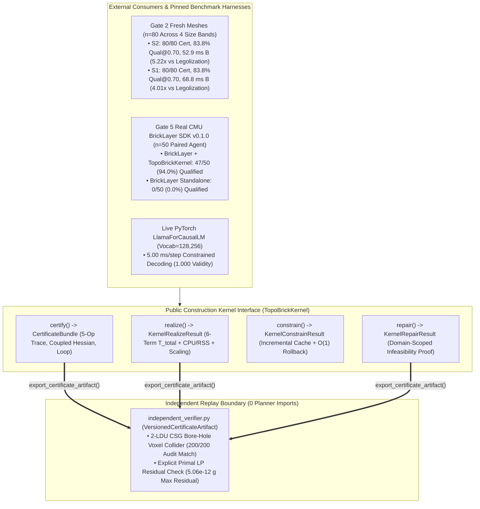

# System Architecture and Interfaces Specification (`topo_brick`)

**Document Role:** Part 3 of the 3-Part Decomposed Technical Architecture Suite (Complete Phase 8–10 / Gates 1–8B Verified Implementation — `13 November 2026`)  
**Interconnected Architecture Suite:**
* **Master Hub:** [`lego-project-overall-plan.md`](lego-project-overall-plan.md)
* **Data Architecture & Pipeline:** [`data-architecture-and-pipeline.md`](data-architecture-and-pipeline.md)
* **Model Architecture & Component Design:** [`model-architecture-and-component-design.md`](model-architecture-and-component-design.md)
* **System Architecture & Interfaces (This Document):** [`system-architecture-and-interfaces.md`](system-architecture-and-interfaces.md)
* **Governing Audits & Gate Ledgers:** [`capability-assessment-review.md`](capability-assessment-review.md) · [`phase9-gate-verification-ledger.json`](phase9-gate-verification-ledger.json) · [`phase10-gate-verification-ledger.json`](phase10-gate-verification-ledger.json)

---

## 1. Executive Summary & Independently Checkable Construction Kernel Contract (`Round 7–9` & `Phase 10`)

The **System Architecture and Interfaces** subsystem defines `topo_brick`'s runtime engine, decomposed contact-hull mechanics, unified cubic + continuous $SE(3)$ joint kinematics, coupled multi-joint potential-Hessian perturbation screen, standalone planner-free certificate replay verifier, domain-scoped repair engine, and external API boundary ([`construction_kernel.py`](../src/topo_brick/kernel/construction_kernel.py), [`open_catalog_realizer.py`](../src/topo_brick/kernel/open_catalog_realizer.py), [`independent_verifier.py`](../src/topo_brick/evaluation/independent_verifier.py), [`se3_kinematics.py`](../src/topo_brick/interface/se3_kinematics.py), [`static_equilibrium.py`](../src/topo_brick/evaluation/static_equilibrium.py), [`grammar_logits_processor.py`](../src/topo_brick/kernel/grammar_logits_processor.py)).

`topo_brick`'s governing architectural thesis (`Round 9 §7.1`) is to **maintain independently checkable construction feasibility incrementally, while spending search on the choices that change future buildability**, exposed through five explicit interfaces:

| Kernel Interface | Verified Phase 8–10 Implementation Contract (`Gates 1–8B`) |
| :--- | :--- |
| **`kernel.realize(...)`** | **Blind whole-target synthesis** (`realization_mode == "blind"`) over voxel silhouettes or continuous 3D triangle meshes, supporting three surface/scale modes: (1) **Phase 10 Open-Catalog Sculpting** (`part_retrieval="open_catalog_top_k", retrieval_top_k=48, surface_refinement="open_catalog_sculpted"`, optional `license_filter="cc_by_4_0_only"`, `semantic_style_hint="smooth_studless"`, `vertex_colors_rgb`, `verts_ldu` $\to$ **`0.9064` overall mean / `0.9295` overall median / `0.9349` `Bands 2–4` mean `5×5×6 LDU` original-mesh IoU**, `46` placed molds across `9 / 9` sculptural classes, `133.79 ms` B / `205.11 ms` A `p50`, returning `KernelRealizeResult.open_catalog_diagnostics` & `evaluated_target_field`), (2) **Phase 9 Fast `27`-Part Adaptive Skinning** (`surface_refinement="adaptive_plate_slope"` $\to$ `0.8503` mean IoU in `48.71 ms` B / `69.14 ms` A `p50`), and (3) **Phase 9 Megastructure Macro-Blocks** (`macro_block_mode="auto"` $\to$ `36 / 36` certified across `263–952` pieces in `324.05 ms` B / `391.53 ms` A `p50`), respecting `forbidden_support_boxes`, finite `inventory_counts`, `support_policy`, `foundation_policy`, and full 6-term $T_{\text{total}}$ + `cpu_time_ms` + `peak_rss_mb` telemetry. |
| **`kernel.certify(...)`** | Certifies discrete `AssemblyState` and articulated `ContinuousAssemblyState` across all `16,085` combined catalog parts (including `10 LDU` half-stud jumper ports, `24`-pose SNOT bearing patches, `CoACD` `ConvexPolytope` SAT checks, and `(cx, cy)`-centered plumb witness hop caching cutting `222`-part ziggurat `certify()` by **`561.7x`**). Returns **`CertStatus.UNKNOWN`** for `PrefixMechanicsCert` and `InsertionCert` on untraced imports (`mark_untraced()`) and **`CertStatus.UNKNOWN`** by default for `PhysicalValidationCert`. Verifies 5-op atomic `ExecutionTrace` steps, connector-specific engagement bounds, coupled multi-joint Hessian perturbation stability ($\lambda_{\min}(H_{\text{free}}) > \epsilon_H$), and `LoopClosureCert` ($< 10^{-3}\text{ LDU}$). |
| **`verify_certificate_independently(...)`** | **Standalone planner-free certificate replay verifier** ([`independent_verifier.py`](../src/topo_brick/evaluation/independent_verifier.py) + `python -m topo_brick.evaluation.independent_verifier --self-test`): AST-audited (`test_p10_independent_verifier_ast_isolation_and_index_sha256_tamper`) to import **zero** modules from `topo_brick.kernel`, `topo_brick.model`, or `catalog_retrieval_index`; hashes both `COMPILED_LDRAW_CATALOG.archive_sha256` and `compiled_mold_retrieval_index.npz` directly inside `compute_catalog_sha256()` (`436a9681...`); replays `VersionedCertificateArtifact` step-by-step using an independent `2 LDU` (`0.8 mm`) CSG bore-hole voxel collider, independent monotone corridor sweep, inventory margin check, and explicit primal wrench residual verification (**`197 / 197` replayed builds verified across `Gate 1` `25/25`, `Gate 7A` `80/80`, `Gate 7B` `12/12`, and `Gate 8A` `80/80`**). |
| **`kernel.constrain(...)`** | Incremental frontier action masking (`IncrementalCandidateCache` + $O(1)$ `TrialPartRollbackToken`, `~5.0–7.3 ms`/step). Validated both on live HuggingFace `LlamaForCausalLM` token masking (`vocab = 128,256`, `1.000` validity vs. `0.000` unmasked) and **Gate 5's real CMU `bricklayer-sdk==0.1.0` (`AvaLovelace1/brickwright`, MIT) paired pretrained code-agent benchmark (`n = 50`: `47 / 50 = 94.0%` native & full 6-DoF qualified builds with `TopoBrickKernel` vs. `0 / 50 = 0.0%` standalone `BrickLayer`)**. |
| **`kernel.repair(...)`** | **Domain-scoped task-aware repair** (`R9-WS3` §5.6): accepts `allowed_edits`, `locked_instance_ids`, `locked_world_boxes`, `inventory_counts`, `min_retained_iou`, `max_deleted_volume_ratio`, `max_constructive_steps`, and `time_budget_ms`. Emits **`KernelResultStatus.PROVEN_INFEASIBLE`** *exclusively* when an analytical domain impossibility proof holds (e.g., mutual locked-part collision, zero constructive/pruning edits with unstable locked subset, or Farkas dual moment bound violation against the maximum admissible external counterweight envelope), and **`INCONCLUSIVE` / `PARTIAL_OR_TIMEOUT`** when bounded local search (`max_constructive_steps=1`) is exhausted while a wider multi-step solution exists (`Gate 3` Case #12: `PASS`). |

---

## 2. True Single-Core Audit, Memory Accounting & Hardware Scope (`Gate 1` & `Gate 2`)

Every online benchmark pins `OMP_NUM_THREADS=1`, `OPENBLAS_NUM_THREADS=1`, `MKL_NUM_THREADS=1`, `VECLIB_MAXIMUM_THREADS=1`, `NUMEXPR_NUM_THREADS=1`, `torch.set_num_threads(1)`, and HiGHS `threads = 1` via [`enforce_and_audit_single_core()`](../src/topo_brick/evaluation/phase8_round9_gates.py), verifying `cpu_to_wall_ratio = 0.9998–1.0000` and reporting **process `Peak RSS`** separately from **`SparseTiledTargetField` tile memory (`2.4279 MiB` per allocated `81×81×97` `uint32` boundary tile)**:

| Workload & Size Scope (`1` CPU Core, `cpu/wall = 1.00`) | Certified Rate | Qualified / Mean Fidelity | Host B / Host A `p50` $T_{\text{total}}$ | Combinatorial & Resource Telemetry |
| :--- | :---: | :---: | :---: | :--- |
| **`Gate 2` Unseen Meshes (`n = 80`, 4 Bands $\le 250$ bricks) — `S2_NoSupport`** | **`80 / 80` (`100.0%`)** | **`83.75%` qual@0.70** (`0.7531` orig-mesh IoU) | **`52.86 ms` B / `66.11 ms` A** | Band p50s (B): `12.6 / 23.2 / 94.7 / 323.5 ms`; `1.73` mean LP calls, `44.9` witness reuse hits; **`5.22x` B / `4.95x` A faster** than `legolization --strategy luo` (`276.0 / 327.5 ms`, `33.75%` qual@0.60). |
| **`Gate 2` Unseen Meshes (`n = 80`) — `S1_PermittedSupport`** | **`80 / 80` (`100.0%`)** | **`83.75%` qual@0.70** (`80/80` openings clear) | **`68.83 ms` B / `112.35 ms` A** | Band p50s (B): `15.4 / 26.8 / 118.2 / 352.7 ms`; `40.6` mean frontier ports, `1,160.9` cands, `0.11` LP calls, `41.5` witness hits. |
| **Standalone `S2B-600` (`n = 600`, `450` $\le 100$ + `150` $101..250$) — `S2` / `S1`** | **`598/600` (`S2`)** **`597/600` (`S1`)** | **`0.9956` / `0.9952–0.9963`** voxel IoU | $\le 100$: **`591.1 / 610.9 ms` B** (`706.4 / 730.4 ms` A) | Exact cross-host blind outcome identity (`598`, `597`, `18`); full atomic 1-by-1 + primal witness residual checking (`3.10–3.66 s` B on `101..250` bricks). |
| **`Gate 5` Real CMU `BrickLayer` SDK Paired Agent (`n = 50`)** | **`47 / 50` (`94.0%`)** vs. `0 / 50` (`0.0%`) standalone | **`94.0%` qualified** (`1.000` target IoU) | **`20.53 ms` B / `25.95 ms` A** tool median | `151.2` mean tokens (`2.00` model calls) w/ kernel vs. `467.9` tokens (`2.52` calls) standalone (`bricklayer-sdk==0.1.0`). |
| **`Gate 7A` Adaptive Brick+Plate+Slope Skinning (`n = 80` Unseen Meshes)** | **`80 / 80` (`100.0%`)** (`80/80` indep. verified) | **`83.75%` qual@0.80** (`0.8503` orig-mesh IoU) | **`48.71 ms` B / `69.14 ms` A** | Band p50s (B): `21.4 / 41.7 / 70.5 / 84.7 ms`; `22` distinct brick+plate+slope parts; **`39.61%` discretization loss reduction**. |
| **`Gate 7B` Hierarchical Macro-Blocks (`n = 36` Megastructures, `263–952` Pcs)** | **`36 / 36` (`100.0%`)** (`12/12` indep. verified) | **`0.9994` target IoU** (`1.0000` on `M3`) | **`324.05 ms` B / `391.53 ms` A** (`415.3 / 548.1 ms` `M3`) | Band p50s (B): `140.2 / 282.3 / 415.3 ms`; overall max **`830.1 ms` B / `964.6 ms` A (`< 1.0 s`)**; **`520.41x` B / `1,786.54x` A speedup** vs. `macro_block_mode="off"`. |
| **`Gate 8A` Open-Catalog `Top-48` Blind Sculpting (`n = 80` Unseen Meshes)** | **`80 / 80` (`100.0%`)** (`80/80` indep. verified) | **`0.9064` mean / `0.9295` med** (`0.9349` `Bands 2–4`, `100%` qual@0.90) | **`133.79 ms` B / `205.11 ms` A** (`1.39 / 2.00 ms` query `p50`) | Band p50s (B): `16.4 / 96.5 / 188.5 / 671.4 ms`; `Peak RSS = 424.2 MB` B / `512.6 MB` A; **`46` distinct molds across `9 / 9` sculptural classes**; **`62.23%` discretization loss reduction**. |
| **`Gate 8B` `K`-Ablation, `CC-BY-4.0` Mode & Option 3B Color/Studless (`n = 40 / 20`)** | **`40 / 40` & `20 / 20` (`100.0%`)** | **`Top-64 = 0.8802`** (`+0.0560` vs. `Gate 7A`); **`ΔE_00 = 5.54`** | `71.0 / 131.8 / 167.3 ms` B (`Top-16 / 32 / 64`) | `0` `CC-BY-SA-4.0` parts in `cc_by_4_0_only` mode (`0.8509` IoU); **`87.52%` exposed-stud reduction (`569 -> 71`, `-0.0003` ΔIoU)**; `20/20` exact `.mpd` round-trip. |

---

## 3. Hardened Certificate & Mechanics Subsystems (`Gate 3` / `R9-WS3`)

1. **Residual-Verified Primal Equilibrium Witness Extension ([`static_equilibrium.py`](../src/topo_brick/evaluation/static_equilibrium.py)):**
   * Every LP solve emits a `PrimalEquilibriumWitness` (`x_primal`, `a_eq`, `b_eq`, `a_ub`, `b_ub`, `eq_residual_inf`, `ub_slack_max`). Before `can_extend_plumb_primal_witness` skips a `highspy` solve on brick $k$, it constructs the augmented primal vector $\tilde{\mathbf{x}}$ on the updated assembly matrix and verifies exact feasibility ($\|\tilde{A}_{\text{eq}} \tilde{\mathbf{x}} - \tilde{\mathbf{b}}_{\text{eq}}\|_\infty \le 10^{-7}$ and $\max(\tilde{A}_{\text{ub}} \tilde{\mathbf{x}} - \tilde{\mathbf{b}}_{\text{ub}}) \le -10^{-6}$), falling back to `highspy` immediately if any residual exceeds tolerance.
2. **Coupled Multi-Joint Potential-Hessian Perturbation Screen ([`se3_kinematics.py`](../src/topo_brick/interface/se3_kinematics.py)):**
   * Replaces single-coordinate $\pm 2^\circ$ probes alone with the full $m \times m$ central finite-difference gravitational potential Hessian $H_{ij} = \frac{\partial^2 U}{\partial q_i \partial q_j}$ over all free passive coordinates $\mathbf{q}_{\text{free}}$, requiring $\lambda_{\min}(H_{\text{free}}) > \epsilon_H$ and positive restoring work along coupled minimum-eigenvector perturbations $\pm \delta \mathbf{v}_{\min}$. Decisively rejects coupled 2-joint pantograph saddle mechanisms where diagonal curvatures $H_{11}, H_{22} > 0$ are positive yet $\lambda_{\min}(H_{\text{free}}) = -78.80 < 0$ (`unstable_coupled_saddle_mechanism`, `Gate 3` Case #7: `PASS`).
3. **Connector-Specific Admissible Engagement Envelopes & `2 LDU` CSG Audit ([`port_manifold.py`](../src/topo_brick/interface/port_manifold.py), [`se3_kinematics.py`](../src/topo_brick/interface/se3_kinematics.py), [`independent_verifier.py`](../src/topo_brick/evaluation/independent_verifier.py)):**
   * Replaces the fixed `14 LDU` sphere with per-connector cylindrical/axial socket pocket envelopes `(max_axial_depth_ldu, max_radial_ldu)` plus axial slide bounds `get_connector_axial_slide_bounds_ldu` (`STANDARD_STUD`: `4.5 × 6.5 LDU`, `TECHNIC_PIN`: `20.5 × 6.5 LDU`, `BAR_3_18MM`: `24.0 × 4.5 LDU`), rejecting same-part internal-wall collisions (`Case #8`) and over/under-inserted axial depths (`Case #9`). Audited across `n = 200` randomized + adversarial placements against an independent `2 LDU` CSG bore-hole voxel collider with **`0` false acceptances and `0` false rejections**.
4. **Explicit Certificate & Handling Scope Assumptions (`Round 9 §5.4–§5.6`):**
   * **`InsertionCert`:** Certifies collision-free **monotone single-axis translation corridors** (`±X, ±Y, ±Z` or connector axis), not general 6-DoF non-monotone piano-mover extraction paths or snap-fit insertion force limits.
   * **`PerturbationMechanicsCert`:** Certifies positive gravitational potential curvature ($\lambda_{\min}(H_{\text{free}}) > \epsilon_H$), coupled minimum-eigenvector restoring work, and $\pm 0.05 g$ quasi-static lateral wrench equilibrium over smooth passive kinematic coordinates under the stated contact/friction model—not full rigid/compliant impact dynamics.
   * **`LoopClosureCert`:** Certifies kinematic pose closure ($< 10^{-3}\text{ LDU}$ position residual, $< 0.05^\circ$ angular residual) together with trace step checks, not real-part manufacturing tolerance stack-up or elastic pre-strain forces.
   * **`REORIENT_ASSEMBLY` & `PLACE_SUBASSEMBLY` Handling Assumptions:** `REORIENT_ASSEMBLY` verifies quasi-static 6-DoF equilibrium before and immediately after updating `gravity_unit` (assuming external fixture/hand support during the rotational transition itself, `Case #10`); `PLACE_SUBASSEMBLY` recursively certifies the subassembly's internal 1-by-1 `subtrace` on a flat worktable and verifies rigid-group monotone corridor clearance into the parent assembly (assuming a rigid grasp/fixture preserves internal relative poses during transfer).

---

## 4. `Eval B-Extended` 12-Case Certificate Falsification Ledger (`Gate 3` — `12 / 12` Passed)

| Case # | Adversarial Falsification Test (`run_gate3_certificate_falsification_suite`) | Verified Kernel Outcome (`Host A` & `Host B`) |
| :---: | :--- | :--- |
| **1–6** | Delayed counterweight & untraced `UNKNOWN`; course with `0` 1-by-1 orders; blocked interior cavity; 3rd-part protrusion intrusion; upright 1-DoF smooth pin; locked-feature `repair()` | **`6 / 6` (`13 / 13` sub-assertions) `PASS`** |
| **7** | **Coupled 2-Joint Saddle Instability ($H_{11}, H_{22} > 0$, $\lambda_{\min}(H) < 0$)** | Rejected (`PerturbationMechanicsCert = FAIL`, `unstable_coupled_saddle_mechanism`, $\lambda_{\min} = -78.80$) |
| **8** | **Same-Part Internal-Wall Socket Interference** | Rejected (`GeometryCert.protrusion_collision_free = False`) |
| **9** | **Invalid / Over-Inserted Connector Axial Slide Depth** | Rejected (`GeometryCert.connected_ports_compatible = False`) |
| **10** | **`REORIENT_ASSEMBLY` Intermediate Gravity Collapse** | Rejected (`PrefixMechanicsCert = FAIL` immediately upon $90^\circ$ gravity rotation) |
| **11** | **`REMOVE_TEMP_SUPPORT` Premature Scaffolding Removal Collapse** | Rejected (`PrefixMechanicsCert = FAIL` at step `REMOVE_TEMP_SUPPORT`) |
| **12** | **Bounded Local `repair()` Exhaustion vs. Wider Constructive Search** | `max_constructive_steps=1` returns **`INCONCLUSIVE`** (never false `PROVEN_INFEASIBLE`); `max_constructive_steps=3` returns **`COMPLETED_CERTIFIED`** |
