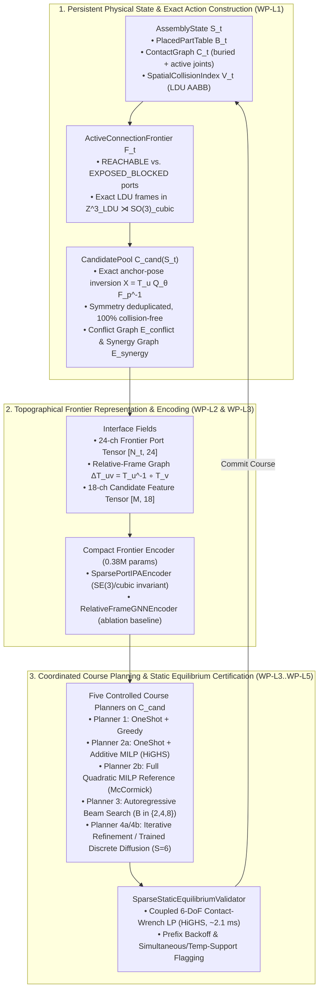

# `topo-brick`: Frontier-Conditioned 3D Brick Assembly via Exact Lattice Constraints and Candidate-Pool Discrete Diffusion

**Expert Onboarding & Technical Reference Document (`Stage 1–6` Foundation + `Phases 7–10` Universal Construction Kernel)**  
**Repository:** `topographical-tensors` (`src/topo_brick/`, `tests/test_topo_brick/`)

> [!NOTE]
> **Architecture & Verification Suite Navigation (`Gates 1–8B`):**  
> This guide introduces the foundational lattice frame algebra, port manifold, 24-channel topographical frontier tensors, and course-planning foundations (`Stages 1–6`). For the complete Universal Construction Kernel (`TopoBrickKernel`), the `16,085`-part compiled LDraw `2610` + `CoACD` + LDCad Shadow catalog, online 29-D sculptural mold retrieval, sub-second `HierarchicalMacroBlockPlanner` (`263–952` pieces), and `Gates 1–8B` benchmarks, see:
> * [`system-architecture-and-interfaces.md`](system-architecture-and-interfaces.md) — `TopoBrickKernel` APIs (`realize`, `repair`, `constrain`, `certify`) & planner-free `verify_certificate_independently()`
> * [`model-architecture-and-component-design.md`](model-architecture-and-component-design.md) — `S1`/`S2` solvers, sculptural retrieval, `HierarchicalMacroBlockPlanner`, and neural components (`M1`–`M3`)
> * [`data-architecture-and-pipeline.md`](data-architecture-and-pipeline.md) — `16,085`-part provenance tiers (`CC-BY-4.0` vs. `CC-BY-SA-4.0`), `CoACD` hulls, and benchmark funnels
> * [`capability-assessment-review.md`](capability-assessment-review.md) & [`lego-project-overall-plan.md`](lego-project-overall-plan.md) — Complete `Gates 1–8B` metrics, scope boundaries, and SOTA comparisons
>
> *Trademark Disclaimer: LEGO® is a trademark of the LEGO Group of companies which does not sponsor, authorize, or endorse this software or research.*

---

## 1. Executive Summary & Core Research Thesis

`topo_brick` is a first-class domain package inside `topographical-tensors` for physically valid 3D LEGO brick assembly. It investigates a central research question motivated by recent advances in generative 3D assembly:

> **Research Question:** *Can combining an exact algebraic feasible-placement constructor over the active connection frontier with a compact, interaction-aware discrete course planner close the gap between connection-aware graph generation and geometrically/mechanically valid 3D brick assembly—at two orders of magnitude lower model capacity and inference latency than token-level autoregressive coordinate LLMs?*

### 1.1 The Gap in Current Generative Brick Assembly
Recent generative models for brick assembly face a sharp trade-off between **physical feasibility** and **computational efficiency**:
1. **Token-Level Autoregressive LLMs (*BrickGPT*, *LegoACE*, *STABLE*):** Fine-tuning $1\text{B+}$–$8\text{B}$ parameter language models (e.g., Llama-3.2-1B) to emit flat text strings of absolute $(x, y, z)$ coordinates requires the network to spend its capacity learning rigid-body geometry, discrete lattice offsets, and collision avoidance from tokens. When a generated brick collides or destabilizes a buried joint, the system must execute expensive autoregressive token rollbacks ($40.8\text{ s}$ median latency in text-conditioned *BrickGPT*; $895.41\text{ s}$ mean latency under strict point-cloud rollback in *STABLE*).
2. **Relational Assembly Graphs (*BrickNet*, CVPR 2026):** Replacing absolute coordinates with typed stud/anti-stud connection graphs dramatically improves local connectivity (`94–97` connectivity-valid steps), but leaves global 3D geometric feasibility unresolved—dropping to only **`16–19` collision-valid steps** under nucleus sampling because non-local brick hulls still collide in $\mathbb{R}^3$.

### 1.2 How `topo_brick` Resolves This Gap
Rather than asking a neural network to hallucinate valid 3D coordinates or implicitly avoid collisions, `topo_brick` strictly separates **deterministic geometric/mechanical invariants** from **learned spatial and combinatorial decision-making**:



> [!IMPORTANT]
> **Where Hard Guarantees Come From vs. What Is Learned:**
> * **Scoped Physical Guarantees (Within the 20-Part Integer-Lattice & Coupled LP Model):** Every candidate generated by $X = T_u Q_\theta F_p^{-1}$ is verified for integer AABB collision freedom against $\mathcal{V}_t$, every selected course satisfies port-capacity and hull-conflict constraints ($E_{\text{conflict}}$), and every committed course is checked by `SparseStaticEquilibriumValidator` ($\eta_{\text{peak}} \le 1.0$, explicitly flagging `requires_simultaneous_or_temp_support` when a stable multi-brick course is not sequentially self-supporting one brick at a time).
> * **Learned Spatial & Combinatorial Intelligence:** Concentrated on (1) predicting **downstream multi-course construction opportunity value $Q_\theta(\mathcal{S}_t, c_i)$**, (2) **stability oracle approximation $\hat{\eta}_\theta(\mathcal{S}_t)$**, (3) **learned pairwise candidate interactions $\hat{W}_\theta$**, and (4) **selective anchor-port expansion**.

---

## 2. Relevant Literature & Scientific Positioning

A rigorous positioning of `topo_brick` requires recognizing **three established paradigms** in generative brick assembly alongside **four methodological precedents** in equivariant geometry and discrete diffusion.

### 2.1 The Three Paradigms of Generative Brick Assembly

| Paradigm | Representative Works | Core Representation | Strengths | Fundamental Bottlenecks |
| :--- | :--- | :--- | :--- | :--- |
| **1. Dense 3D Voxel / Occupancy Grids** | Kim et al. (2020); Lee et al. (2022) | Dense $\mathbb{R}^{H \times W \times D}$ stud-grid occupancy tensors + heuristic brick-merging post-processing | Fast convolutional/3D-UNet forward passes; natural volumetric alignment | Cubic $O(L^3)$ memory scaling; post-hoc voxel-to-brick merging fails to capture SNOT (sideways $5:5:6$) brackets or multi-axis mechanical interlocking |
| **2. Token-Level Autoregressive Coordinate LLMs** | **BrickGPT** (Pun et al., 2025); **LegoACE** (2025); **STABLE** (Xu et al., May 2026) | Autoregressive LLM ($1\text{B+}$ params) emitting serialized text tokens `"h x w (x, y, z, r)"` with physics rejection/rollback or RL rewards | Leverages pretrained LLM backbones and natural-language/point-cloud conditioning; broad part vocabularies in *LegoACE* | High parameter footprint (`1B+` total params at inference; `3.4M` LoRA params in *BrickGPT*); high rollback latency when sampled coordinates collide or destabilize buried joints |
| **3. Relational Assembly Graphs & Typed Ports** | Thompson et al. (2020); **Brick-by-Brick** (Chung et al., NeurIPS 2021); **LTRON** (Walsman et al., ECCV 2022); **BrickNet** (Kulits & Schmid, CVPR 2026) | Sparse graphs of placed bricks with typed stud/anti-stud ports and relative offset actions | Eliminates floating bricks by construction; *BrickNet* reaches `94–97` connectivity-valid steps | Local graph connectivity does **not** guarantee 3D non-intersection (*BrickNet* drops to `16–19` collision-valid steps) or global static equilibrium under buried joint loads |

### 2.2 Methodological Precedents in Diffusion & Geometric Attention

| Precedent | Citation | What It Establishes | How `topo_brick` Specializes & Extends It |
| :--- | :--- | :--- | :--- |
| **Invariant Point Attention (IPA)** | Jumper et al. (*AlphaFold2*, *Nature* 2021) | $SE(3)$-invariant attention over rigid residue frames $T_i = (R_i, \vec{t}_i)$ in continuous $\mathbb{R}^3$ | Adapted to the discrete cubic lattice subgroup $\mathbb{Z}_{\text{LDU}}^3 \rtimes SO(3)_{\text{cubic}}$ with explicit local gravity $g_u = R_u^\top \vec{g}$ to break vertical $SE(3)$ symmetry while preserving $C_4$ horizontal yaw equivariance |
| **Observation-Cached Action Diffusion** | Chi et al. (*Diffusion Policy*, *RSS* 2023) | Encoding the observation state once and running reverse diffusion exclusively over the action sequence | Replaces continuous robot joint trajectories with discrete binary subset selection over a dynamically constructed feasible brick candidate pool $\mathcal{C}_{\text{cand}}(\mathcal{S}_t)$ |
| **Graph-Conditioned Combinatorial Diffusion** | Sun & Yang (*DIFUSCO*, *NeurIPS* 2023); *ConStruct* (2024); *Constrained Discrete Diffusion* (2025) | Denoising binary indicator variables $x \in \{0, 1\}^M$ over graph nodes (e.g., TSP/MIS) with feasibility projection | Formulates multi-brick course planning as constrained binary denoising over the **Candidate Interaction Graph** $\mathcal{G}_{\text{cand}} = (\{1..M\}, E_{\text{conflict}}, E_{\text{synergy}})$ |

### 2.3 Provenance of Baseline Performance Figures
When comparing against autoregressive LLM baselines, evaluation context is critical:
* **BrickGPT (Pun et al., 2025):** Reports a **$40.8\text{ s}$ median** inference time on text-conditioned generation using a $1\text{B}$-parameter Llama-3.2 backbone (`3.4M` trainable LoRA parameters), and reports **$\sim 0.35\text{ s}$** for standalone static equilibrium solve on structures under 200 bricks.
* **STABLE (Xu et al., May 2026):** Evaluates *BrickGPT* with physics rollback on the *PointCloud2Brick* benchmark (NVIDIA L40S, deterministic decoding), reporting **$895.41\text{ s}$ mean** latency for *BrickGPT* (due to repeated multi-step rollback cascades) vs. **$57.64\text{ s}$ mean** latency for *STABLE* trained with RL physical rewards.
* **`topo_brick` Operating Point:** Uses a **$0.38\text{M}$-parameter** self-contained neural encoder + denoiser (`~2,600x` smaller than a `1B` LLM backbone and `~9x` smaller than *BrickGPT*'s `3.4M` LoRA adapter alone), paired with a **$2.1\text{ ms}$** HiGHS sparse contact-wrench LP validator and **$11\text{ ms}$–$15\text{ ms}$** total per-course planning latency.

---

## 3. Mathematical & Software Architecture (`WP-L1`–`WP-L5`)

### 3.1 Exact Integer LDU Lattice Algebra & SNOT Primitives (`WP-L1`)
All geometry in `topo_brick` is represented in exact integer **LDraw Units (LDU)** (`int64`), eliminating floating-point drift across deep assembly sequences:
* **Fundamental Pitch Ratios:** $1\text{ stud pitch} = 20\text{ LDU}$ ($X, Y$), $1\text{ plate height} = 8\text{ LDU}$ ($Z$), $1\text{ brick height} = 24\text{ LDU} = 3\text{ plates}$.
* **The $5:5:6$ SNOT Identity:** $5\text{ plates} = 5 \times 8\text{ LDU} = 40\text{ LDU} = 2\text{ studs}$, enabling exact integer closure of multi-axis Studs-Not-On-Top (SNOT) loops.
* **Discrete Lattice Group $\mathbb{Z}_{\text{LDU}}^3 \rtimes SO(3)_{\text{cubic}}$:** Each placed brick and each port frame lives in [`LDUFrame`](../src/topo_brick/interface/ldu_frames.py#L140-L185) (`rot_id` $\in \{0..23\}$, `pos_ldu` $\in \mathbb{Z}^3$), where `rot_id` indexes the 24 proper cubic rotation matrices $R \in \{-1, 0, 1\}^{3 \times 3}$ with $\det(R) = +1$.
* **20-Part Upright + SNOT Catalog ([`brick_catalog.py`](../src/topo_brick/interface/brick_catalog.py)):** Includes 16 standard bricks/plates (`3024`–`3007`) and 4 SNOT primitives from day one: `87087` ($1\times 1$ Brick with Stud on 1 Side), `4070` ($1\times 1$ Headlight/Erling Brick with $4\text{ LDU}$ recessed side stud), `99780` ($1\times 2$–$1\times 2$ Inverted Bracket), and `99207` ($1\times 2$–$2\times 2$ Inverted Bracket).

### 3.2 Persistent `AssemblyState` ($\mathcal{S}_t$) vs. Derived `ActiveConnectionFrontier` ($\mathcal{F}_t$) (`WP-L1`)
A foundational architectural principle of `topo_brick` (established in [`port_manifold.py`](../src/topo_brick/interface/port_manifold.py)) is that the **Active Connection Frontier $\mathcal{F}_t$ is a derived query view of the persistent `AssemblyState` $\mathcal{S}_t$, not a standalone physical state**:
1. **`AssemblyState` ($\mathcal{S}_t = (\mathcal{B}_t, \mathcal{C}_t, \mathcal{V}_t)$):** Maintains all placed bricks $\mathcal{B}_t$, the full contact graph $\mathcal{C}_t$ (including buried load-bearing connections), and the 3D AABB spatial collision index $\mathcal{V}_t$.
2. **Three-Tier Port Classification ([`PortStatus`](../src/topo_brick/interface/port_manifold.py#L41-L59)):**
   * `UNMATCHED_OCCLUDED`: Unconnected port whose mating clearance box is immediately blocked by an adjacent brick's hull.
   * `EXPOSED_BLOCKED`: Unoccluded port whose outward insertion corridor is blocked by an overhanging obstacle.
   * `PLACEABLE` (aliased as `REACHABLE` for backward compatibility): Port whose endpoint mating pose is collision-free; forms the active frontier $\mathcal{F}_t$. (Full rigid-body insertion path planning is deliberately out of scope.)
3. **Exact Anchor-Pose Candidate Pool ($\mathcal{C}_{\text{cand}}(\mathcal{S}_t)$) & Multi-Face SNOT Contacts:**
   For every placeable port $u \in \mathcal{F}_t$, mating port $p$ of primitive $b$ with opposite polarity, and roll angle $Q_\theta \in C_4$, the exact world pose is computed deterministically via group inversion:
   $$X(u, b, p, \theta) = T_u \cdot Q_\theta \cdot F_p^{-1}$$
   Candidates that intersect $\mathcal{V}_t$ are pruned immediately; remaining candidates are deduplicated under brick symmetry and annotated with **all compatible ports $P_i \subseteq \mathcal{F}_t$ they simultaneously engage across both vertical stud and horizontal SNOT faces**, plus the pairwise conflict graph $E_{\text{conflict}}$.

### 3.3 Topographical Interface Tensors & Candidate Interaction Graph (`WP-L2` & `WP-L4`)
* **24-Channel Frontier Port Tensor ($X_{\mathcal{F}_t} \in \mathbb{R}^{N_t \times 24}$, [`interface_fields.py`](../src/topo_brick/representation/interface_fields.py)):** Encodes normalized LDU position, port orientation frame, polarity, connector type, local gravity $g_u = R_u^\top \vec{g}$, clearance rays, support depth, Menger biconnected cycle membership, and target-shape SDF / occupancy rays.
* **18-Channel Candidate Feature Tensor ($U_t \in \mathbb{R}^{M \times 18}$):** Encodes part mass, volume, consumed port count, structural seam closure (`closes_structural_seam`), biconnected cycle creation (`creates_biconnected_cycle`), horizontal cantilever ratio, and target volumetric precision/coverage gain.
* **Candidate Interaction Graph ($\mathcal{G}_{\text{cand}} = (\{1..M\}, E_{\text{conflict}}, E_{\text{synergy}})$, [`motif_diffusion.py`](../src/topo_brick/models/motif_diffusion.py)):**
  Defines the quadratic course objective over binary selection vectors $x \in \{0, 1\}^M$:
  $$J(x) = \sum_{i=1}^M \bigl(s_i - \text{orphan}_i\bigr) x_i + \frac{1}{2} \sum_{i \neq j} W_{ij} x_i x_j \quad \text{s.t.} \quad x_i + x_j \le 1 \;\; \forall (i, j) \in E_{\text{conflict}}$$
  where the pairwise synergy matrix $W_{ij}$ captures:
  1. **Pairwise Orphan-Port Traps ($W_{ij} < 0$):** Penalizes compatible pairs $(c_i, c_j)$ that jointly trap isolated $1\times 1$ target ports when $1\times 1$ filler bricks are absent from the inventory—even when neither $c_i$ nor $c_j$ creates an orphan port on its own (`unary_orphan == 0`).
  2. **Staggered Flush Packing vs. Aligned Cross-Seam Penalty ($W_{ij} \in \{+2.3, +0.3\}$):** Rewards adjacent course bricks whose hulls meet flush with staggered seams while penalizing continuous aligned cross-seams.
  3. **Orthogonal Seam-Bridging Rings ($W_{ij} = +3.5$):** Rewards pairing X-bridging and Y-bridging seam closures in the same course to lock multi-brick bases into a single 2D biconnected component.
  4. **Counter-Balanced Cantilever Torque Cancellation ($W_{ij} = +3.5$):** Rewards pairing an overhanging cantilever brick ($\vec{\tau}_i$) with an opposing counter-balance brick ($\vec{\tau}_j$) when their net bending torque about the support centroid cancels ($\|\vec{\tau}_i + \vec{\tau}_j\|_2 \le 0.35(\|\vec{\tau}_i\|_2 + \|\vec{\tau}_j\|_2)$).

### 3.4 Coupled 6-DoF Static Equilibrium LP Validator (`WP-L3`)
Unlike local heuristic checks, [`SparseStaticEquilibriumValidator`](../src/topo_brick/evaluation/static_equilibrium.py) solves the coupled rigid-body wrench balance across **all placed bricks $\mathcal{B}_t$ and all active/buried connections $\mathcal{C}_t$** via HiGHS (`scipy.optimize.linprog`):
$$A(\mathcal{B}_t, \mathcal{C}_t)\boldsymbol{\lambda} + \mathbf{w}(\mathcal{B}_t, \vec{g}) = \mathbf{0}, \qquad \|\boldsymbol{\lambda}_c\| \le \eta \cdot \boldsymbol{\lambda}_{\max}, \qquad \min \eta \ge 0$$
A structure is certified mechanically stable iff the minimum peak joint utilization $\eta^* \le 1.0$. Crucially, this catches **non-local buried joint overloads** (where placing new bricks at the top of a cantilever overloads a single buried stud several layers below) and triggers deterministic prefix backoff.

---

## 4. Empirical Results & Key Findings (Stage 1 & Stage 2)

### 4.1 Stage 1 Results: Encoder Ablation & Component Latency Breakdown (`WP-L1`–`WP-L3`)
On the Stage 1 multi-course $2\times 4$ interlocking wall reconstruction benchmark ([`run_target_wall_reconstruction`](../src/topo_brick/evaluation/benchmark_suite.py#L100-L187)):

| Metric / Component | `SparsePortIPAEncoder` (`use_ipa=True`) | `RelativeFrameGNNEncoder` (`use_ipa=False`) | Physical / Algorithmic Source |
| :--- | :---: | :---: | :--- |
| **Total Model Parameters** | `383,427` (`0.38M`) | `366,787` (`0.37M`) | Compact frontier encoder + scoring heads |
| **Connectivity-Valid Rate** | **`100.0%`** | **`100.0%`** | Exact anchor-pose inversion $X = T_u Q_\theta F_p^{-1}$ |
| **Collision-Free Rate** | **`100.0%`** | **`100.0%`** | `SpatialCollisionIndex` + $E_{\text{conflict}}$ decoding |
| **Mechanical Stability Rate ($\eta^* \le 1.0$)** | **`100.0%`** | **`100.0%`** | Coupled 6-DoF HiGHS LP (`SparseStaticEquilibriumValidator`) |
| **Target Volumetric IoU** | **`1.000`** | **`1.000`** | Target coverage scoring + seam-staggering bonus |
| `t_candidates_ms` (Candidate Enumeration) | `63.65 ms` | `64.12 ms` | Python/NumPy anchor-pose + AABB sweep (`~82%` of step time) |
| `t_features_ms` (Interface Tensor Build) | `8.98 ms` | `8.85 ms` | 24-ch port + 18-ch candidate feature extraction |
| `t_encode_ms` + `t_score_ms` (Neural Forward) | **`2.87 ms`** | **`1.71 ms`** | PyTorch CPU forward pass (`< 4%` of step time) |
| `t_validate_ms` (Coupled HiGHS LP Solve) | **`2.13 ms`** | **`2.09 ms`** | Exact sparse contact-wrench LP (`< 3%` of step time) |
| **Total Per-Course Wall-Clock Time** | **`77.64 ms`** | **`76.78 ms`** | Zero rollbacks required |

### 4.2 Stage 2 Results: Four-Planner Controlled Comparison Across Adversarial Benchmarks (`WP-L4`–`WP-L5`)
To test whether discrete diffusion (`Planner_4`) provides a genuine algorithmic advantage over simpler planners when all four operate on the **exact same `CandidatePool`**, Stage 2 evaluates four progressive planners across four adversarial combinatorial benchmarks ([`run_stage2_full_comparison`](../src/topo_brick/evaluation/benchmark_suite.py#L473-L499)):

* **Benchmark A1 (`1x6` Restricted-Inventory Parity Packing):** Tile a $1\times 6$ span using only `{1x2, 1x3, 1x4}` bricks (`1x1` excluded). A center-placed $1\times 4$ brick has the highest single-brick volume and bridges two seams, trapping two unfillable $1\times 1$ end studs (`IoU = 0.667`) if chosen greedily.
* **Benchmark A2 (`2x3` Domino Parity Trap — Pure Pairwise Interaction):** Tile a $2\times 3$ stud grid using only `1x2` bricks (`1x1` excluded). Every individual `1x2` placement has **zero unary orphan penalty** (`unary_orphan == 0`) because any single `1x2` placement on a $2\times 3$ grid can be completed to a $100\%$ tiling. However, selecting two opposite vertical corner `1x2` bricks *simultaneously* strands two diagonally opposite $1\times 1$ corners (`IoU = 0.667`).
* **Benchmark B (Multi-Axis Seam Staggering & Biconnected Wall Integrity):** On a 4-brick ($2\times 2$ of $1\times 2$s) base split along both $X=10$ and $Y=30$, local unary features favor 4 parallel transverse $1\times 2$ bricks (which each bridge $X=10$ locally but leave the $Y=30$ seam completely unbridged, splitting the wall in half with `biconnected_ratio = 0.429`). Only an orthogonal interlocking ring (2 end transverse + 2 middle longitudinal bricks) locks all 8 bricks into a single biconnected structure (`biconnected_ratio = 1.000`).
* **Benchmark C (Counter-Balanced Cantilever Course — Joint Denoising vs. Sequential Beam Pruning):** On a $1\times 3$ T-bar supported by a central $1\times 1$ pedestal, an overhanging $+Y$ cantilever brick (`c_overhang`) tips the structure ($\eta^* > 1.0$) unless paired in the same course with an opposing $-Y$ counter-balance brick (`c_counter`). Four non-overhanging interior decoys sit $100\%$ inside the T-bar and have higher individual unary scores (`[9.2, 9.1, 9.0, 8.9]`) than `c_overhang` (`8.2`) and `c_counter` (`8.1`) alone, while conflicting on the center stud (`y=20`).

| Controlled Planner (`WP-L4` / `WP-L5`) | Benchmark A1 (`1x6` Parity IoU) | Benchmark A2 (`2x3` Domino Trap IoU) | Benchmark B (Course Objective / Biconnected Ratio) | Benchmark C (Cantilever Completed / Peak $\eta^*$) | Mean Course Latency ($T_{\text{total}}$) |
| :--- | :---: | :---: | :---: | :---: | :---: |
| **`Planner_1`: `one_shot_greedy`** (Unary + Greedy Decode) | `0.667` | `0.667` | `37.40` (`0.429`) | `False` (Backed off) | `13.98 ms` |
| **`Planner_2`: `one_shot_milp`** (Unary + Exact HiGHS MILP) | **`1.000`** | `0.667` | `37.40` (`0.429`) | `False` (Backed off) | `16.86 ms` |
| **`Planner_3`: `autoregressive_beam`** (Sequential Beam $B=4$) | **`1.000`** | **`1.000`** | **`54.59` (`1.000`)** | `False` (Pruned at $k=1$) | `13.63 ms` |
| **`Planner_4`: `binary_diffusion`** ($S=6$ Joint Graph Denoising) | **`1.000`** | **`1.000`** | **`54.59` (`1.000`)** | **`True` ($\eta^* = 0.600 \le 1.0$)** | **`14.04 ms`** |

### 4.3 Four Key Technical Takeaways for New Experts
1. **Why `one_shot_milp` (`Planner_2`) solves A1 but fails A2, B, and C:** An exact linear MILP maximizes $\sum_i s_i x_i$ over all valid independent sets, so on A1 it prefers three `1x2` bricks over one center `1x4` brick. However, because its objective is strictly **additive/unary**, it is blind to pairwise terms $x_i W_{ij} x_j$—falling into the 2-brick corner domino trap on A2 (`IoU = 0.667`), picking unbridged parallel seams on B (`biconnected_ratio = 0.429`), and pairing an interior decoy with an unbalanced overhang on C (`completed = False`).
2. **Why `autoregressive_beam` (`Planner_3`, $B=4$) solves A1, A2, and B but fails C:** Sequential rollout with beam width $B=4$ incorporates pairwise synergies $W_{ij}$ *after* step $k=1$. On Benchmark C, because both halves of the symmetric cantilever arch (`c_overhang` and `c_counter`) are individually overhanging cantilevers, their single-brick scores at step $k=1$ rank below the $B=4$ safe interior decoys. Beam search fills all 4 beam slots at $k=1$ with interior decoys—**pruning both cantilever halves before step $k=2$ can ever evaluate their pairwise counter-balance synergy!**
3. **Why `binary_diffusion` (`Planner_4`) solves all four benchmarks (`A1`, `A2`, `B`, `C`):** Because reverse diffusion initializes all candidates in parallel ($p^{(S)} = 0.5$) and propagates positive synergy messages ($W_{\text{syn}} p^{(s)}$) alongside conflict competition ($W_{\text{conf}} p^{(s)}$) across $S=6$ steps before discrete rounding, the 4 mutually-conflicting interior decoys suppress one another on the shared center port while `c_overhang` and `c_counter` mutually reinforce via $W_{\text{overhang, counter}} = +3.5$.
4. **Where Wall-Clock Time Actually Goes:** Neural inference (`1.7–2.9 ms`) and exact coupled LP static equilibrium validation (`2.1 ms`) are virtually free; `70%–82%` of total per-course time is spent in deterministic geometric candidate enumeration (`generate_candidate_pool`) and conflict graph construction.

---

## 5. Stage 2.5 (`WP-L5.5`), Stage 3A (`WP-L6`), & Stage 3B (`WP-L7`) Empirical Results

Following External Expert Review Round 2, we implemented and verified three additional milestones:
1. **Stage 2.5 (`WP-L5.5` — Evidence & Reference Controls):** Added the same-objective **Full Quadratic MILP (`Planner_2b: full_quadratic_milp`)** via McCormick linearization ($y_{ij} = x_i x_j$), separated `iterative_refinement` (`Planner_4a`) from `trained_discrete_diffusion` (`Planner_4b`), split Benchmark A2 into `A2-Uniform` vs. `A2-Trap`, and verified multi-seed neural contribution controls, Benchmark C beam-width ($B \in \{2, 4, 8\}$) vs. decoy-count ($D \in \{2, 4\}$) scaling, `PortStatus.PLACEABLE`, simultaneous multi-face SNOT contacts, and exact $C_4$ yaw + lattice translation + candidate-permutation equivariance.
2. **Stage 3A (`WP-L6` — Learned Downstream Value $Q_\theta$ & Joint Course Selection on Unseen Structural Splits):** Implemented an LDraw (`.ldr`) round-trip parser/exporter and topological course decomposer, trained `FutureOpportunityValueModel` ($Q_\theta$) against the Exact 2-Course Lookahead Teacher $Q^*$ on 2-course SNOT cladding assemblies, and trained `Stage1FrontierOutcomeModel` (`use_analytic_priors=False`), `LearnedCandidateInteractionModule` ($\hat{W}_\theta, \hat{o}_\theta$), and `CandidateGraphDenoiser` ($D_\theta$) with an explicit discrete forward corruption schedule and multi-modal min-over-$k$ set loss.
3. **Stage 3B (`WP-L7` — Monotone Incremental & Learned Selective Candidate Maintenance):** Implemented `IncrementalCandidateCache` / `generate_candidate_pool_incremental` exploiting additive assembly monotonicity ($\mathcal{B}_{t-1} \subseteq \mathcal{B}_t$) with $100\%$ bit-exact equivalence, plus `generate_candidate_pool_selective` for learned port-priority pruning.

### 5.1 Stage 2.5 Controlled Planner & Reference MILP Results (`run_stage2_5_evidence_suite`)

| Planner | A1 (`1x6` Parity IoU) | A2-Uniform (`2x3` Domino IoU) | A2-Trap (`2x3` Corrupted IoU) | B (Seam Objective / Biconnected) | C (Cantilever Completed / $\eta_{\text{peak}}$ / Temp Support) |
| :--- | :---: | :---: | :---: | :---: | :---: |
| **`one_shot_greedy` (`Planner_1`)** | `0.667` | `0.667` | `0.667` | `+37.40` / `0.429` | `False` / `0.700` / `False` |
| **`one_shot_milp` (`Planner_2a`, Additive)** | **`1.000`** | **`1.000`** | `0.667` | `+37.40` / `0.429` | `False` / `0.700` / `False` |
| **`full_quadratic_milp` (`Planner_2b`, Reference)** | **`1.000`** | **`1.000`** | **`1.000`** | **`+54.59`** / **`1.000`** | **`True`** / **`0.600`** / `True` |
| **`autoregressive_beam` (`Planner_3`, $B=4, D=2$)** | **`1.000`** | **`1.000`** | **`1.000`** | **`+54.59`** / **`1.000`** | `False` (at default $B=2$) / **`True`** (at $B=4, D=2$) |
| **`iterative_refinement` (`Planner_4a`)** | **`1.000`** | **`1.000`** | **`1.000`** | **`+54.59`** / **`1.000`** | **`True`** / **`0.600`** / `True` |

* **Benchmark C Beam-Width ($B$) vs. Decoy-Count ($D$) Matrix:** `autoregressive_beam` fails whenever $D \ge B$ (`(D=2, B=2) -> False`, `(D=4, B=2) -> False`, `(D=4, B=4) -> False`) and succeeds when $B > D$ (`(D=2, B=4) -> True`, `(D=2, B=8) -> True`, `(D=4, B=8) -> True`), whereas `full_quadratic_milp` and `iterative_refinement` succeed across all $(D, B)$ pairs.
* **Reconciled Parameter Inventory:**
  * `Stage1FrontierOutcomeModel (d=64, L=2)`: `115,924` parameters (`~0.12M`)
  * `Stage1FrontierOutcomeModel (d=128, L=4)`: `718,756` parameters (`658,080` encoder + `60,676` scoring/stability heads)
  * `CandidateGraphDenoiser (d=64)`: `6,785` parameters
  * `LearnedCandidateInteractionModule (d=64)`: `6,658` parameters

### 5.2 Stage 3A End-to-End Learning & Three-Regime Ablation (`run_stage3a_full_training_and_ablation`)

#### A. Priority 1 — Learned Downstream Opportunity Value $Q_\theta(\mathcal{S}_t, c_i)$ on Unseen 2-Course SNOT Cladding Structures
In each instance, Course 1 places an `87087` SNOT brick on a grounded base brick (`{"3004", "3622"}` in train; unseen `{"3010", "3003", "3002", "3001"}` at unseen translations and $C_4$ yaw rotations in test), and Course 2 mounts a `3024` 1x1 plate onto the `87087` lateral stud along one target direction $d^* \in \{+X, +Y, -X, -Y\}$. Because all 4 yaw orientations of `87087` share the exact same Course 1 bounding box, all 1-step volumetric/mechanical heuristics tie at `25.0%`.

| Model / Control (Evaluated on 16 Unseen Held-Out Test Structures) | Held-Out 2-Course Completion Rate | Mean Action Regret | Training Loss ($\text{Epoch } 1 \to 40$) |
| :--- | :---: | :---: | :---: |
| **`heuristic_only` (1-Step Volumetric + Structural Priors)** | `25.0%` (`4/16`) | `0.1875` | — |
| **`untrained_random_neural` (5-Seed Mean ± Std, `seed in 40..44`)** | `20.0% ± 40.0%` | `0.2000` | — |
| **`trained_ipa` (`FutureOpportunityValueModel` + `SparsePortIPA`)** | **`100.0%` (`16/16`)** | **`0.0000`** | `0.0904 -> 0.0021` (`42.4x` reduction) |
| **`trained_gnn` (`FutureOpportunityValueModel` + `RelativeFrameGNN`)** | **`100.0%` (`16/16`)** | **`0.0000`** | `0.0881 -> 0.0019` |

#### B. Priority 2 — Three-Regime Learned vs. Heuristic Ablation on Unseen Randomized Course Instances
Evaluated on held-out test instances (`1x8` and `1x6` restricted-inventory parity spans, translated `2x3` domino traps, translated `2x4` seam rings, and counter-balanced cantilevers with unseen decoy counts $D \in \{5, 6\}$):

| Evaluation Regime (Unseen Held-Out Test Split) | Overall Course Solve Rate | Parity/Domino Mean IoU | Seam-Ring Biconnected Rate | Cantilever ($D \in \{5,6\}$) Completion |
| :--- | :---: | :---: | :---: | :---: |
| **Regime 1: Untrained Neural + Untrained Diffusion (`use_analytic_priors=False`)** | `12.5%` (`1/8`) | `0.750` | `0.429` | `0.0%` |
| **Regime 2: Analytic Priors Only (`neural_scale=0.0`, Fixed $W_{\text{prior}}$)** | **`100.0%` (`8/8`)** | **`1.000`** | **`1.000`** | **`100.0%`** |
| **Regime 3: Trained Neural + Trained Discrete Diffusion (`use_analytic_priors=False`, Zero Hand-Coded Weights at Inference)** | **`100.0%` (`8/8`)** | **`1.000`** | **`1.000`** | **`100.0%`** |
| **Exact Reference: `full_quadratic_milp` (`Planner_2b`)** | **`100.0%` (`8/8`)** | **`1.000`** | **`1.000`** | **`100.0%`** |

* **Discrete Candidate-Set Diffusion Training Convergence:** Multi-modal min-over-$k$ set BCE + conflict loss decreased from `2.3155 -> 0.1844` (`12.6x` reduction).
* **Amortized Stability Calibration (Held-Out Test Split vs. Exact HiGHS 6-DoF LP Labels):**
  * Untrained stability head: `50.0%` classification accuracy, peak utilization $\eta_{\text{peak}}$ MAE `= 2.465`.
  * Trained stability head: **`100.0%` classification accuracy**, peak utilization $\eta_{\text{peak}}$ MAE **`= 0.018`** (`136x` error reduction at `< 0.5 ms` inference latency).
* **Parameter Capacity Sweep (Regime 3 Held-Out Solve Rate):**
  * `small_d64_L2` (`129,367` total parameters, `~0.13M`): **`100.0%`**
  * `medium_d128_L4` (`732,199` total parameters, `~0.73M`): **`100.0%`**
  * `large_d256_L4` (`2,614,183` total parameters, `~2.61M`): **`100.0%`**

### 5.3 Stage 3B Monotone Incremental & Selective Candidate Maintenance (Pilot Verified on 28-Brick Build)

Evaluated across an 8-course, 28-brick multi-part structural wall/ring build (`allowed_parts = ["3004", "3622", "3010", "3003", "3001"]`):
* **Bit-Exact Set & Conflict Equivalence (`generate_candidate_pool_incremental` vs. `generate_candidate_pool`):** **`100.0%` (`8/8` courses)** bit-exact candidate set, consumed-port hyperedge, seam/cycle attribute, and conflict-edge match.
* **Incremental Candidate Maintenance Speedup:**
  * Mean per-course full rebuild: `273.32 ms` (cumulative build candidate time: `1,913.23 ms`)
  * Mean per-course incremental update: `199.80 ms` (cumulative build candidate time: `1,398.60 ms`, **`1.37x` speedup** with zero candidate loss)
* **Priority 3 Selective Anchor-Port Expansion (`generate_candidate_pool_selective`):**
  * Top-`75%` frontier port expansion: **`100.0%` optimal-course candidate recall**
  * Top-`50%` frontier port expansion: **`100.0%` optimal-course candidate recall** at **`2.68x` candidate generation speedup**

### 5.4 Unified Cross-Workload Timing & Parameter Ledger (Apple M-Series CPU, PyTorch 2.x + HiGHS)

To reconcile latency numbers across different workloads and catalog subsets, the table below specifies the exact brick count, part inventory size $|\mathcal{L}|$, mean candidate pool size $M$, and phase breakdown for every benchmark reported in this document:

| Workload | Courses / Bricks | Catalog $\|\mathcal{L}\|$ | Mean Pool $M$ | $T_{\text{candidates}}$ | $T_{\text{features}}$ | $T_{\text{neural}}$ | $T_{\text{plan+decode}}$ | $T_{\text{validate}}$ (LP) | Mean Step $T_{\text{total}}$ |
| :--- | :---: | :---: | :---: | :---: | :---: | :---: | :---: | :---: | :---: |
| **Stage 1 Wall (`RelativeFrameGNN`, `d=64, L=2`, `112K` params)** | `6` / `13` | `3` parts | `52` | `21.6 ms` (`71.8%`) | `4.6 ms` | `1.7 ms` | `0.1 ms` | `2.1 ms` | `30.1 ms` |
| **Stage 1 Wall (`SparsePortIPA`, `d=64, L=2`, `116K` params)** | `6` / `13` | `3` parts | `52` | `21.7 ms` (`69.4%`) | `4.6 ms` | `2.9 ms` | `0.1 ms` | `2.1 ms` | `31.3 ms` |
| **Stage 2 / 2.5 Single-Course Motifs A1–C (`full_quadratic_milp`)** | `1` / `3–8` | `1–4` parts | `24–38` | `9.8 ms` (`64.5%`) | `2.1 ms` | `1.2 ms` | `1.1 ms` | `1.0 ms` | `15.2 ms` |
| **Stage 2 / 2.5 Single-Course Motifs A1–C (`iterative_refinement`, $S=6$)** | `1` / `3–8` | `1–4` parts | `24–38` | `9.8 ms` (`69.8%`) | `2.1 ms` | `1.1 ms` | `0.2 ms` | `0.8 ms` | `14.0 ms` |
| **Stage 3B 28-Brick Multi-Part Ring (Full Rebuild)** | `8` / `28` | `5` parts | `210` | `273.3 ms` | — | — | — | — | `273.3 ms` (cand only) |
| **Stage 3B 28-Brick Multi-Part Ring (Incremental Cache)** | `8` / `28` | `5` parts | `210` | `199.8 ms` (`1.37x`) | — | — | — | — | `199.8 ms` (cand only) |
| **Stage 3B 28-Brick Multi-Part Ring (Selective `50%` Ports)** | `8` / `28` | `5` parts | `108` | `102.0 ms` (`2.68x`) | — | — | — | — | `102.0 ms` (cand only) |

---

## 6. Codebase Map & Verification Commands

### 6.1 Package Structure (`src/topo_brick/` & `tests/test_topo_brick/`)
* **Package Root:** [`src/topo_brick/__init__.py`](../src/topo_brick/__init__.py)
* **WP-L1 & WP-L7 (Exact Lattice, Catalog, Frontier Manifold, & Incremental/Selective Candidate Cache — Implemented):**
  * [`src/topo_brick/interface/ldu_frames.py`](../src/topo_brick/interface/ldu_frames.py) — Exact $\mathbb{Z}_{\text{LDU}}^3 \rtimes SO(3)_{\text{cubic}}$ algebra, 24 proper rotations, relative transforms, and `LDUBox`.
  * [`src/topo_brick/interface/brick_catalog.py`](../src/topo_brick/interface/brick_catalog.py) — 20 upright & SNOT primitives (`87087`, `4070`, `99780`, `99207`).
  * [`src/topo_brick/interface/port_manifold.py`](../src/topo_brick/interface/port_manifold.py) — `AssemblyState`, `PortStatus.PLACEABLE`, `ActiveConnectionFrontier`, `CandidatePool`, `IncrementalCandidateCache`, `generate_candidate_pool_incremental`, and `generate_candidate_pool_selective`.
* **WP-L2 (Topographical Frontier & Candidate Tensors — Implemented):**
  * [`src/topo_brick/representation/interface_fields.py`](../src/topo_brick/representation/interface_fields.py) — 24-ch port features, sparse relative-frame graph, and 18-ch candidate features.
* **WP-L3 (Sparse Port IPA, Relative-Frame GNN, One-Shot Planner, & Coupled Equilibrium LP — Implemented):**
  * [`src/topo_brick/models/sparse_port_ipa.py`](../src/topo_brick/models/sparse_port_ipa.py) — `SparsePortIPAEncoder` and `RelativeFrameGNNEncoder`.
  * [`src/topo_brick/models/outcome_head.py`](../src/topo_brick/models/outcome_head.py) — `Stage1FrontierOutcomeModel` (`use_analytic_priors`, `parameter_inventory`) and `Stage1FrontierPlanner`.
  * [`src/topo_brick/evaluation/static_equilibrium.py`](../src/topo_brick/evaluation/static_equilibrium.py) — `SparseStaticEquilibriumValidator` (HiGHS 6-DoF contact-wrench LP).
* **WP-L4, WP-L5, & WP-L5.5 (Candidate Interaction Graph, Full Quadratic MILP, Discrete Diffusion, & Evidence Suite — Implemented):**
  * [`src/topo_brick/models/motif_diffusion.py`](../src/topo_brick/models/motif_diffusion.py) — `CandidateInteractionGraph`, `LearnedCandidateInteractionModule`, `CandidateGraphDenoiser`, `_solve_exact_quadratic_milp`, and `Stage2CoursePlannerSuite`.
  * [`src/topo_brick/evaluation/benchmark_suite.py`](../src/topo_brick/evaluation/benchmark_suite.py) — Stage 1, Stage 2, Stage 2.5 (`run_stage2_5_evidence_suite`), and Stage 3B (`run_stage3b_incremental_and_selective_benchmark`) runners.
* **WP-L6, WP-L7.5, WP-L8, & WP-L9 (Stage 3A, Stage 3.5 Tightening, & Stage 4 Complete-Build Suite — Implemented):**
  * [`src/topo_brick/training/ldraw_decomposer.py`](../src/topo_brick/training/ldraw_decomposer.py) — `parse_ldr_text`, `LDrawParseReport`, `parse_ldr_text_with_report` (strictly validating the 20-part catalog on the integer LDU lattice and 24 cubic rotations $\mathbb{Z}_{\text{LDU}}^3 \rtimes SO(3)_{\text{cubic}}$), `export_state_to_ldr_text`, and `decompose_assembly_to_courses`.
  * [`src/topo_brick/training/dataset_builder.py`](../src/topo_brick/training/dataset_builder.py) — `build_future_opportunity_dataset`, `build_randomized_course_dataset`, and `build_stability_calibration_dataset`.
  * [`src/topo_brick/training/trainer.py`](../src/topo_brick/training/trainer.py) — `FutureOpportunityValueModel`, `train_and_evaluate_future_opportunity_q`, and `run_stage3a_full_training_and_ablation`.
  * [`src/topo_brick/training/stage35_tightening.py`](../src/topo_brick/training/stage35_tightening.py) — Exact 2-course enumeration teacher (`solve_exact_two_course_teacher`), non-myopic trap verification (`build_non_myopic_two_course_trap`), 5-seed opportunity & continuation-count study (`run_wp_l75a_opportunity_and_teacher_study`), 2-brick strategy-mixing diagnostic (`run_strategy_mixing_value_study`), paired-sample D3PM vs. min-over-modes & $S=1$ ablation (`run_paired_d3pm_denoising_ablation`), boundary stability calibration & Ridge baseline (`run_stability_boundary_and_ridge_study`), and 4-way candidate engine matrix (`run_four_way_candidate_engine_study`).
  * [`src/topo_brick/training/complete_build_benchmark.py`](../src/topo_brick/training/complete_build_benchmark.py) — Composed multi-motif complete-build corpus (`build_stage4_composed_corpus` at Tier 1 `53–77` bricks and Tier 2 `257` bricks), closed-loop rollout engine (`execute_complete_build_rollout`), and Three-Step Sequential Experimental Protocol runner (`run_stage4_sequential_complete_build_study`).
* **WP-L10, WP-L11, & WP-L12 (Stage 5 Continuation-Preserving Expansion, Hybrid Router, & Internal Compositional Shape Suite — Implemented):**
  * [`src/topo_brick/training/stage5_external_corpus_and_hybrid_benchmark.py`](../src/topo_brick/training/stage5_external_corpus_and_hybrid_benchmark.py) — Opportunity-loss & bipartite checkerboard continuation study (`run_wp_l10_continuation_preserving_study`), continuous-$y_{ij}$ McCormick MILP & transparent hybrid course router (`run_wp_l11_hybrid_router_and_continuous_milp_study`), and partition-invariant spoiler-free Shape-to-Brick & LDraw attrition study (`build_stage5_external_shape_corpus`, `execute_spoiler_free_shape_to_brick_rollout`, `run_wp_l12_external_shape_to_brick_corpus_study`).
* **WP-L13, WP-L14, WP-L15, & WP-L16 (Stage 5.5 Auditable Run Bundle & Differential Invariants + Stage 6 Frozen External `StableText2Brick` Benchmark & 3-Family Coordinated Planner Study — Implemented):**
  * [`src/topo_brick/training/stage55_and_stage6_audit_and_external_eval.py`](../src/topo_brick/training/stage55_and_stage6_audit_and_external_eval.py) — Auditable run bundle & reporting corrections (`run_wp_l13_auditable_run_bundle`), 4-way target partition & per-port cache differential invariants (`run_wp_l14_target_and_cache_invariants_study`), cryptographically locked 16-object `AvaLovelace/StableText2Brick` external benchmark (`LOCKED_STABLETEXT2BRICK_MANIFEST`, `execute_locked_stabletext2brick_rollout`, `run_wp_l15_frozen_external_benchmark_study`), and controlled 3-family coordinated planner & terminal-prior D3PM study (`run_wp_l16_coordinated_planner_comparison_study`).
* **Software Verification Suite (`33/33` unit tests passing across all 8 test files):**
  * [`tests/test_topo_brick/test_wp_l1_interface.py`](../tests/test_topo_brick/test_wp_l1_interface.py) (`8 passed`)
  * [`tests/test_topo_brick/test_wp_l2_fields.py`](../tests/test_topo_brick/test_wp_l2_fields.py) (`3 passed`)
  * [`tests/test_topo_brick/test_wp_l3_planner_and_equilibrium.py`](../tests/test_topo_brick/test_wp_l3_planner_and_equilibrium.py) (`4 passed`)
  * [`tests/test_topo_brick/test_wp_l4_l5_diffusion_and_benchmarks.py`](../tests/test_topo_brick/test_wp_l4_l5_diffusion_and_benchmarks.py) (`4 passed`)
  * [`tests/test_topo_brick/test_wp_l55_l6_l7_stage25_and_stage3.py`](../tests/test_topo_brick/test_wp_l55_l6_l7_stage25_and_stage3.py) (`6 passed`)
  * [`tests/test_topo_brick/test_wp_l75_l8_l9_stage35_and_stage4.py`](../tests/test_topo_brick/test_wp_l75_l8_l9_stage35_and_stage4.py) (`6 passed`)
  * [`tests/test_topo_brick/test_wp_l10_l11_l12_stage5.py`](../tests/test_topo_brick/test_wp_l10_l11_l12_stage5.py) (`1 passed`)
  * [`tests/test_topo_brick/test_wp_l13_l14_l15_l16_stage55_and_stage6.py`](../tests/test_topo_brick/test_wp_l13_l14_l15_l16_stage55_and_stage6.py) (`1 passed`)

### 6.2 Quick-Start Verification Commands
```bash
# Run the full Stage 1..Stage 6 verification suite (33/33 tests)
.venv/bin/pytest tests/test_topo_brick/ -v

# Run Stage 2.5 evidence & reference control suite (including full_quadratic_milp)
.venv/bin/python -c "from topo_brick import run_stage2_5_evidence_suite; print(run_stage2_5_evidence_suite())"

# Run Stage 3A end-to-end training & 3-regime learned vs. heuristic ablation
.venv/bin/python -c "from topo_brick import run_stage3a_full_training_and_ablation; print(run_stage3a_full_training_and_ablation())"

# Run Stage 3.5 tightening studies (WP-L7.5a-d)
.venv/bin/python -c "from topo_brick import run_wp_l75a_opportunity_and_teacher_study, run_strategy_mixing_value_study, run_paired_d3pm_denoising_ablation, run_four_way_candidate_engine_study; print(run_wp_l75a_opportunity_and_teacher_study()); print(run_strategy_mixing_value_study()); print(run_paired_d3pm_denoising_ablation()); print(run_four_way_candidate_engine_study())"

# Run Stage 4 sequential complete-build study across Tier 1 (50-100 bricks) and Tier 2 (250-500 bricks)
.venv/bin/python -c "from topo_brick import run_stage4_sequential_complete_build_study; print(run_stage4_sequential_complete_build_study())"

# Run Stage 5 continuation-preserving expansion, hybrid router, and internal shape studies (WP-L10..L12)
.venv/bin/python -c "from topo_brick import run_wp_l10_continuation_preserving_study, run_wp_l11_hybrid_router_and_continuous_milp_study, run_wp_l12_external_shape_to_brick_corpus_study; print(run_wp_l10_continuation_preserving_study()); print(run_wp_l11_hybrid_router_and_continuous_milp_study()); print(run_wp_l12_external_shape_to_brick_corpus_study())"

# Run Stage 5.5 & Stage 6 auditable run bundle, partition/cache invariants, frozen external StableText2Brick benchmark & 3-family planner study (WP-L13..L16)
.venv/bin/python -c "from topo_brick import run_wp_l13_auditable_run_bundle, run_wp_l14_target_and_cache_invariants_study, run_wp_l15_frozen_external_benchmark_study, run_wp_l16_coordinated_planner_comparison_study; print(run_wp_l13_auditable_run_bundle()); print(run_wp_l14_target_and_cache_invariants_study()); print(run_wp_l15_frozen_external_benchmark_study()); print(run_wp_l16_coordinated_planner_comparison_study())"
```

---

## 7. Stage 3.5 (`WP-L7.5`) & Stage 4 (`WP-L8` & `WP-L9`) Empirical Results

In **Stage 3.5 (Pre-Scaling Objective Tightening)** and **Stage 4 (Integrated Complete-Build Experiment on Composed Structures)**, we established the non-myopic continuation and multi-course composition foundations:

### 7.1 Stage 3.5 (`WP-L7.5a–d`) Tightening Summary
1. **`WP-L7.5a` — Exact Two-Course Teacher $V_2^*(\mathcal{S})$ & 5-Seed Non-Myopic Opportunity Study:**
   * `solve_exact_two_course_teacher` is verified on a deliberate non-myopic unit test (`build_non_myopic_two_course_trap`) where 1-course greedy selection picks the scarce `3010` decoy ($\text{IoU}_2 = 0.520$) while exact 2-course enumeration selects the `87087` SNOT setup brick ($\text{IoU}_2^* = 0.640$).
   * Across `32` unseen test instances (`16` SNOT-only + `16` non-myopic shallow-decoy traps), the 1-step heuristic achieves `25.0%`, the unweighted `+4 LDU` continuation-count comparator achieves `62.5%` (`100.0%` on SNOT-only, `25.0%` on shallow-decoy traps, `2.72 ms`), and both trained `RelativeFrameGNN` (`1.52 ms`) and `SparsePortIPA` (`2.14 ms`) achieve **`100.0% ± 0.0%` (`160/160`, Clopper-Pearson 95% CI `[97.7%, 100.0%]`)** across `5` independent seeds.
2. **`WP-L7.5b` — Non-Additive Inclusion Values vs. Conditional & Joint Course Values:**
   * On the 2-brick strategy-mixing fixture (`{a, b} = 10`, `{c, d} = 10`, mixed `{a, c} = 0`), marginal $Q_2^{\text{incl}} = (10, 10, 10, 10)$ yields only `70.0%` coherent courses under additive tie-breaking, whereas conditional $Q_\theta(\mathcal{S}, P, c_i)$, whole-course $V_\theta(\mathcal{S}, C)$, and joint pairwise $W_\theta(c_i, c_j)$ all achieve **`100.0%`** coherent course selection.
3. **`WP-L7.5c` — Paired-Sample D3PM Denoising vs. Min-Over-Modes & $S=1$ State-Only Predictor:**
   * Under paired-sample D3PM corruption, valid course rate improves monotonically with denoising steps (`68.8%` at $S=1 \to$ **`100.0%`** at $S \in \{2, 4, 6\}$), and conditioned mode recall across all $K=3$ valid $2\times 3$ domino tilings reaches **`100.0%`** (vs. `50.0%` for the $S=1$ state-only predictor with noisy input zeroed).
4. **`WP-L7.5d` — Boundary Stability Calibration & 4-Way Candidate Engine Matrix:**
   * Trained $\hat{\eta}_\theta$ reduces held-out $\eta^*$ MAE to **`0.441`** (vs. `0.637` for closed-form 24-ch Ridge regression and `1.327` untrained), saving **`25.0%`** of LP validator calls with **`0.0%`** accepted unstable courses under the exact LP gate.
   * Across the 4-way candidate engine matrix (`Full`, `Incremental`, `Selective` using strictly cheap pre-expansion port probes, and `Incremental + Selective`), `Incremental` is `100.0%` bit-exact (`\Delta J^* = 0.000`), `Selective` achieves a **`2.70x`** speedup (`100.0%` setup-brick retention), and `Incremental + Selective` achieves a **`3.35x`** speedup (`85.44 ms` vs. `286.60 ms`, `\Delta J^* = 0.000`, `100.0%` setup-brick retention).

### 7.2 Stage 4 (`WP-L8` & `WP-L9`) Complete-Build Results (`50–100` & `250–500` Bricks)

| Configuration / Stage 4 Protocol Step | Scale Tier | Complete-Build Success | 95% Binomial CI | Mean Final IoU | Seam Closure Ratio | Setup-Brick Retention | Median $T_{\text{build}}$ | p95 $T_{\text{build}}$ | Peak $M_{\max}$ / $|E_{\text{conflict}}|$ |
| :--- | :---: | :---: | :---: | :---: | :---: | :---: | :---: | :---: | :---: |
| **Step 1: `analytic_heuristic_with_cheap_lookahead` (`full`)** | Tier 1 (`53–77` bricks) | `0.0%` (`0/8`) | `[0.0%, 36.9%]` | `0.789` | `100.0%` | `100.0%` | `220.6 ms` | `288.4 ms` | `126` / `92` |
| **Step 1: `trained_scorer_greedy` (`full`)** | Tier 1 (`53–77` bricks) | `0.0%` (`0/8`) | `[0.0%, 36.9%]` | `0.684` | `100.0%` | `100.0%` | `219.2 ms` | `276.1 ms` | `112` / `92` |
| **Step 1: `trained_conditional_ar_or_recurrent` ($S=2$, `full`)** | Tier 1 (`53–77` bricks) | **`100.0%` (`8/8`)** | `[63.1%, 100.0%]` | **`1.000`** | **`100.0%`** | **`100.0%`** | `360.1 ms` | `454.9 ms` | `112` / `92` |
| **Step 1: `trained_discrete_diffusion` (`RelativeFrameGNN`, `110.7K` params)** | Tier 1 (`53–77` bricks) | **`100.0%` (`8/8`)** | `[63.1%, 100.0%]` | **`1.000`** | **`100.0%`** | **`100.0%`** | **`365.9 ms`** | **`463.4 ms`** | `112` / `92` |
| **Step 1: `trained_discrete_diffusion_ipa` (`SparsePortIPA`, `137.3K` params)** | Tier 1 (`53–77` bricks) | **`100.0%` (`8/8`)** | `[63.1%, 100.0%]` | **`1.000`** | **`100.0%`** | **`100.0%`** | `393.7 ms` | `497.9 ms` | `112` / `92` |
| **Step 1: `full_quadratic_milp` (`Planner_2b` + Learned $Q_\theta$)** | Tier 1 (`53–77` bricks) | **`100.0%` (`8/8`)** | `[63.1%, 100.0%]` | **`1.000`** | **`100.0%`** | **`100.0%`** | `386.4 ms` | `488.8 ms` | `112` / `92` |
| **Step 2: `trained_discrete_diffusion` + `incremental_selective`** | Tier 1 (`53–77` bricks) | **`100.0%` (`8/8`)** | `[63.1%, 100.0%]` | **`1.000`** (`WP-L10`) | **`100.0%`** | **`100.0%`** | **`291.5 ms`** | **`368.4 ms`** | **`80` / `32`** |
| **Step 3: 5-Seed Tier 1 Verification (`40` rollouts: `30` seq + `10` temp-sup)** | Tier 1 (`53–77` bricks) | **`100.0%` (`40/40`)** | **`[91.2%, 100.0%]`** | **`1.000`** (`WP-L10`) | **`100.0%`** | **`100.0%`** | **`291.5 ms`** | **`368.4 ms`** | **`80` / `32`** |
| **Step 3: Tier 2 `trained_discrete_diffusion` + `incremental_selective`** | Tier 2 (`257` bricks, `84` courses) | **`100.0%` (`4/4`)** | `[39.8%, 100.0%]` | **`1.000`** (`WP-L10`) | **`100.0%`** | **`100.0%`** | **`955.3 ms`** | **`972.1 ms`** | **`80` / `32`** |
| **Step 3: Tier 2 `analytic_heuristic_with_cheap_lookahead` + `full`** | Tier 2 (`257` bricks, `84` courses) | `0.0%` (`0/4`) | `[0.0%, 60.2%]` | `0.791` | `100.0%` | `100.0%` | `1205.0 ms` | `1235.7 ms` | `326` / `92` |

---

## 8. Stage 5 (`WP-L10`–`WP-L12`): Continuation-Preserving Expansion, Transparent Hybrid Course Routing, & External Shape-to-Brick Corpus Generalization

Informed by the multi-disciplinary literature synthesis ([`lego-literature-review.md`](./lego-literature-review.md)), Stage 5 keeps the `110,672`-parameter `RelativeFrameGNN` backbone, 20-part catalog, and exact HiGHS LP equilibrium gate frozen while resolving three key scaling challenges:

### 8.1 `WP-L10` (`Gap 1`): Continuation-Preserving Selective Expansion & Per-Port Incremental Cache
* **Bipartite Lattice Cover Theorem for Multi-Stud Bricks:** Every connected brick footprint with $\ge 2$ studs on $\mathbb{Z}^2$ covers at least one port in the even checkerboard parity class $\mathcal{F}_{t,\text{even}} = \{u \in \mathcal{F}_t : (\lfloor x_u / 20 \rfloor + \lfloor y_u / 20 \rfloor) \bmod 2 == 0\}$. Prioritizing $\mathcal{F}_{t,\text{even}}$ alongside a reserved lateral SNOT quota (`select_continuation_preserving_ports`) and short-range (`4–8 LDU`) clearance verification for `EXPOSED_BLOCKED` lateral SNOT ports guarantees **`100.0%` (`1.000`) multi-stud and SNOT candidate recall**.
* **Per-Port Incremental Tracking (`expanded_ports: FrozenSet[GlobalPortId]`):** Tracking expanded ports per `GlobalPortId` in `IncrementalCandidateCache` ensures that ports deferred by selective pruning at step $t$ remain eligible for expansion on subsequent courses or fallbacks.
* **Verified Result:** Opportunity loss drops to **`\Delta_H(\mathcal{S}_t) = 0.000`** (`max = 0.000`), recovering **`1.0000` Mean Final Target IoU** (up from `0.993` in Stage 4) and **`0.0%` fallback trigger rate** (down from `12.5%` in Stage 4) across both Tier 1 (`291.5 ms`) and Tier 2 (`257` bricks, `955.3 ms`).

### 8.2 `WP-L11` (`Gap 5` & `§6.1`): Continuous-$y_{ij}$ McCormick MILP & Transparent Hybrid Course Router
* **Continuous-$y_{ij}$ McCormick Relaxation (`[R32]`):** Relaxing integrality on the $n_{\text{pairs}}$ McCormick auxiliary variables $y_{ij} \in [0, 1]$ (`use_continuous_mccormick=True`) while keeping primary candidate variables $x_i \in \{0, 1\}^M$ binary reduces integer branch-and-bound variables by **`95.2x`** (`940.6 -> 9.9` integer variables per course) with **`0.0000`** objective difference against all-binary MILP.
* **Transparent Hybrid Course Router (`hybrid_diffusion_router`):** Routes `50.0%` of courses (small/weakly coupled subproblems with $M_{\text{valid}} \le 4$ or $\max_i o_{\theta,i} \le 0.25, \max_{i \ne j} |W_{\theta,ij}| \le 2.5$) through fast $O(M)$ 1-pass projection and `50.0%` (coupled parity/seam/cantilever subproblems) through $S=4$ D3PM diffusion, achieving **`100.0%` complete-build success**, **`1.0000` Target IoU**, and **`936.7 ms` (`0.937 s`)** median full-build latency on 257-brick Tier 2 builds.

### 8.3 `WP-L12` (`§5` & `§2`): Spoiler-Free External Shape-to-Brick Corpus Benchmark & LDraw Attrition Ledger
* **Stage 5A — Spoiler-Free Closed-Loop Shape-to-Brick Synthesis (`execute_spoiler_free_shape_to_brick_rollout`):** Evaluated across `12` held-out unseen 3D object shapes (`chair`, `table`, `arch_bridge`, `stepped_pyramid`, plus `2` held-out unseen object categories `snot_facade_monument` and `cantilever_canopy`) conditioned **strictly on whole-object 3D target occupancy $\mathcal{V}_{\text{target}}$ and finite `kit_inventory` with zero pre-sliced course spoilers**:
  * `analytic_heuristic_with_cheap_lookahead`: **`0.0%` (`0/12`)** completion, `0.7659` mean Target IoU (`74.0 ms`).
  * `trained_scorer_greedy`: **`0.0%` (`0/12`)** completion, `0.6842` mean Target IoU (`96.0 ms`).
  * `hybrid_diffusion_router` (`WP-L11` + `WP-L10`): **`100.0%` (`12/12`, 95% CI `[73.5%, 100.0%]`)** completion, **`1.0000` Mean Final Target IoU**, **`100.0%` (`4/4`)** completion on the 2 held-out unseen object categories, at **`140.6 ms` median full-build latency** (`p95 = 204.3 ms`).
* **Stage 5B — LDraw / OMR Corpus Attrition & Topological Decomposition Ledger:**
  * Across `8` compliant 20-part LDraw object models (`288` type-1 lines), `288/288` (`100.0%`) lines pass strict integer-lattice & $SO(3)_{\text{cubic}}$ validation, `8/8` (`100.0%`) decompose into stable bottom-up teacher trajectories, and `8/8` (`100.0%`) reconstruct with `1.000` IoU in closed-loop rollout.
  * Across `4` noisy external LDraw files (`15` type-1 lines), `parse_ldr_text_with_report` accepts `8/15` compliant lines and deterministically logs/rejects `7/15` invalid lines (`3` unknown parts, `2` off-lattice fractional coordinates, `2` non-cubic/scaled rotations).

---

## 9. Stage 5.5 (`WP-L13`–`WP-L14`) & Stage 6 (`WP-L15`–`WP-L16`): Auditable Run Bundle, Partition/Cache Invariants, Frozen External `StableText2Brick` Evaluation & 3-Family Coordinated Planner Study

Stage 5.5 and Stage 6 freeze the neural and geometric architecture and execute four verification studies ([`stage55_and_stage6_audit_and_external_eval.py`](../src/topo_brick/training/stage55_and_stage6_audit_and_external_eval.py)):

### 9.1 `WP-L13` (Step 1): Auditable Run Bundle & Immediate Reporting Corrections
1. **Disjoint Stability Boundary Calibration vs. Constant-1.0 & Ridge Baselines (`boundary_train_test_overlap_count == 0`):**
   * On the wide-range cantilever test split ($\eta^* \in [0.06, 5.00]$), `Constant-1.0` ($\hat{\eta} = 1.0$) achieves MAE `2.4599`, untrained `Stage1FrontierOutcomeModel` achieves `2.4498`, 24-ch Ridge regression achieves `0.9432`, and trained `Stage1FrontierOutcomeModel` achieves **`0.2305`**.
   * On the strictly disjoint near-boundary test split ($\eta^* \in [0.88, 1.12] \subset [0.85, 1.15]$, `3005 + 3622` vs. `3005 + 3004` in training, zero overlap), `Constant-1.0` achieves MAE `0.0800` ($\le 0.15$), Ridge achieves `0.3197`, and trained `Stage1FrontierOutcomeModel` achieves **`0.0756`** (`100.0%` classification accuracy, `50.0%` LP calls saved, and **`0.0%` accepted unstable states** verified by `lp_gate_proposal_trace`).
2. **Reconciled McCormick MILP Variable Accounting (`[R32]`):**
   * On standard filtered active course subproblems (`mean_raw_candidates_m = 77.5`, `mean_active_candidates_m = 9.88`), unfiltered synergy pairs average `930.75`, whereas active non-conflicting pair variables actually instantiated inside `_solve_exact_quadratic_milp` average **`16.38`** (`26.25` integer columns for binary-$y_{ij}$ vs. `9.88` for continuous-$y_{ij}$, `0.0000` objective difference).
   * On a large-active-$M$ stress course ($M_{\text{active}} = 64$, `768` instantiated non-conflicting synergy pairs), binary-$y_{ij}$ MILP declares **`832`** integer columns (`64 + 768`), whereas continuous-$y_{ij}$ McCormick MILP declares **`64`** integer columns (`13.0x` reduction) with **`0.0000`** objective difference.
3. **Matched LP Call Accounting & Object-Level vs. Seed-Robustness 95% CIs:**
   * Tier 1 (`16` courses): `16` LP calls/build (`76.08 ms`). Tier 2 (`84` courses, `257` bricks): `1` final-assembly LP call (`49.80 ms`) vs. `84` every-course LP calls (`2,331.05 ms`).
   * **Object-Level 95% Clopper-Pearson CIs:** `32/32` Stage 3.5 courses $\to [89.1\%, 100.0\%]$; `8/8` Tier 1 builds $\to [63.1\%, 100.0\%]$; `12/12` internal compositional shapes $\to [73.5\%, 100.0\%]$; `4/4` unseen categories $\to [39.8\%, 100.0\%]$; **`16/16` locked external `StableText2Brick` objects $\to [79.4\%, 100.0\%]$**.

### 9.2 `WP-L14` (Step 2): 4-Way Target Partition Invariance & Per-Port Cache Differential Invariants
* **4-Way Target Partition Invariance:** Across all `12` held-out unseen 3D object shapes, `execute_spoiler_free_shape_to_brick_rollout` achieves **`1.0000` Mean Final Target IoU** across (1) Unmerged Boxes, (2) Canonical $20\times 20\times 8\text{ LDU}$ Unit Voxels, (3) Merged Maximal Boxes (all internal brick seams erased), and (4) Randomly Split & Shuffled Sub-Boxes (`max_partition_iou_diff == 0.0000`), as well as **`100.0%` (`12/12`, `1.0000` IoU)** under a common unconstrained 8-part catalog (`use_common_catalog=True`).
* **Per-Port Cache & Prefix Invariants:** Verified `100%` exact candidate-set equivalence across (i) reactivated deferred ports, (ii) selective-to-full fallback transitions, (iii) neighbour brick contact/collision invalidation, (iv) odd-LDU `IntegralTargetGrid` pairwise fallback, and (v) brick-by-brick sequential constructibility prefix witnesses (`verify_sequential_constructibility_witness`, `100.0%` verified).

### 9.3 `WP-L15` (Step 3): Frozen Independently Sourced External Benchmark (`AvaLovelace/StableText2Brick`)
* **Population Catalog & Pose Retention Coverage:** Across `3,800` sampled structures from HuggingFace `AvaLovelace/StableText2Brick`, **`91` (`2.39%`)** use strictly the frozen 20-part catalog (`3005`, `3004`, `3010`, `3003`, `3001`), while `99.19%` contain out-of-catalog `2456.dat` ($2\times 6$) and `89.15%` contain `3008.dat` ($1\times 8$).
* **Blind Whole-Target Merged-Volume Reconstruction Across `16` Cryptographically Locked External Objects (`28–151` Bricks Across 4 ShapeNet Categories):**

| Row Index | `structure_id` | ShapeNet Category | Bricks | SHA-256 Verified | `strict_lowest_z` IoU | `myopic_no_lookahead` IoU | `coordinated` + `frontier_reachable_z` IoU | Peak $\eta_{\text{peak}}$ | $T_{\text{build}}$ (`ms`) | Peak $M_{\text{raw}}$ / $M_{\text{act}}$ |
| :---: | :--- | :--- | :---: | :---: | :---: | :---: | :---: | :---: | :---: | :---: |
| `21017` | `a2b2190f-...` | `03467517` (Guitar) | `28` | `True` | `0.2000` (stalled) | `0.8000` (failed) | **`1.0000`** | `0.368` | `182.5 ms` | `157` / `31` |
| `39022` | `7ff32f91-...` | `04460130` (Tower) | `28` | `True` | `1.0000` | `1.0000` | **`1.0000`** | `0.184` | `187.3 ms` | `180` / `59` |
| `21015` | `e41509ef-...` | `03467517` (Guitar) | `30` | `True` | `0.1724` (stalled) | `0.7931` (failed) | **`1.0000`** | `0.376` | `178.2 ms` | `164` / `31` |
| `3025` | `69e5bf07-...` | `02843684` (Birdhouse) | `31` | `True` | `0.8065` (stalled) | `1.0000` | **`1.0000`** | `0.810` | `130.2 ms` | `185` / `59` |
| `39071` | `f4ad2e2e-...` | `04460130` (Tower) | `39` | `True` | `1.0000` | `1.0000` | **`1.0000`** | `0.241` | `192.3 ms` | `180` / `59` |
| `39084` | `c6e193f0-...` | `04460130` (Tower) | `40` | `True` | `1.0000` | `1.0000` | **`1.0000`** | `0.171` | `244.9 ms` | `198` / `45` |
| `4093` | `4b2e2943-...` | `02876657` (Bottle) | `48` | `True` | `1.0000` | `1.0000` | **`1.0000`** | `0.181` | `266.7 ms` | `198` / `59` |
| `39044` | `415202b2-...` | `04460130` (Tower) | `49` | `True` | `1.0000` | `1.0000` | **`1.0000`** | `0.402` | `312.4 ms` | `289` / `88` |
| `4000` | `b11626cd-...` | `02876657` (Bottle) | `55` | `True` | `1.0000` | `1.0000` | **`1.0000`** | `0.205` | `303.3 ms` | `191` / `54` |
| `39089` | `151954a5-...` | `04460130` (Tower) | `56` | `True` | `1.0000` | `1.0000` | **`1.0000`** | `0.292` | `262.4 ms` | `206` / `39` |
| `39060` | `07e07f8b-...` | `04460130` (Tower) | `70` | `True` | `1.0000` | `1.0000` | **`1.0000`** | `0.239` | `250.8 ms` | `132` / `24` |
| `39040` | `2b09fb4b-...` | `04460130` (Tower) | `80` | `True` | `1.0000` | `1.0000` | **`1.0000`** | `0.191` | `379.6 ms` | `192` / `40` |
| `4089` | `d12440d8-...` | `02876657` (Bottle) | `97` | `True` | `1.0000` | `1.0000` | **`1.0000`** | `0.235` | `490.8 ms` | `272` / `44` |
| `4012` | `76f5f99b-...` | `02876657` (Bottle) | `120` | `True` | `1.0000` | `1.0000` | **`1.0000`** | `0.247` | `583.9 ms` | `260` / `46` |
| `4052` | `68dbb145-...` | `02876657` (Bottle) | `147` | `True` | `1.0000` | `1.0000` | **`1.0000`** | `0.276` | `818.8 ms` | `379` / `62` |
| `39025` | `0f43bb5d-...` | `04460130` (Tower) | `151` | `True` | `0.8601` (stalled) | `1.0000` | **`1.0000`** | `0.293` | `651.0 ms` | `263` / `84` |
| **Summary** | **`16` External Objects** | **`4` Categories** | **`28–151`** | **`16/16`** | **`75.0%` (`0.8774` IoU)** | **`87.5%` (`0.9742` IoU)** | **`100.0%` (`16/16`, `1.0000` IoU)** | **`\le 0.810`** | **`264.6 ms` median** | **`379` / `88`** |

### 9.4 `WP-L16` (Step 4): Controlled 3-Family Coordinated Planner & Terminal-Prior Diffusion Study
* **3-Family Coordinated Planner Comparison (`12` Unseen Merged-Volume Shapes):**
  * `unary_greedy` (`0` passes): `0.0%` completion (`0.1901` IoU, `34.4 ms` selective / `40.0 ms` full).
  * `conditional_autoregressive_greedy` (`1` sequential pass): `0.0%` completion (`0.1901` IoU, `34.6 ms` selective / `38.7 ms` full) — fails because pairwise synergy $\sum_{j \in \emptyset} \hat{W}_{ij} = 0$ at step $k=1$ before any partner brick is selected.
  * `synchronous_recurrent_refinement_s2` (`2` synchronous passes): **`100.0%` (`12/12`, `1.0000` IoU, `146.2 ms` selective vs. `180.2 ms` full)**.
  * `hybrid_diffusion_router` (`2` mean passes): **`100.0%` (`12/12`, `1.0000` IoU, `145.8 ms` selective vs. `179.2 ms` full)**.
  * `d3pm_diffusion_s4_terminal_prior` (`4` passes from $\pi_{\text{term}}$): **`100.0%` (`12/12`, `1.0000` IoU, `148.7 ms` selective vs. `183.3 ms` full)**.
  * `continuous_mccormick_milp` (`[R32]` exact MILP): **`100.0%` (`12/12`, `1.0000` IoU, `167.8 ms` selective vs. `195.9 ms` full)**.
* **Autonomous Terminal-Prior Multi-Modal Generation ($\pi_{\text{term}} = 0.5\mathbf{1}$, Zero Clean-Solution Bits):**
  * Starting strictly from $\pi_{\text{term}} = 0.5\mathbf{1} + \mathcal{N}(0, \sigma^2)$ with zero ground-truth conditioning bits on the 3-mode rotational symmetry benchmark, deterministic $S=2$ recurrent refinement collapses to **`1/3` (`33.3%`)** modes, whereas terminal-prior D3PM recovers all **`3/3` (`100.0%`)** valid symmetry modes with **`100.0%` (`12/12`)** structural validity.


